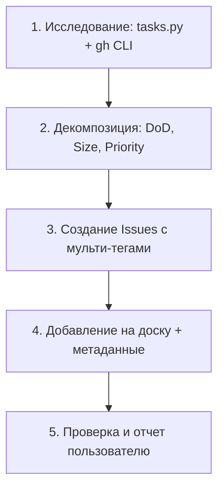

# GitHub Projects & Task Management — Runbook для AI-агентов

Родительский документ: [`AGENTS.md`](../../../AGENTS.md).
Справочник команд `gh` CLI: [`references/gh-commands.md`](./references/gh-commands.md).
Таксономия лейблов и процесс: [`docs/DEVELOPMENT.md`](../../../docs/DEVELOPMENT.md).

---

## 1. Принципы

1. **Не угадывать — исследовать.**
   Нельзя предполагать ID проекта, полей или логины. Начинай с `scripts/tasks.py` и `gh CLI` (см. шаг 1).
   Нельзя придумывать логины — если соответствие «Имя Фамилия -> GitHub Login» не зафиксировано в `scripts/tasks.py` или документации, спроси пользователя.

2. **Атомарность и DoD-first.**
   Задача формулируется через действие и заканчивается материальным артефактом (PR, конфиг, отчет в markdown, Figma-доска).
   В каждой задаче обязателен блок «Критерии приемки (DoD)» с чек-листом для проверки.

3. **Насыщенность метаданными.**
   Минимум 2–4 метки из таксономии (`docs/DEVELOPMENT.md`), откалиброванный приоритет (`P0`–`P3`) и размер (`XS`–`M`).

4. **Идемпотентность.**
   Перед созданием — проверяй существующий бэклог (`scripts/tasks.py --ready`, `gh issue list`), чтобы не дублировать тикеты.

5. **Безопасность.**
   Удаление карточек с досок (`gh project item-delete`) — только с явным подтверждением пользователя. Никаких автоматических удалений.

---

## 2. Workflow



### Шаг 1. Исследование контекста

Переменные окружения — выводи из контекста проекта или уточняй у пользователя: `<OWNER>` (организация/пользователь), `<PROJECT_NUMBER>` (номер доски), `<REPO>` (`owner/repo`), `<PREFIX>` (префикс тикетов, напр. `ARCH`).

1. Показать текущий бэклог (источник правды — `tasks.py`):
   ```bash
   python3 scripts/tasks.py --ready          # задачи в статусе Ready
   python3 scripts/tasks.py --assignee паша # фильтр по исполнителю
   gh issue list --state all --limit 100 --json title --jq '.[].title' | grep -o '[A-Z]\+-[0-9]\+' | sort -u -V  # следующий свободный номер
   ```
2. Если нужны метаданные доски (ID полей, опции `Status`/`Size`/`Приоритет`):
   ```bash
   gh project list --owner <OWNER>
   gh project field-list <PROJECT_NUMBER> --owner <OWNER> --format json
   ```
3. Активные майлстоуны:
   ```bash
   gh api repos/<OWNER>/<REPO>/milestones --jq '.[] | {number: .number, title: .title}'
   ```

### Шаг 2. Формулирование задачи

Заголовок:
```text
<PREFIX>-<NUMBER>: [<MODULE/TAG>] <Глагол в инфинитиве> <Что сделать>
```
Примеры: `ARCH-46: [Portal-BFF-4] Проксировать и агрегировать данные ядра`, `ARCH-50: [Portal-DevOps-1] Описать сборку: Dockerfile (SPA + BFF) и docker-compose`.

Обязательная структура описания (Body):
```markdown
Parent Epic: #<номер_эпика> (если есть)
Исполнитель: Имя Фамилия ([@github_login](url))
Срок / Спринт: Спринт N (1 неделя)

## Контекст и документация
- Ссылки на .md, ADR, спецификации.

## Цель задачи
Какую проблему решает и зачем нужна системе.

## Что нужно сделать
- [ ] Шаг 1
- [ ] Шаг 2

## Артефакты для проверки
1. Артефакт (PR, ветка, конфиг).
2. Способ демонстрации (команда, тесты, сценарий в браузере).

## Критерии приемки (DoD)
- [ ] Проверяемый факт 1
- [ ] Код компилируется и проходит линтер
```

### Шаг 3. Тегирование

Единая таксономия — в `docs/DEVELOPMENT.md` (раздел Issue Tracking). Не дублируется здесь.
Правила: 2–4 тега на задачу, минимум один из группы «Архитектурный блок» + один из «Характер работы».

### Шаг 4. Приоритет и размер

Приоритет (`Приоритет` на доске):
* `P0 - Blocker` — блокирует разработку команды или релиз.
* `P1 - High` — ключевые задачи текущего спринта.
* `P2 - Medium` — развитие, последующие экраны.
* `P3 - Low` — бэклог, опциональные фичи.

Размер (`Size`):
| Размер | Трудоемкость | Описание |
| :---: | :--- | :--- |
| `XS` | до 0.5 дня | Мелкий фикс, правка конфига, дока |
| `S` | 1–2 дня | Атомарный компонент, эндпоинт, Dockerfile |
| `M` | 3–5 дней | Экран со стейтом, модуль интеграции |
| `L` | > 1 недели | **Запрещено** — декомпозируй на 2–3 задачи `S`/`M` |

### Шаг 5. Создание и размещение на доске

Базовый сценарий — `gh` в цикле:
```bash
gh issue create --repo <OWNER>/<REPO> --title "..." --body "..." --assignee <login> --label "showcase" --label "architecture" --milestone "..."
gh project item-add <PROJECT_NUMBER> --owner <OWNER> --url <ISSUE_URL> --format json
gh project item-edit <PROJECT_NUMBER> --owner <OWNER> --url <ISSUE_URL> --field "Status" --value "Ready"
gh project item-edit <PROJECT_NUMBER> --owner <OWNER> --url <ISSUE_URL> --field "Size" --value "S"
gh project item-edit <PROJECT_NUMBER> --owner <OWNER> --url <ISSUE_URL> --field "Приоритет" --value "P1 - High"
```

Для пакетного создания (10+ задач) используй Python-скрипт — шаблон в `references/gh-commands.md` (раздел 4). Для 3–9 задач цикл в bash достаточен.

Проверка изоляции досок: если в организации несколько проектов с `Auto-add`, проверь соседние доски через `gh project item-list <OTHER_PROJECT> --owner <OWNER> --format json`. При обнаружении утечек — сообщи пользователю; удаляй (`gh project item-delete`) только после подтверждения.

### Шаг 6. Жизненный цикл

```
[ Backlog ] -> [ Ready ] -> [ In progress ] -> [ In review ] -> [ Done ]
```

* `Backlog` — описана, но не детализирована.
* `Ready` — есть DoD, исполнитель, теги, размер, приоритет; готова к спринту.
* `In progress` — создана ветка `feature/<PREFIX>-<id>-kebab`.
* `In review` — открыт PR с `Closes #<issue_id>`, проходят CI-чеки.
* `Done` — PR смержен, DoD подтвержден, issue закрыт.

---

## 3. Чек-лист перед сдачей

- [ ] Все задачи имеют префикс и номер (`<PREFIX>-XX`) и проверены на дубликаты
- [ ] У каждой задачи — контекст, шаги и измеримый DoD
- [ ] Исполнитель назначен по проверенному соответствию логинов
- [ ] Проставлены 2–4 тега, размер (`XS`/`S`/`M`) и приоритет (`P0`–`P3`)
- [ ] Задачи добавлены в целевой GitHub Project (не только Issues)
- [ ] Проставлен `Status = Ready` (или `Backlog` для будущих)
- [ ] Проверено отсутствие утечек на соседние доски (сообщено пользователю при наличии)
- [ ] Пользователю выдан отчет: таблица с задачами и прямыми ссылками
