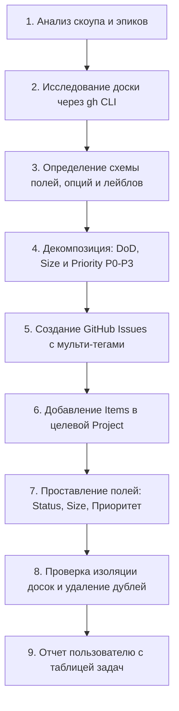

# GitHub Projects & Task Management Runbook for AI Agents

Этот скилл регламентирует сквозной процесс проектного управления для агентного ИИ: от исследования предметной области и декомпозиции до создания тикетов в GitHub Issues, расстановки метаданных на доске GitHub Projects (V2) и контроля жизненного цикла задач.

Справочник всех команд `gh` CLI вынесен в отдельный документ: [references/gh-commands.md](./references/gh-commands.md).

---

## 1. Ментальная модель и принципы работы

Агентный ИИ должен действовать как технический проджект-менеджер и архитектор:

1. **Не угадывать — исследовать:**
   * Нельзя предполагать ID проекта, ID полей или логины людей. Всегда начинать с вызова API / CLI (`gh project list`, `gh project field-list`).
   * Нельзя придумывать логины исполнителей. Если соответствие «Имя Фамилия -> GitHub Login» не зафиксировано в документации проекта, запросить уточнение у пользователя.
2. **Атомарность и проверяемость (DoD-first):**
   * Задача не может звучать как «Изучить фреймворк» или «Сделать бэкенд».
   * Каждая задача обязана формулироваться через действие и заканчиваться **материальным артефактом** (Pull Request, конфиг, Figma-доска, отчет в markdown, документ архитектуры).
   * В каждой задаче обязателен блок **Критерии приемки (DoD)** с чек-листом для проверки тимлидом.
3. **Изоляция проектов и досок:**
   * В организации могут существовать несколько проектов (например, `archon-core` Project 2 и `archon-portal` Project 3).
   * При наличии репозиторных автоматизаций (Auto-add) задачи могут утекать на соседние доски. Агент обязан контролировать состав карточек и очищать доски от чужих задач через `gh project item-delete`.
4. **Насыщенность метаданными:**
   * Не оставлять задачи без приоритета и с одним плоским тегом. Задачи должны быть насыщены тегами (2–4 метки) и иметь откалиброванный приоритет (`P0`–`P3`) и размер (`XS`–`M`).
5. **Идемпотентность и безопасность:**
   * Перед созданием задач проверять существующий бэклог, чтобы не дублировать тикеты.
   * Для пакетного создания тикетов (от 3 задач) всегда писать локальный скрипт на Python/Bash с обработкой ошибок.

---

## 2. Пошаговый алгоритм (Workflow)



### Шаг 1. Исследование контекста проекта
1. Найти номер и ID целевого проекта:
   ```bash
   gh project list --owner <org_or_user>
   ```
2. Выгрузить схему полей доски (Project Fields):
   ```bash
   gh project field-list <project_number> --owner <org_or_user> --format json
   ```
   *Зафиксировать ID:* поля `Status` (опции `Backlog`, `Ready`, `In progress`, `In review`, `Done`), поля `Size` (`XS`, `S`, `M`, `L`, `XL`), поля `Приоритет` (`P0 - Blocker`, `P1 - High`, `P2 - Medium`, `P3 - Low`).
3. Найти активные майлстоуны:
   ```bash
   gh api repos/<owner>/<repo>/milestones --jq '.[] | {number: .number, title: .title}'
   ```
4. Определить следующий свободный номер задачи (например, `ARCH-XX`):
   ```bash
   gh issue list --state all --limit 100 --json title --jq '.[].title' | grep -o '[A-Z]\+-[0-9]\+' | sort -u -V
   ```

---

### Шаг 2. Стандарт формулирования задачи

Заголовок тикета формируется по единому шаблону:
```text
[PROJECT_PREFIX]-[NUMBER]: [[MODULE/TAG]] [Глагол в инфинитиве] [Что сделать]
```
*Примеры:*
* `ARCH-46: [Portal-BFF-4] Проксирование и агрегация данных ядра (archon-core-service)`
* `ARCH-50: [Portal-DevOps-1] Спецификация сборки: Dockerfile (SPA + BFF) и локальный docker-compose`

#### Обязательная структура описания (Body):
```markdown
Parent Epic: #<номер_эпика> (если есть)
Исполнитель: Имя Фамилия ([@github_login](url))
Срок / Спринт: Спринт N (1 неделя)

## Контекст и документация
- Ссылки на релевантные .md документы, архитектурные решения (ADR) и спецификации.

## Цель задачи
Краткое объяснение, какую проблему решает задача и зачем она нужна системе.

## Что нужно сделать
- [ ] Шаг 1: конкретное действие
- [ ] Шаг 2: конкретное действие
- [ ] Шаг 3: конкретное действие

## Артефакты для проверки (Как тимлид проверяет задачу)
1. Конкретный артефакт 1 (PR, ветка, файл конфигурации, Figma-макет).
2. Способ демонстрации (запуск команды, прогон тестов, сквозной сценарий в браузере).

## Критерии приемки (DoD)
- [ ] Четкий проверяемый факт 1
- [ ] Четкий проверяемый факт 2
- [ ] Код компилируется без ошибок и проходит линтер
```

---

### Шаг 3. Система тегирования (Label Taxonomy & Multi-tagging)

В Archon задачи **не оставляются с одним общим тегом**. Применяется насыщенное комбинированное тегирование (2–4 тега на задачу):

#### 1. Архитектурный блок (Product Block / Layer):
* `showcase` — Витрина: веб-портал, SPA, Fastify BFF, боты, экспорт, LikeC4.
* `core-backend` — Ядро платформы: Kotlin, PostgreSQL + Apache AGE, Temporal, парсеры.
* `ai-research` — AI-пайплайн: LLM-экстракция, RAG, эмбеддинги, MCP-сервер.
* `devops` — Инфраструктура: Docker, docker-compose, CI/CD GitHub Actions, SaaS runtime.
* `product` — Продуктовая часть: CustDev, UI/UX, CJM, дизайн-система, тарифы.

#### 2. Характер работы (Discipline & Nature of work):
* `architecture` — Архитектурные решения, спецификации, схемы данных, контракты API, базовые каркасы.
* `poc` — Исследовательские прототипы, спайки, моки, бенчмарки.
* `enhancement` — Разработка продуктовой функциональности и компонентов.
* `documentation` — Документация, онбординг, аналитические отчеты, гайды.

#### 3. Специальные маркеры:
* `epic` — Крупная составная инициатива / модуль (Parent Epic).
* `blocker` — Блокирует написание кода или работу смежных потоков.
* `question` / `bug` / `help wanted` — Вспомогательные типы по ситуации.

#### Примеры эталонных комбинаций:
| Тип задачи | Пример тегов |
| :--- | :--- |
| **Portal SPA Shell** | `['showcase', 'architecture', 'enhancement']` |
| **Portal Экран / Каталог** | `['showcase', 'product', 'enhancement']` |
| **Portal Интеграция с ядром** | `['showcase', 'architecture', 'core-backend']` |
| **Portal BFF Mock API** | `['showcase', 'poc', 'enhancement']` |
| **Portal DevOps CI/CD** | `['showcase', 'devops', 'architecture']` |
| **Portal Design & Wireframes** | `['showcase', 'product', 'architecture']` |
| **Core Storage PoC** | `['core-backend', 'poc']` |
| **Core Top-Level Epic** | `['blocker', 'architecture', 'core-backend', 'epic']` |

---

### Шаг 4. Калибровка приоритета и размера (Priority & Sizing)

#### 1. Шкала приоритетов (`Приоритет`):
* **`P0 - Blocker`**: Блокирует дальнейшую разработку команды или релиз (DDL схемы БД, базовые ADR, критические PoC).
* **`P1 - High`**: Основные задачи текущего спринта, фундаменты модулей (App Shell, Fastify BFF, CI workflow, каркасы экранов, первый дизайн-спринт).
* **`P2 - Medium`**: Развитие и последующие экраны (паспорт сервиса, инбокс находок, интерактивная карта LikeC4, сессии/куки).
* **`P3 - Low`**: Опциональные задачи, долгосрочный бэклог, второстепенные фичи (PR-бот, вспомогательные утилиты).

#### 2. Шкала трудоемкости (`Size`):
| Размер | Трудоемкость | Описание |
| :---: | :---: | :--- |
| **`XS`** | до 0.5 дня (2–4 часа) | Мелкий фикс, правка конфига, обновление документации, базовый скрипт |
| **`S`** | 1–2 дня (8–12 часов) | Атомарный компонент, изолированный эндпоинт, Dockerfile, исследование со спайком |
| **`M`** | 3–5 дней (до 1 спринта) | Полноценный экран со стейтом, модуль интеграции, сложная таблица с фильтрами |
| **`L`** | более 1 недели | **Запрещено.** Задача слишком велика, агент обязан декомпозировать ее на 2–3 задачи `S`/`M` |

---

### Шаг 5. Пакетное создание, проставление метаданных и изоляция досок

Для создания задач агент пишет временный скрипт автоматизации на Python:
1. Создает issue через `gh issue create` с мульти-лейблами (`--label "showcase" --label "architecture"...`) и майлстоуном.
2. Получает URL созданного issue.
3. Добавляет issue в целевой проект через `gh project item-add`.
4. Проставляет статус (`Ready` / `Backlog`) через `gh project item-edit`.
5. Проставляет размер (`Size = S/M`) через `gh project item-edit`.
6. Проставляет приоритет (`Приоритет = P1 - High`) через `gh project item-edit --field "Приоритет" --value "P1 - High"` или через `single-select-option-id`.
7. **Контроль утечек (Auto-add):** проверяет соседние проекты (например, `archon-core`) на предмет автодобавления созданных тикетов и при необходимости удаляет карточки через `gh project item-delete`.

---

### Шаг 6. Жизненный цикл задачи (Status Transitions)

```
[ Backlog ] ──► [ Ready ] ──► [ In progress ] ──► [ In review ] ──► [ Done ]
```

1. **`Backlog`:** задача описана, но не детализирована или запланирована на будущее.
2. **`Ready`:** задача имеет понятный DoD, привязана к исполнителю, имеет насыщенные теги, размер, приоритет и готова к взятию в спринт.
3. **`In progress`:** исполнитель взял задачу в работу (создана ветка `feature/<task-id>-kebab`).
4. **`In review`:** открыт Pull Request с описанием «Closes #<issue_id>», проходят CI-чеки.
5. **`Done`:** PR смержен, критерии DoD подтверждены, issue закрыт.

---

## 3. Чек-лист для агента перед сдачей работы пользователю

- [ ] Все задачи имеют префиксы и порядковые номера проекта (например, `ARCH-XX`).
- [ ] У каждой задачи указан контекст, перечень действий и измеримый результат (DoD).
- [ ] Назначен корректный исполнитель (по проверенному соответствию логинов).
- [ ] Проставлены насыщенные теги (2–4 метки из репозиторного классификатора).
- [ ] Задачи добавлены в целевой GitHub Project (не просто висят в Issues).
- [ ] Проставлены статус (`Status = Ready`), размер (`Size = XS/S/M`) и приоритет (`Приоритет = P0..P3`).
- [ ] Проверено отсутствие утечек задач на соседние доски (`archon-core` / `archon-portal`).
- [ ] Пользователю предоставлен отчет со сводной таблицей и прямыми ссылками на тикеты.
