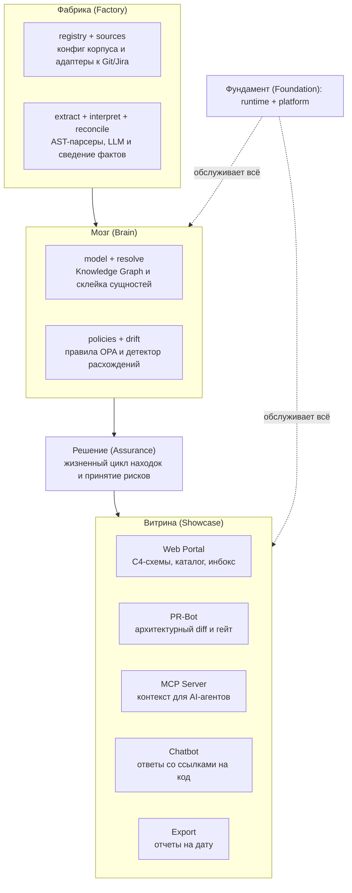

# archon
**Living Architecture, Zero Drift & AI-Native Context Layer**

`archon` — платформа для автоматической сборки архитектурной документации, контроля дрифта и управления контекстом для инженерных команд и AI-агентов (Cursor, Copilot, Claude Code) на основе анализа исходного кода, манифестов и спецификаций.

---

## Назначение проекта

1. **Автоматическая документация (Zero Drift & Docs-as-Code):** Сборка актуальных C4-диаграмм (C0–C3) и непрерывная генерация файлов контекста (`AGENTS.md`, `.archon/`) прямо в репозитории без ручной рутины.
2. **AI-Native Source of Truth (MCP Server):** Предоставление AI-агентам проверенного архитектурного контекста, зависимостей и контрактов через Model Context Protocol (MCP) для точной кодогенерации без галлюцинаций.
3. **Аудит архитектурного здоровья:** Автоматический поиск аномалий и техдолга в коде (Shared DB, циклические зависимости, незадокументированные API).
4. **Единый каталог (Service Passport):** Паспорт каждого сервиса, объединяющий бизнес-контекст, технический стек, API-контракты и статус здоровья.
5. **Контроль внешней аналитики (Spec Drift):** Индексация Confluence/ТЗ через RAG и автоматическое выявление устаревших спецификаций при изменении кода.

---

## Архитектура платформы

Внутри Archon работает фабрика из 17 модулей, объединенных в 5 функциональных блоков:

---

## Модель поставки и безопасность

* **Managed Cloud (SaaS):** Archon разворачивается как управляемый сервис. Пользователь подключает репозитории за пару кликов и сразу получает доступ к Web-порталу, API и MCP-серверу.
* **Приватность кода по умолчанию:** Анализ исходного кода выполняется в памяти воркеров, код не оседает в постоянном хранилище. В графе знаний сохраняются только структурные метаданные (интерфейсы, зависимости, топология).
* **Enterprise/Private Cloud:** Для организаций со строгими политиками безопасности предусмотрена возможность развертывания в изолированном VPC или запуск легковесного локального сканера (Local Agent).

---

## Команда проекта (Team v.3.9)

### Инженерное ядро (Core & AI Backend)
* **Денис (`@ischademadda`, Lead / Architect):** Метамодель графа знаний, алгоритмы дедупликации Landscape, продуктовый вижен.
* **Миша (`@vocisy`, AI / R&D Scientist):** RAG-пайплайны для Confluence, интеграция локальных LLM, обработка естественного языка.
* **Паша (`@Pavelgrr7`, Core Backend & Security):** AST-парсеры кода, движок поиска аномалий, безопасность и проксирование.
* **Максим (`@lelouch-byte`, DevOps / SRE):** Helm-чарты, K8s-оркестрация, CI/CD коннекторы, оптимизация производительности.

### Клиентская витрина ([archon-portal](https://github.com/teamv39/archon-portal))
* **Артем (`@dusk190`, Tech Lead / Fullstack & BFF Lead):** Архитектура Fastify BFF, безопасность сессий, Mock API сервер.
* **Кирилл (`@KiRyXaIvaNov`, Frontend Lead):** Клиентская архитектура SPA, дизайн-система `shadcn/ui`, LikeC4 диаграммы.
* **Егор (`@Bruuhher`, DevOps / Infra Portal):** Контейнеризация витрины (SPA + BFF), локальное окружение, CI/CD.
* **Екатерина (`@katyaand007`, UX/UI Designer):** CJM ключевых сценариев, UI-kit, вайрфреймы в Figma.

Подробная информация о компетенциях команды: [`team_v39.md`](team_v39.md).

---

## Для агентных моделей

- [`AGENTS.md`](AGENTS.md) — как работать с репозиторием (любая LLM)
- [`CLAUDE.md`](CLAUDE.md) → `AGENTS.md` (совместимость)

---

## Документация

Вся техническая документация находится в `/docs`:
- [`/docs/adr/`](docs/adr/) — Architecture Decision Records
- [`/docs/architecture/`](docs/architecture/) — архитектура системы, модель данных
- [`/docs/research/`](docs/research/) — результаты исследований
- [`/docs/nfr/`](docs/nfr/) — Non-Functional Requirements
- [`/docs/api/`](docs/api/) — API спецификации
- [`ROADMAP.md`](docs/ROADMAP.md) — план развития проекта
- [`DEVELOPMENT.md`](docs/DEVELOPMENT.md) — процессы разработки
- [`INDEX.md`](docs/INDEX.md) — полный алфавитный индекс всех документов

---

## Текущий статус

**Фаза 0: Product & Business Analysis** (текущая)
- Бизнес-анализ ценности и экономики продукта ([business-value-analysis.md](docs/research/business-value-analysis.md))
- Архитектурное позиционирование: переход к AI-native Source of Truth и Context Layer ([ai-context-layer-research.md](docs/research/ai-context-layer-research.md), [iaas-to-saas-migration.md](docs/research/iaas-to-saas-migration.md))
- Закрытие архитектурных блокеров (OQ-1, OQ-2, OQ-8) перед началом активной кодовой разработки

Подробности в [ROADMAP.md](docs/ROADMAP.md)

---

## Лицензия

Проект распространяется под лицензией [Apache License 2.0](LICENSE).

