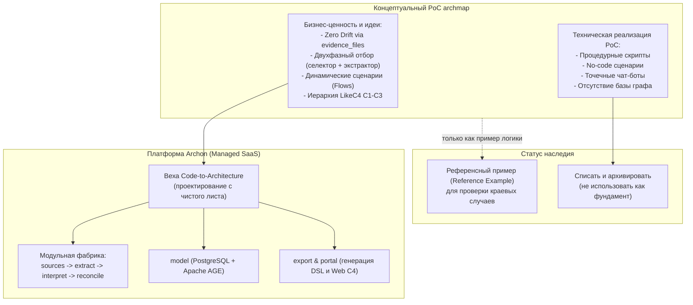

# 0002. Концептуальное наследие archmap: перенос бизнес-ценности и списание прототипа

Дата: 2026-09-04 (обновлено 2026-09-07)

## Статус

Partially Superseded ([ADR-0008](0008-xyflow-replaces-likec4.md)): в части LikeC4 (визуализация и генерация DSL); решение по судьбе прототипа и переносу Extraction Contract остаётся в силе.

Закрывает [OQ-1](../architecture/open-questions.md#oq-1-судьба-прототипа-archmap).  
Связан с [ADR-0003](0003-source-of-truth-and-tenant-isolation.md), [ADR-0004](0004-module-decomposition-revision-1.md), [ADR-0006](0006-saas-delivery-model-and-ai-native-source-of-truth.md), [вехой Code-to-Architecture](../architecture/code-to-architecture.md) и [OQ-3](../architecture/open-questions.md#oq-3-границы-и-версионирование-extraction-contract).

## Контекст

Проект `archmap` создавался как исследовательский PoC (Proof of Concept) для проверки фундаментальной бизнес-гипотезы: **возможно ли автоматически извлекать архитектурную модель из исходного кода репозиториев и визуализировать ее в виде интерактивных C4-диаграмм без ручной рутины архитектора**.

### Доказанная бизнес-ценность и идеи PoC

Прототип доказал жизнеспособность концепции и сформировал ключевые продуктовые ценности:
1. **Zero Drift и верифицируемость фактов (Proof-of-Truth):**
   Принципиальный отказ от слепого доверия языковой модели. Любая обнаруженная сущность, эндпоинт, зависимость или шаг вызова должны иметь жесткую привязку к исходному коду (`evidence_files`). Это устраняет галлюцинации и обеспечивает юридическую достоверность модели.
2. **Двухфазный контур извлечения (Two-Phase Extraction):**
   Разделение задачи на дешевый предварительный отбор релевантных файлов (селектор путей с правилом репрезентативности доменов) и глубокий семантический анализ отобранных файлов (экстрактор) с фиксацией степени уверенности (`confidence`) и зоны сомнений (`uncertainties`).
3. **Моделирование динамических бизнес-сценариев (Flows):**
   Переход от статичных плоских «коробок со стрелочками» к пошаговым цепочкам вызовов между микросервисами, синхронизированным с бизнес-логикой кода.
4. **Сквозная иерархия C1–C3 в LikeC4 DSL:**
   Автоматическая сборка контекста системы (C1), контейнеров (C2) и внутренних компонентов (C3) с автоматическим «всплытием» межсервисных связей и маркировкой неоднозначностей (`#manual_check`).

### Архитектурные ограничения прототипа

Несмотря на успех продуктовой идеи, техническая реализация прототипа носила временный, скриптовый характер:
- Построение на базе сторонних no-code сценариев и процедурных скриптов, не рассчитанных на многопользовательскую enterprise-нагрузку.
- Отсутствие мультитенантности, строгой модели изоляции данных и соответствия корпоративным требованиям безопасности.
- Отсутствие персистентного версионируемого графа: модель пересобиралась «в один конец» без отслеживания инкрементального дрейфа между коммитами.
- Жесткая привязка к точечным мессенджерам и конкретным git-хостингам вместо платформо-независимых API и MCP.

## Решение

Принята стратегия: **полное списание легаси-реализации и выделение отдельной вехи под чистое проектирование контура извлечения в Archon**.

### 1. Legacy-код — только референсный пример, а не основа
Все исходные скрипты, наработки и дампы прототипа переводятся в статус **Reference Examples**. Они служат исключительно справочным материалом для понимания частных алгоритмических нюансов (синтаксис DSL LikeC4, правила всплытия связей, структура промптов), но **не являются кодовой или архитектурной основой** для Archon.

### 2. Списание рантайма прототипа
Все временные цепочки выполнения, скрипты деплоя и точечные боты полностью выводятся из эксплуатации. Прототип архивируется.

### 3. Выделение отдельной архитектурной вехи: Code-to-Architecture
Проектирование контура автоматического извлечения и визуализации архитектуры выделяется в самостоятельную проектную веху: [docs/architecture/code-to-architecture.md](../architecture/code-to-architecture.md). 

Веха охватывает сквозной конвейер:
- **`sources`** — платформо-независимое получение метаданных и исходного кода из любых Git-провайдеров;
- **`extract`** — детерминированный AST-анализ манифестов, контрактов и конфигураций;
- **`interpret`** — семантический LLM-контур (интеллектуальный селектор файлов и экстрактор сущностей с фиксацией `confidence` и `uncertainties`);
- **`reconcile`** — верификация и сведение детерминированных фактов с семантическими гипотезами;
- **`model`** — сохранение в персистентный версионируемый граф (ADR-0003);
- **`export` / `portal`** — компиляция графа в LikeC4 DSL и интерактивная визуализация.

### 4. Стандартизация Extraction Contract (OQ-3)
Идеи структурированного JSON-контракта формализуются в нейтральной спецификации `Extraction Contract v1.0` без привязки к вендорам или частным инфраструктурам, с обязательными гарантиями верификации (`evidence_files`).

## Альтернативы

### Вариант 1: Развитие и рефакторинг исходных скриптов прототипа
Попытка постепенно дописывать и переделывать существующую кодовую базу PoC.
- *Почему отклонено:* Архитектурный тупик. Накопленный технический долг монолитных процедурных скриптов не позволяет обеспечить требования enterprise SaaS по надежности, тестируемости, типам данных и безопасности.

### Вариант 2: Полный отказ от наработок и идей PoC
Игнорирование опыта прототипа и разработка без учета проверенных эвристик.
- *Почему отклонено:* Привело бы к потере времени на повторное решение решенных проблем (эвристики отбора файлов в LLM, предотвращение галлюцинаций через `evidence_files`, правила формирования C1–C3 в LikeC4).

## Последствия

### Плюсы
- Четкое разделение: продуктовая ценность PoC сохранена, а устаревшая техническая реализация полностью отсечена.
- Архитектура Archon строится модульно из первых принципов без оглядки на ограничения ранних экспериментов.
- Команда получает ясный план работ через выделенную архитектурную веху `code-to-architecture`.

### Риски и митигация
- **Риск:** Искушение механически скопировать старый процедурный код в новые микросервисы.
- *Митигация:* Строгое следование принципу «Reference Only»: код новых модулей пишется с чистого листа в целевом стеке проекта (Kotlin/Go/Python), с типизацией и unit-тестами.
