# 0002. Судьба прототипа archmap: списание рантайма и интеграция ядра извлечения и генератора LikeC4

Дата: 2026-09-04

## Статус

Accepted

Закрывает [OQ-1](../architecture/open-questions.md#oq-1-судьба-прототипа-archmap).  
Связан с [ADR-0004](0004-module-decomposition-revision-1.md), [ADR-0006](0006-saas-delivery-model-and-ai-native-source-of-truth.md), [OQ-3](../architecture/open-questions.md#oq-3-границы-и-версионирование-extraction-contract), [OQ-7](../architecture/open-questions.md#oq-7-склейка-сущностей-между-репозиториями), [OQ-9](../architecture/open-questions.md#oq-9-канонический-словарь-и-его-поддержка) и [OQ-19](../architecture/open-questions.md#oq-19-генерация-docs-as-code-артефактов).

## Контекст

Проект `archmap` был создан как внутренний PoC (Proof of Concept) для проверки гипотезы: можно ли автоматически извлекать архитектуру из исходного кода репозитория с помощью LLM и компилировать ее в C4-диаграммы на DSL LikeC4.

Прототип доказал принципиальную реализуемость подхода, сформировав следующие ценные активы:
1. **JSON-контракт RFC-44.2 (v1.0):** спецификация обмена данными с жестким требованием `evidence_files` (защита от галлюцинаций), поддержкой метрики `confidence`, фиксацией сомнений (`uncertainties`), описанием шагов бизнес-процессов (`flows`) и инфраструктурных подсказок (`k8s_hints`).
2. **Двухфазный контур извлечения (Two-Phase Extraction):**
   - *File Selector Agent (`selector_prompt.md`):* отбор релевантных файлов по дереву путей без чтения содержимого, с правилом представительства (не читать десятки однотипных контроллеров) и отсечением тестов/vendor.
   - *Architecture Extractor Agent (`extractor_prompt.md`):* семантическое извлечение архитектуры с учетом словаря типов (`vocabulary.json`) и свободного фокуса пользователя (`user_prompt`).
3. **Детерминированный компилятор LikeC4 (`json_to_likec4.py`):** 1300 строк логики на Python, строящей C1 (контекст), C2 (контейнеры), C3 (компоненты), динамические view бизнес-сценариев, разрешающей адреса сущностей, синтезирующей связи из flow-шагов и вычисляющей диагностический статус `#manual_check`.

Однако инфраструктурная реализация прототипа содержит архитектурные ограничения, несовместимые с миссией Archon как корпоративной платформы Managed SaaS (ADR-0006):
- **Оркестрация в n8n:** no-code движок не обеспечивает строгой изоляции тенантов, SLA, детерминированного управления очередями, параллелизма и наблюдаемости.
- **Хранение учетных данных:** хранение GitLab PAT пользователей в таблицах n8n Data Table нарушает требования информационной безопасности.
- **Привязка к корпоративному мессенджеру TiMe и GitLab Pages:** Archon строится платформо-независимым с собственным веб-порталом, поддержкой GitHub/GitLab/Bitbucket и интерфейсами Slack/Telegram/MCP.
- **Отсутствие персистентного графа:** каждый запуск выполнял полную перегенерацию, ручные правки архитектора в Git затирались, история дрейфа между коммитами терялась.
- **Ручной справочник `shared/externals.c4`:** ручная поддержка ID общих внешних сервисов не масштабируется за пределы 2-3 репозиториев.

Необходимо определить судьбу компонентов прототипа и архитектурное место его наработок в Archon, сняв блокирующий открытый вопрос OQ-1.

## Решение

Принята стратегия **селективного переноса ценности (Extract Core & Retire Runtime)**:

```mermaid
flowchart TD
    subgraph ARCHMAP ["Прототип archmap (PoC)"]
        subgraph DISCARD ["Списать и архивировать"]
            n8n["n8n Workflows"]
            timebot["TiMe Bot"]
            pattable["GitLab PAT в Data Table"]
            glpages["GitLab Pages deployment loop"]
            manual_ext["Ручной shared/externals.c4"]
        end
        subgraph KEEP ["Ядро и наработки (перенести в Archon)"]
            contract["RFC-44.2 JSON Contract"]
            prompts["Two-Phase Selector + Extractor & Prompts"]
            compiler["json_to_likec4.py (AST / DSL компилятор)"]
            vocab["vocabulary.json (канонические типы)"]
        end
    end

    subgraph ARCHON ["Платформа Archon (Managed SaaS)"]
        OQ3["Extraction Contract (OQ-3)"]
        INTERPRET["Модуль interpret (LLM)"]
        EXTRACT["Модуль extract (детерминированный)"]
        PORTAL["Модуль portal (LikeC4 Web Viewer)"]
        EXPORT["Модуль export (генератор C4 в Git)"]
        REGISTRY["Модуль registry (OQ-9)"]
        RESOLVE["Модуль resolve (OQ-7)"]
        RUNTIME["Модуль runtime (Temporal)"]
    end

    contract -->|"основа спецификации"| OQ3
    prompts -->|"интеграция эвристик"| INTERPRET
    compiler -->|"портирование логики сборки C4"| PORTAL
    compiler -->|"портирование генератора"| EXPORT
    vocab -->|"справочник типов"| REGISTRY
    manual_ext -.->|"заменяется алгоритмической склейкой"| RESOLVE
    n8n -.->|"заменяется Temporal workflows"| RUNTIME
```

### 1. Полный отказ от рантайма прототипа
- n8n-воркфлоу, интеграции с TiMe-ботом, скрипты коммитов в multi-project GitLab Pages и промежуточный Generator Repo полностью выводятся из эксплуатации.
- Исходный репозиторий `archmap` переводится в архивный режим (Read-Only) как исторический артефакт.
- Все задачи оркестрации в Archon возлагаются на модуль `runtime` (движок Temporal).

### 2. Спецификация RFC-44.2 принимается за основу Extraction Contract (OQ-3)
- Схема данных из `json_contract.md` (RFC-44.2 v1.0) принимается как фундамент для единого межуровневого контракта извлечения.
- Сохраняются ключевые принципы:
  - **Zero Tolerance to Hallucinations:** обязательность поля `evidence_files` (минимум один реальный путь к файлу/строке) для любой сущности, связи и flow-шага.
  - **Метрика достоверности и сомнения:** поддержка `confidence` (0.0–1.0) и явного массива `uncertainties` для передачи в контур доверия (модуль `assurance`).
  - **Динамические бизнес-процессы:** секция `flows` для пошагового моделирования сценариев.
  - **Связывание с инфраструктурой:** секция `k8s_hints` для обогащения логической модели данными из деплой-манифестов.
- Контракт версионируется в репозитории Archon как формальная JSON Schema.

### 3. Двухфазный контур извлечения переносится в модуль `interpret`
- Модель **File Selector Agent** (отбор путей без чтения содержимого + правило представительства доменов + фильтрация шума) и **Architecture Extractor Agent** интегрируются в пайплайн модуля `interpret`.
- В модуле `extract` реализуется детерминированное извлечение фактов (AST-парсинг манифестов, зависимостей, роутов), результаты которого подаются на вход `interpret` для исключения галлюцинаций.

### 4. Алгоритмическое ядро `json_to_likec4.py` портируется в модули `portal` и `export`
- Алгоритмы генерации синтаксиса LikeC4 DSL, валидации идентификаторов, всплытия связей (`inferred_from`), синтеза рёбер из flows, разрешения "фантомных" компонентов и диагностической разметки `#manual_check` переносятся из прототипа:
  - в модуль `portal` — для отрисовки интерактивных диаграмм на веб-витрине;
  - в модуль `export` — для генерации docs-as-code файлов C4 в репозитории клиентов (ADR-0006, OQ-19).
- Код генератора рефакторится из монолитного скрипта в типизированную библиотеку (Pydantic-модели, модульный дизайн) с покрытием unit-тестами.

### 5. Дедупликация общих систем передается модулям `registry` и `resolve`
- Ручной файл `shared/externals.c4` и словарь `vocabulary.json` заменяются:
  - системным реестром типов и канонических сущностей в модуле `registry` (OQ-9, OQ-16);
  - алгоритмической межрепозиторной склейкой сущностей в модуле `resolve` (OQ-7, OQ-13).

## Альтернативы

### Вариант 1: Полное переписывание с нуля без оглядки на archmap
Начать проектирование контракта и генератора заново, не изучая прототип.

- **Плюсы:** Отсутствие легаси-решений, полная свобода выбора форматов.
- **Минусы:** Потеря времени на повторное решение решенных проблем: отладка защиты от галлюцинаций в LLM, эвристики отбора репрезентативных файлов, тонкости синтаксиса LikeC4 DSL, адресация контейнеров и компонентов.
- **Почему не выбрали:** Прототип содержит проверенные решения (RFC-44.2, селектор файлов, компилятор DSL), ускоряющие Фазу 1.

### Вариант 2: Доработка прототипа archmap в исходном виде
Попытаться развить стек n8n + GitLab Pages до промышленного уровня.

- **Плюсы:** Быстрый старт на готовых скриптах.
- **Минусы:** Тупиковая архитектура. n8n не масштабируется на распределенные тенанты, не обеспечивает строгую изоляцию данных, а многоминутные циклы через Git-коммиты и GitLab Pages не обеспечивают нужного пользовательского опыта.
- **Почему не выбрали:** Противоречит архитектурной модели Managed SaaS (ADR-0006) и требованиям надежности.

### Вариант 3: Выделение archmap в обособленный сервис
Оставить archmap работать во внешнем контуре, вызывая его по HTTP/gRPC.

- **Плюсы:** Минимум правок в кодовой базе прототипа на старте.
- **Минусы:** Сохранение ограничений n8n, появление «черного ящика» с непрозрачным SLA, дублирование сущностей между базой данных Archon и файлами archmap.
- **Почему не выбрали:** Archon строится на четкой 16-модульной декомпозиции (ADR-0004); сохранение гибридного легаси-сервиса нарушает изоляцию подсистем.

## Последствия

### Плюсы
- **Снят архитектурный блокер OQ-1:** разблокирована разработка модулей `extract`, `interpret`, `portal`, `export`.
- **Готовая основа Extraction Contract (OQ-3):** контракт RFC-44.2 закрывает базовые требования к структуре архитектурных фактов, включая подтверждение источниками (`evidence_files`) и flow views.
- **Экономия времени на генераторе LikeC4:** перенос отлаженного транслятора `json_to_likec4.py` позволяет сразу получать валидный LikeC4 DSL уровней C1–C3.
- **Инженерная чистота стека:** отказ от n8n в пользу Temporal обеспечивает предсказуемую оркестрацию, строгие ретраи и мониторинг.

### Минусы
- **Необходимость рефакторинга:** монолитный скрипт `json_to_likec4.py` (1300 строк) требует разделения на независимые пакеты и покрытия тестами.
- **Обобщение промптов:** промпты селектора и экстрактора настраивались под монорепозитории и проекты конкретного подразделения; их потребуется обобщить для многоязычных кодовых баз (Go, Python, TypeScript, Java, C#, PHP).

### Риски и митигация
- **Риск:** Расхождение структуры контракта между фазой извлечения и графовой моделью `model`.  
  *Митигация:* фиксация JSON Schema в репозитории, типизация через Pydantic-модели и валидация в CI/CD.
- **Риск:** Зависимость генератора от жестко зашитых стилей и словарей.  
  *Митигация:* параметризация LikeC4-генератора конфигурацией, поставляемой через модуль `registry`.
