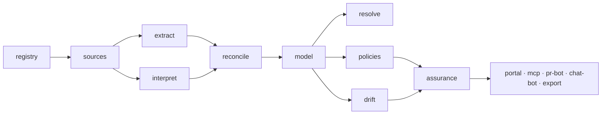

# 0004. Модульная декомпозиция, ревизия 1

Дата: 2026-08-29

## Статус

Accepted

Номера 0002 и 0003 зарезервированы за planned-решениями: судьба archmap
(OQ-1, закрыт) и source of truth (OQ-2).
Расширено аддендумом от 2026-09-03 (ADR-0006): включение 17-го модуля `mcp`.

## Контекст

Исходная декомпозиция (10 модулей с кодами `m1..m4`, `e1..e2`, `d1..d4`)
была принята быстро и без проверки. Два прохода её сломали:

1. Сквозные сценарии ([`user-journeys.md`](../research/user-journeys.md))
   дали 9 дефектов (F1-F9).
2. Adversarial-разбор границ
   ([`decomposition-adversarial.md`](../research/decomposition-adversarial.md))
   дал вердикт `broken` в шести местах. Общее в них: отсутствующие концепты —
   примирение двух контуров извлечения, глобальная склейка сущностей по
   корпусу, владение находками и ревью, оркестрация со стоимостью,
   конфигурация корпуса. Плюс `m1` оказался двумя модулями с разной
   экономикой.

Цена ошибки в декомпозиции сейчас — переименование файлов. После начала
кода — перепись контрактов и, возможно, кода.

## Решение

### 1. Новая декомпозиция: 17 логических модулей, без категорий

`runtime` планирует и оплачивает прогоны всех вычислительных модулей;
`platform` (SSO, RBAC, audit, tenancy) обслуживает все модули.

| Модуль | Ответственность (одной строкой) |
| :--- | :--- |
| `registry` | конфигурация корпуса: реестр репозиториев, привязки repo -> product -> team, словарь тегов, наборы правил, скоуп |
| `sources` | транспорт и аутентификация к внешним системам; отдаёт сырые артефакты и события, ничего не нормализует |
| `extract` | детерминированное извлечение из кода: AST, манифесты, зависимости, контракты |
| `interpret` | вероятностное извлечение: LLM-семантика, flows, бизнес-слой |
| `reconcile` | примирение `extract` и `interpret`: конфликты, provenance, confidence, `#manual_check` |
| `model` | граф знаний: хранение, версионирование, merge с ручными правками, единый query API |
| `resolve` | батч по корпусу: склейка сущностей между репозиториями, сборка landscape |
| `policies` | структурные правила и аномалии над графом |
| `drift` | сверка документации с фактами кода; своя инфраструктура: индексация, эмбеддинги, реестр документов |
| `assurance` | находки как первоклассная сущность: lifecycle, ревью, принятие риска, trust-статы (auto/reviewed/accepted) |
| `portal` | web-интерфейс: графы, дашборды, ревью-очереди; каталог — секция портала (OQ-17) |
| `mcp` | сервер Model Context Protocol: контекст, контракты и правила для AI-агентов в IDE (ADR-0006) |
| `pr-bot` | архитектурный diff и проверки в MR/PR |
| `chat-bot` | запуск прогонов и вопросы по графу в мессенджере |
| `export` | выгрузка отчётности наружу (аудит) и генерация docs-as-code артефактов (F7, ADR-0006) |
| `runtime` | очереди, планирование, ретраи, throttling и бюджеты LLM |
| `platform` | enterprise-обвязка: SSO, RBAC, audit, tenancy, секреты |

### 2. Отказ от буквенных кодов

Категории `m/e/d` отменены. После ревизии они перестают что-то описывать
(`resolve`, `reconcile`, `assurance`, `runtime` не вписываются ни в одну), а
до этого лишь путали. Модули называются именами; порядок чтения — по потоку
данных выше.

### 3. Логический модуль не равен сервису

17 модулей — это единицы ответственности и контрактов, а не 17 деплоя.
Сборочные единицы (что реально разворачивается, в одном ли процессе живёт)
— отдельное решение, OQ-8. Жёсткое требование к нему: MVP собирается из 2-3
единиц, иначе команда утонет в интеграциях. Пары-кандидаты на объединение:
`registry`+`sources` (корпус и доступ к нему), `extract`+`interpret`+`reconcile`
(контур извлечения), `portal`+`assurance` (там же UI ревью).

### 4. Люди не закрепляются за модулями

В файлах модулей нет поля "владелец" с именем. Модуль — граница контрактов,
а не граница оргструктуры: состав команды меняется (в том числе за счёт
найма и подкоманд), а декомпозиция должна это переживать. Ответственность
за модуль — свойство плана работ (GitHub Projects), а не архитектуры.
Допустимо указывать компетенцию, нужную для модуля, если это помогает
планированию найма.

### 5. Разрешённые конфликты

- `policies`/`drift` НЕ сливаются в `analyze`, вопреки первой версии
  кандидата: слияние потеряло бы границу стоимости (у `drift` своя
  инфраструктура). Общее для них — слой `assurance`, а не общий модуль
  (закрывает A3 и F4).
- `reconcile` — отдельный модуль, а не часть ingest в `model`: это точка
  рождения provenance, нужного и trust-статам, и объяснению аномалий
  (закрывает A2, OQ-4 получает владельца).
- `registry` и `sources` разделены логически, хотя атака 7 предполагала
  слияние: меняются по разным причинам. Физическое слияние остаётся
  возможностью в OQ-8 (частично закрывает A7, F9).

### 6. Аддендум: расширение витрины модулем mcp (17 модулей)

Дата аддендума: 2026-09-05 (в развитие [ADR-0006](0006-saas-delivery-model-and-ai-native-source-of-truth.md)).

В связи с переходом на модель Managed SaaS (Context-as-a-Service) и позиционированием Archon как AI-native Source of Truth блок «Витрина» дополнен модулем `mcp`. Модуль реализует протокол Model Context Protocol (JSON-RPC) для снабжения AI-агентов в IDE (Cursor, Copilot, Claude Desktop) точным архитектурным контекстом без галлюцинаций.

Итоговое количество логических модулей системы — **17**. Терминальный блок «Витрина» включает 5 модулей доставки: `portal`, `mcp`, `pr-bot`, `chat-bot`, `export` (где `export` отвечает за генерацию отчуждаемых docs-as-code файлов и аудиторских срезов). Внешний программный доступ обеспечивает Public API (OQ-22).

## Альтернативы

**Оставить 10 модулей, точечно дописать отсутствующее.** Отклонили: шесть
`broken`-мест — не недостающие файлы, а неправильно проведённые линии.
Точечные заплатки сохранили бы `m1` с тремя владельцами и разной экономикой
внутри одной границы.

**Слиться с первой версией кандидата (со `analyze`).** Отклонили: кандидат
противоречил атаке 3, на основании которой был написан. Противоречие
разрешено в пользу атаки.

**Сделать модули сразу сервисами (16 сервисов).** Отклонено заранее: не
выдерживается размером команды (A11).

## Последствия

### Плюсы
- Все шесть `broken`-мест получили владельцев: `reconcile`, `resolve`,
  `assurance`, `runtime`, `registry`.
- OQ-7 (склейка shared-сущностей) перестаёт быть абстракцией — это работа
  модуля `resolve`.
- Economics разделения (`extract` дешёвый/точный, `interpret` дорогой/
  вероятностный) видны прямо в структуре — бюджет `runtime` проектируется
  осмысленно.
- Продуктовое ядро ("управляемый контур": ревью, trust, принятие риска)
  оформлено модулем `assurance`, а не расползается по UI.
- Рост команды не требует правки архитектуры.

### Минусы
- 17 модулей вместо 10 — выше порог входа в чтение реестра; лечится
  заглавым документом и потоком данных.
- Миграция документации: переписать файлы модулей и ссылки. Дешевле сейчас,
  чем после начала кода.
- Появились модули, которые почти невозможно начать до решения OQ-2
  (`model`, `resolve`) — ревизия их не отменяет, только делает видимыми.

### Риски
- Ревизия без проверки сценариями могла бы привнести новые дыры — после
  принятия нужно прогнать J1-J6 по новой декомпозиции (следующий проход).
- `assurance` рискует стать свалкой всего человеческго — контроль: у него
  один контракт (finding + trust-стат), всё остальное остаётся в
  `policies`/`drift`.

## Ссылки

- [`decomposition-adversarial.md`](../research/decomposition-adversarial.md) — обоснование
- [`user-journeys.md`](../research/user-journeys.md) — дефекты F1-F9
- [`modules/README.md`](../architecture/modules/README.md) — актуальный реестр
- [`open-questions.md`](../architecture/open-questions.md) — OQ-11..OQ-17 закрыты этим решением, OQ-8 остаётся блокером формы деплоя
