# 0005. Граница скоупа продукта и модель поставки

Дата: 2026-09-02

## Статус

Accepted

Закрывает OQ-10. Открывает OQ-18 (SaaS/cloud как будущий канал поставки).

## Контекст

Archon позиционируется как enterprise-платформа для Zero Drift —
автоматической сверки документации с кодом. Перед началом разработки
необходимо зафиксировать три фундаментальных вопроса:

1. **Скоуп:** Archon — самостоятельная docs-as-code платформа, которая
   заменяет существующие инструменты, или слой знаний поверх них?
2. **Границы ответственности:** что делаем мы, что оставляем внешним
   инструментам?
3. **Модель поставки:** on-premise / SaaS / CLI / комбинация?

Без ответа на эти вопросы невозможно определить скоуп MVP, оценить
ресурсы и начать разработку. Решение принято на встрече команды
(Денис, Миша, Паша) 2026-09-02.

## Решение

### 1. Archon — слой знаний, а не замена существующих инструментов

Archon строит Knowledge Graph из фактов, извлечённых из кода и
документов, находит расхождения и доставляет результат пользователю.
Мы не заменяем Backstage, Confluence, Git-хостинги, линтеры и
генераторы документации — мы работаем поверх них.

Что внутри Archon:
- Извлечение фактов из кода (AST, контракты, зависимости)
- Семантический анализ документов (LLM)
- Примирение источников и provenance
- Knowledge Graph с историей и запросами
- Склейка сущностей между репозиториями
- Архитектурные политики и drift detection
- Жизненный цикл находок (assurance)
- Каналы доставки (портал, PR-бот, чат-бот, экспорт)

Что вне Archon (интеграция-мосты через `sources`):
- Git-хостинги (GitHub, GitLab, Bitbucket) — источники кода
- Confluence, Notion — источники документов
- Jira — источники привязок команд/владельцев
- SAST/DAST (Snyk, SonarQube, Trivy) — читаем как сигналы, обогащаем граф
- Линтеры документации (Vale, markdownlint) — читаем результаты
- Генераторы документации (Docusaurus, MkDocs) — вне скоупа
- CI/CD системы — вне скоупа, но pr-bot взаимодействует через API

### 2. Универсальные адаптеры для внешних инструментов

Модуль `sources` реализует архитектуру адаптеров:
- Каждый внешний инструмент подключается через стандартный интерфейс
- Адаптер отдаёт сырые артефакты и события, ничего не нормализует
- Пользователь не привязан к конкретному Git-хостингу или
  трекеру задач — адаптеры взаимозаменяемы
- Archon работает и без части адаптеров (минимум — Git)

### 3. Модель поставки: self-hosted CLI-first MVP

MVP поставляется как **all-in-one standalone self-hosted CLI-first** продукт:

- **Self-hosted:** разворачивается в контуре клиента, никуда не звонит
- **All-in-one:** один бинарник / Docker-образ, без зоопарка сервисов
- **CLI-first:** основной интерфейс — командная строка; портал и боты —
  надстройка поверх того же ядра
- **Standalone:** работает без внешних зависимостей (кроме анализируемого
  репозитория)

Cloud/SaaS — **второстепенный** канал поставки, ресёрч по нему вынесен
в OQ-18. Не блокирует MVP.

### Набросок архитектуры развёртывания

```mermaid
flowchart TB
    subgraph USER ["Пользователь"]
        cli["CLI<br><code>$ archon analyze ./repo</code>"]
        browser["Браузер<br>http://localhost:PORT"]
        git["Git PR<br>webhook / polling"]
        messenger["Slack / Teams<br>бот"]
    end

    subgraph ARCHON ["Archon (single process / Docker)"]
        direction TB

        subgraph CORE ["Ядро"]
            registry["registry"]
            sources["sources<br>адаптеры (Git, Jira, Confluence)"]
            extract["extract (AST)"]
            interpret["interpret (LLM)"]
            reconcile["reconcile"]
            model["model (Knowledge Graph)"]
            resolve["resolve"]
            policies["policies"]
            drift["drift"]
            assurance["assurance"]
            runtime["runtime (оркестрация)"]
        end

        subgraph DELIVERY ["Каналы доставки"]
            portal["portal (веб-интерфейс)"]
            prbot["pr-bot"]
            chatbot["chat-bot"]
            export["export"]
        end

        subgraph STORAGE ["Встроенное хранилище"]
            pg[("PostgreSQL + AGE<br>граф + данные")]
            vec[("Qdrant / pgvector<br>эмбеддинги")]
        end
    end

    subgraph EXTERNAL ["Внешние системы (адаптеры)"]
        github["GitHub / GitLab / Bitbucket"]
        confluence["Confluence / Notion"]
        jira["Jira"]
        sast["Snyk / SonarQube / Trivy"]
        llm_api["LLM API (cloud / local)"]
    end

    cli --> CORE
    browser --> portal
    git --> prbot
    messenger --> chatbot

    sources --> github
    sources --> confluence
    sources --> jira
    sources --> sast
    interpret --> llm_api
    drift --> llm_api

    CORE --> STORAGE
    CORE --> DELIVERY

    %% Стили и цветовая дифференциация фреймов
    style USER fill:#f8fafc,stroke:#475569,stroke-width:2px
    style ARCHON fill:#f0f9ff,stroke:#0284c7,stroke-width:3px
    style CORE fill:#ffffff,stroke:#2563eb,stroke-width:2px
    style DELIVERY fill:#ffffff,stroke:#059669,stroke-width:2px
    style STORAGE fill:#ffffff,stroke:#7c3aed,stroke-width:2px
    style EXTERNAL fill:#f8fafc,stroke:#64748b,stroke-width:2px

    style pg fill:#f3e8ff,stroke:#7c3aed,stroke-width:1px
    style vec fill:#f3e8ff,stroke:#7c3aed,stroke-width:1px
```



**CLI-first сценарий (MVP):**
```
$ archon init                    # создать конфиг (.archon.yaml)
$ archon analyze ./my-repo       # полный прогон: extract → model → drift
$ archon report                  # вывести находки в stdout
$ archon serve                   # поднять портал на localhost
$ archon check --pr 42           # проверить PR (для CI)
```

**Docker-сценарий (пилот):**
```
$ docker run -v ./repos:/data archon/archon analyze /data/my-repo
$ docker run -p 8080:8080 archon/archon serve
```

**Kubernetes-сценарий (enterprise, фаза 2+):**
```
$ helm install archon archon/archon-chart \
    --set sources.github.token=... \
    --set llm.provider=ollama
```

## Альтернативы

### Вариант B: Полная docs-as-code платформа

Archon как самостоятельная платформа, заменяющая часть стека
(свой каталог вместо Backstage, свой рендер документации, свой CI).

**Плюсы:**
- Полный контроль, сильнее lock-in, выше ARPU

**Минусы:**
- Огромный скоуп, конкуренция с Backstage в лоб
- Команда из 4 человек не потянет

**Почему не выбрали:**
- Наша ценность — Knowledge Graph и drift detection, а не ещё один каталог.
  Разумнее быть лучшим слоем знаний, чем посредственной платформой.

### Вариант C: SaaS-first

MVP как облачный сервис, self-hosted потом.

**Плюсы:**
- Быстрее до первых пользователей, проще биллинг

**Минусы:**
- Целевые enterprise-клиенты не отдадут код в облако (гипотеза из
  пре-ресерча, требует валидации интервью)
- Сложнее архитектура с первого дня (multi-tenancy, изоляция данных)

**Почему не выбрали:**
- On-prem/self-hosted — конкурентное преимущество (Backstage тоже
  self-hosted, Port/OpsLevel — нет). SaaS не отменяется, а откладывается
  в OQ-18 как второй канал поставки.

## Последствия

### Плюсы
- Скоуп MVP резко сужается: не нужно строить каталог, рендер документации,
  CI/CD — только ядро (extract → model → drift → assurance → каналы)
- CLI-first снимает зависимость от UI на старте: можно демонстрировать
  ценность из терминала раньше, чем будет готов портал
- Self-hosted = меньше инфраструктуры для команды (нет облака, нет
  multi-tenancy в MVP)
- Адаптеры делают продукт vendor-agnostic: работаем и с GitHub, и с
  GitLab, и с Bitbucket

### Минусы
- CLI-first требует хорошего DX (документация, ошибки, конфигурация) —
  плохой CLI хуже, чем никакого
- All-in-one single process ограничивает масштабирование — на фазе 2
  придётся разделять
- Адаптеры — это код, который нужно поддерживать. Каждый новый
  источник — затраты

### Риски
- Гипотеза "enterprise хочет self-hosted" не подтверждена интервью.
  Митигация: интервью запланированы в P1, если гипотеза не подтвердится —
  пересмотр в пользу SaaS-first (OQ-18 станет приоритетом)
- CLI-first может отпугнуть нетехнических пользователей (CISO, PM).
  Митигация: портал поднимается одной командой (`archon serve`), CLI —
  не единственный интерфейс, а точка входа для разработчиков
- All-in-one может не влезть в ограничения корпоративных контуров
  (air-gapped, без Docker). Митигация: поставка как native binary
  рассматривается после MVP (GraalVM native-image — в tech-stack.md)

## Ссылки

- [OQ-10](../architecture/open-questions.md) — закрыт этим решением
- [product-overview.md](../architecture/product-overview.md) — 4 точки входа
- [tech-stack.md](../architecture/tech-stack.md) — стек и GraalVM
- [competitive-analysis.md](../research/competitive-analysis.md) — SaaS vs self-hosted у конкурентов
