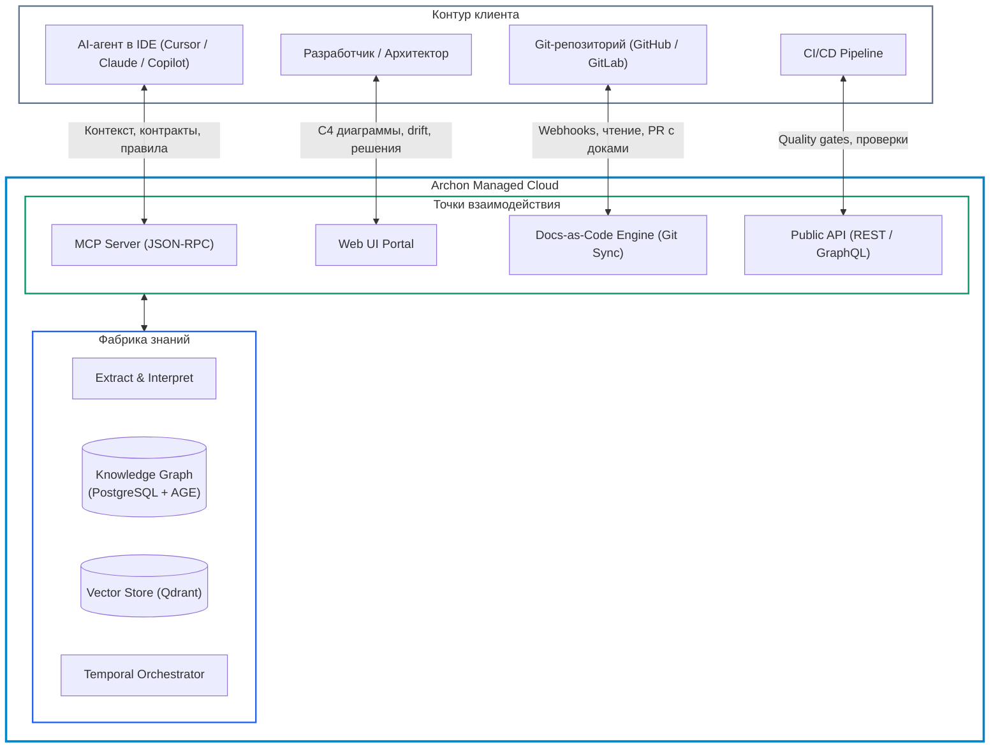

# 0006. Модель поставки Managed SaaS и Archon как AI-native Source of Truth

Дата: 2026-09-03

## Статус

Accepted

Частично заменяет [ADR-0005](0005-product-scope-and-delivery-model.md) в части модели поставки (отказ от CLI-first self-hosted в пользу Managed SaaS) и позиционирования (переход от пассивного наблюдателя к AI-native Source of Truth).
Закрывает [OQ-18](../architecture/open-questions.md#oq-18-saascloud-как-первичная-модель-поставки) и [OQ-19](../architecture/open-questions.md#oq-19-генерация-docs-as-code-артефактов).
Открывает [OQ-22](../architecture/open-questions.md#oq-22-формат-и-скоуп-публичного-api), [OQ-23](../architecture/open-questions.md#oq-23-поддержка-закрытых-контуров-hybrid--local-agent) и [OQ-24](../architecture/open-questions.md#oq-24-авторизация-роли-и-аудит-запросов-к-mcp-server).

## Контекст

В [ADR-0005](0005-product-scope-and-delivery-model.md) было зафиксировано: Archon поставляется как all-in-one self-hosted CLI-first инструмент, а SaaS отложен на вторую фазу. Предполагалось, что локальный запуск снимет барьер безопасности, а CLI позволит быстро запускать анализ.

Дальнейший анализ рынка и сценариев ([`ai-context-layer-research.md`](../research/ai-context-layer-research.md), [`business-value-analysis.md`](../research/business-value-analysis.md), [`iaas-to-saas-migration.md`](../research/iaas-to-saas-migration.md)) выявил фундаментальные противоречия:

1. **Неприемлемый Time-to-Value (TTV):**
   Для работы Archon требуется сложный инфраструктурный комплекс (PostgreSQL + Apache AGE, Qdrant, Temporal, NATS, инференс LLM). Развертывание в контуре клиента требует дней или недель согласований с DevOps и SecOps.
2. **Сдвиг в сторону ADLC (Agentic Development Lifecycle):**
   Разработка стремительно переходит к постоянному взаимодействию с AI-агентами (Cursor, Copilot, Claude Code). Агентам требуется сетевой доступ к контексту в реальном времени через Model Context Protocol (MCP). Локальный CLI не способен непрерывно обслуживать распределенные IDE-агенты.
3. **Ограниченность пассивного drift detection:**
   Поиск расхождений между документами и кодом решает задачу контроля, но не создает ежедневного рабочего потока. Истинная ценность — непрерывное снабжение агентов и людей актуальным контекстом без галлюцинаций (Context-as-a-Service).

## Решение

### 1. Переход к модели Managed SaaS (Context-as-a-Service)

Archon разворачивается и обслуживается внутри нашей управляемой облачной инфраструктуры.

- **Нулевые затраты клиента на инфраструктуру:** все тяжелые компоненты (парсеры, Temporal, графовая БД, векторное хранилище, очереди) масштабируются и обновляются на нашей стороне.
- **Подключение за минуты:** интеграция через GitHub App / GitLab OAuth без необходимости выделять серверы и настраивать базы данных.
- **CLI трансформируется в тонкий клиент к API:** локальный CLI сохраняется как утилита разработчика и раннер для CI, но не является средой исполнения фабрики.

### 2. Archon как AI-native Source of Truth

Archon перестает быть лишь пассивным валидатором существующих документов. Archon становится **активным источником правды для AI-агентов и разработчиков**:

- Система непрерывно извлекает факты из кода и фиксирует архитектурный граф.
- Система **генерирует и поддерживает в актуальном состоянии** docs-as-code артефакты в репозиториях (`AGENTS.md`, `.archon/`, C4-модели) через двустороннюю синхронизацию (Git Sync).
- При изменении кода документация обновляется автоматически или через предлагаемые Pull Request'ы.

### 3. Четыре интерфейса сервиса

1. **MCP Server:** Главная точка входа для AI-агентов. Передает компактную, проверенную топологию: границы сервиса, входящие/исходящие зависимости, схемы контрактов (DTO, OpenAPI, AsyncAPI), архитектурные инварианты и статус известных проблем.
2. **Web Portal:** Визуальный интерфейс для людей. Интерактивные C4-диаграммы (LikeC4/React Flow), мониторинг spec-drift, граф зависимостей и Assurance Inbox для фиксации решений архитектора.
3. **Public API (REST / GraphQL):** Программный интерфейс для CI/CD quality gates, отправки событий и интеграции с корпоративными системами (детализируется в OQ-22).
4. **Docs-as-Code Engine (Git Sync):** Модуль генерации и двусторонней синхронизации structured markdown (`AGENTS.md`, каталоги сервисов).

### 4. Принцип Privacy-by-default

Для устранения барьера безопасности кода в облачной среде:
- Исходный код клонируется во временные изолированные контейнеры-песочницы только на время извлечения AST и структурных фактов.
- После завершения анализа сырой код **немедленно удаляется**.
- В постоянном хранилище Archon сохраняются исключительно архитектурные метаданные: топология, имена типов, интерфейсы, связи и контракты.

## Альтернативы

### Вариант A: Сохранение Self-hosted CLI-first (ADR-0005)
Оставить продукт в виде локального бинарника/образа.
- **Плюсы:** код гарантированно не покидает контур клиента.
- **Минусы:** высокий TTV, колоссальные затраты клиента на поддержку инфраструктуры графа и LLM, невозможность предоставить централизованный сетевой MCP-сервер для всей команды, медленная обратная связь и цикл обновлений.
- **Почему отклонен:** блокирует масштабирование продукта и адаптацию AI-агентами.

### Вариант B: Пассивный SaaS-шлюз (только чтение и drift detection)
Развернуть Archon в облаке, но оставить роль пассивного компаратора между Confluence и Git.
- **Плюсы:** проще реализация (не нужно генерировать файлы).
- **Минусы:** Confluence остается устаревающим источником правды; AI-агенты не получают структурированный docs-as-code в репозитории; ценность остается эпизодической.
- **Почему отклонен:** проигрывает современным Context Lake платформам (Port, OpsLevel, Swimm).

## Последствия

### Плюсы
- **Time-to-Value сокращается до минут:** клиент подключает GitHub App и сразу получает доступ к MCP и порталу.
- **Регулярная ценность (Daily/Hourly retention):** каждый запрос разработчика к AI-агенту проходит через MCP Archon.
- **AI-native ценность:** автоматическая генерация и поддержание `AGENTS.md` решает проблему устаревания документации на корню.
- **Централизованный мониторинг и оптимизация затрат:** кэширование эмбеддингов и графа на нашей стороне снижает расходы на LLM.

### Минусы
- **Усложнение слоя платформы (`platform`):** с первого дня требуются надежная мультитенантность, изоляция данных организаций, биллинг и строгий аудит.
- **Сетевая зависимость:** работа MCP и Web UI требует сетевой доступности облака Archon.

### Риски и митигация
- **Страх утечки интеллектуальной собственности у Enterprise:**
  *Митигация 1:* Архитектура *Privacy-by-default* (хранение только метаданных, код стирается).
  *Митигация 2:* Разработка гибридного сценария (Local Agent / сканирующий раннер в закрытом контуре клиента, см. OQ-23).
- **Качество автогенерируемой документации:**
  *Митигация:* Использование проверенных шаблонов, валидация через контур `assurance`, генерация через PR с возможностью человеческого ревью.

## Ссылки

- [ADR-0005](0005-product-scope-and-delivery-model.md) — частично заменен настоящим решением
- [iaas-to-saas-migration.md](../research/iaas-to-saas-migration.md) — исследование предпосылок миграции
- [ai-context-layer-research.md](../research/ai-context-layer-research.md) — исследование рынка AI context layer
- [open-questions.md](../architecture/open-questions.md) — открытые вопросы (OQ-22, OQ-23, OQ-24)
