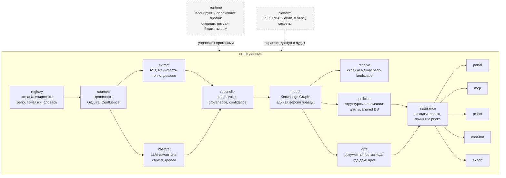

# Архитектура системы Archon

> **Раздел:** `docs/architecture/` (Высокоуровневая архитектура)  
> **Статус:** Актуально (Фаза 0, ADR-0004, ADR-0006)  
> **Навигация:** [Корень проекта](../../README.md) | [Документация](../README.md) | [Полный индекс](../INDEX.md) | [Реестр модулей](modules/README.md)

Общая архитектура платформы, компонентная модель, интеграции.
Каноническое описание модулей — в реестре [`modules/README.md`](modules/README.md),
декомпозиция принята [`ADR-0004`](../adr/0004-module-decomposition-revision-1.md).

Продуктовый взгляд — что видит пользователь и как система выглядит снаружи —
в [`product-overview.md`](product-overview.md). Этот файл про то, как всё
устроено внутри.

## Высокоуровневая архитектура

Смысл: `runtime` и `platform` — горизонтальные слои, они не ступеньки
конвейера, а обслуживание всего потока (пунктир). Основной поток читается
слева направо: корпус -> извлечение -> граф -> аналитика -> человеческий
контур -> каналы доставки (витрина: портал, MCP-сервер, бот в PR, чат-бот,
генератор артефактов экспорт) и Public API.

## Слои

| Слой | Модули | Ответ |
| :--- | :--- | :--- |
| Корпус | `registry`, `sources` | что анализировать и как туда дотянуться |
| Извлечение | `extract`, `interpret`, `reconcile` | факты о системе и кто в них прав |
| Модель | `model`, `resolve` | единый граф и склейка между репозиториями |
| Аналитика | `policies`, `drift` | что не так |
| Доверие | `assurance` | что с этим решили люди |
| Доставка | `portal`, `mcp`, `pr-bot`, `chat-bot`, `export` | показать результат, передать контекст и выгрузить артефакты |
| Инфраструктура | `runtime`, `platform` | чтобы работало, окупалось и продавалось |

## Ключевые архитектурные вехи

- [Архитектурная веха Code-to-Architecture](code-to-architecture.md) — проектирование сквозного контура автоматического извлечения и xyflow-визуализации (на базе бизнес-ценности прототипа archmap по [ADR-0002](../adr/0002-archmap-fate.md)).

## Модель данных, хранилище и фикстуры

Хранилище Source of Truth и изоляция тенантов приняты в [ADR-0003](../adr/0003-source-of-truth-and-tenant-isolation.md) (PostgreSQL 16 + Apache AGE, граф на тенанта, openCypher). Черновая модель данных описана в [`data-model.md`](data-model.md).  
Эталонная тестовая модель зафиксирована в [`sample-architecture.md`](sample-architecture.md) (Golden Dataset), а единый каталог всех тестовых наборов данных, фикстур и моков — в [`mocks-and-fixtures.md`](mocks-and-fixtures.md).

## Интеграции

Коннекторы (транспорт) — `sources`; правила скоупа и привязки — `registry`.
Список провайдеров и статусы коннекторов — TBD (спека `sources`).

## Deployment архитектура

Физическая топология принята в [ADR-0007](../adr/0007-saas-process-topology-and-packaging.md) (закрыт блокер [OQ-8](open-questions.md#oq-8-физическая-топология)).  
17 логических модулей упакованы в 3 сборочные единицы (`archon-core-service`, `archon-ai-service`, `archon-portal`) под управлением оркестратора Temporal.  
Полная спецификация процессов, протоколов и песочницы Privacy-by-default оформлена в [`deployment.md`](deployment.md).
