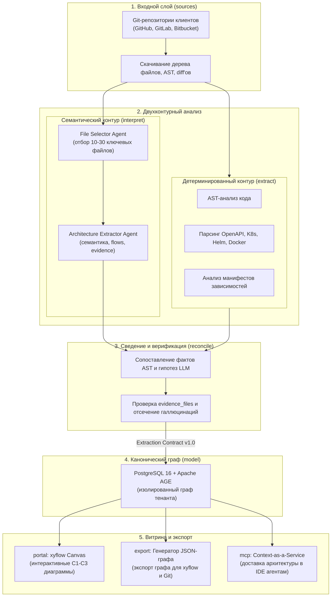
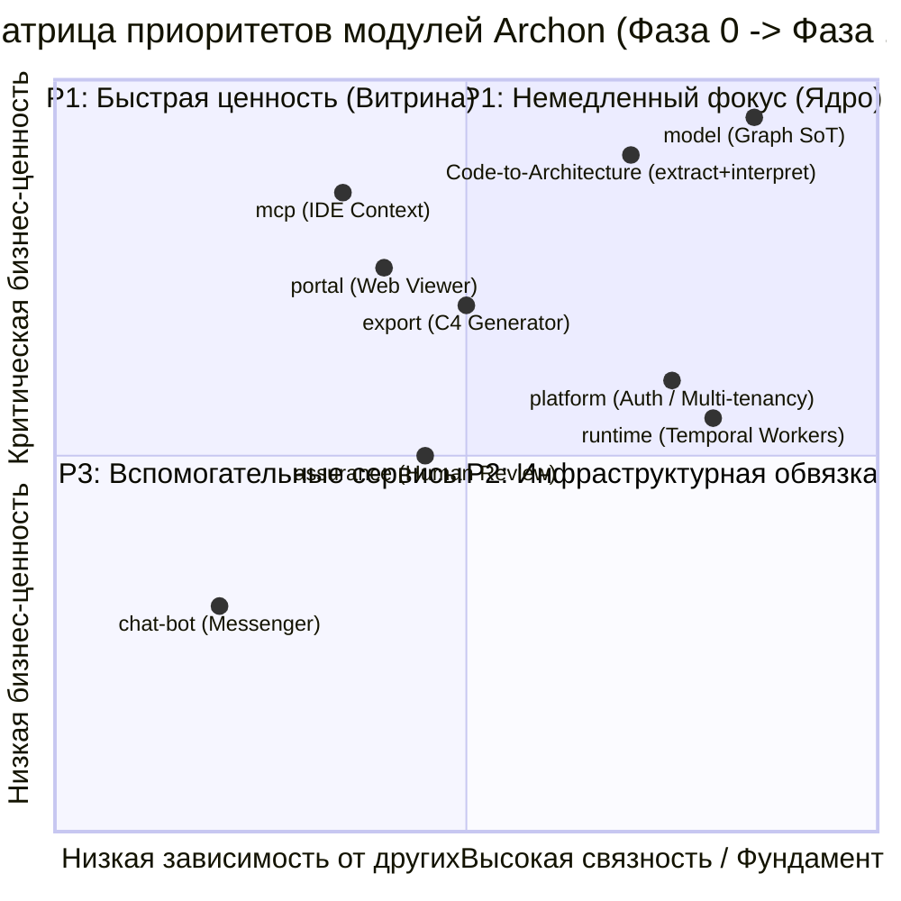

# Проектирование контура автоматического извлечения и визуализации (Code-to-Architecture)

> **Статус:** Архитектурная веха (Active Planning / Milestone)  
> **Связанные решения:** [ADR-0002 (Наследие archmap)](../adr/0002-archmap-fate.md), [ADR-0003 (Граф Source of Truth)](../adr/0003-source-of-truth-and-tenant-isolation.md), [ADR-0004 (17 модулей)](../adr/0004-module-decomposition-revision-1.md), [ADR-0006 (Managed SaaS)](../adr/0006-saas-delivery-model-and-ai-native-source-of-truth.md), [Extraction Contract v1.0](contracts/README.md), [RFC гибридного анализа](rfc-hybrid-repository-analysis.md).

Данный документ определяет архитектуру сквозного контура **Code-to-Architecture** в платформе Archon: от чтения исходного кода репозиториев до формирования верифицированного графа знаний и генерации интерактивных C4-диаграмм.

---

## 1. Бизнес-ценность и продуктовая идея

Главная ценность Archon — **Zero Drift (нулевой дрейф архитектуры)** и предоставление верифицированного контекста для разработчиков и AI-агентов. 

Контур Code-to-Architecture реализует эту ценность через четыре ключевых принципа:

1. **Доказуемость фактов (Proof-of-Truth / Zero Hallucinations):**
   * Никаких «галлюцинированных» связей. Любая архитектурная сущность (сервис, база данных, очередь), эндпоинт или ребро зависимости должны иметь обязательную привязку к исходному коду (`evidence_files` с указанием конкретных файлов и диапазонов строк).
   * Если LLM или парсер не могут подтвердить связь кодом или конфигурацией, сущность либо отбрасывается, либо маркируется как требующая ручной проверки (`uncertainties` / `#manual_check`).

2. **Иерархическая ясность по модели C4:**
   * Автоматическая сборка уровней **C1 (Системный контекст)**, **C2 (Контейнеры / Сервисы)** и **C3 (Внутренние компоненты)**.
   * Автоматическое «всплытие» зависимостей (inferred relations): связи между компонентами внутри сервисов автоматически агрегируются в высокоуровневые связи между сервисами на диаграммах верхнего уровня.

3. **Сквозные бизнес-сценарии (Flows):**
   * Архитектура не ограничивается статической топологией. Контур извлекает цепочки вызовов (`flows`), показывающие, как запрос проходит сквозь сервисы, очереди и базы данных при выполнении бизнес-операции (например, «Создание заказа» или «Авторизация пользователя»).

4. **Прозрачность степени уверенности (Confidence & Uncertainties):**
   * Каждому извлеченному факту присваивается уровень достоверности (`confidence`).
   * Сомнения анализатора явно формулируются в массиве `uncertainties` и передаются в контур управления рисками (`assurance`), превращая технический долг в понятный инбокс задач для тимлида.

---

## 2. Целевой архитектурный конвейер Archon

В отличие от ранних монолитных экспериментов, контур Code-to-Architecture в Archon строится как декомпозированный конвейер независимых модулей фабрики:

### Этапы конвейера:

1. **Слой источников (`sources`):**
   * Подключается к Git-провайдеру по вебхукам или по запросу.
   * Извлекает структуру директорий, метаданные коммита, файлы манифестов и измененные файлы (diff).

2. **Детерминированный экстрактор (`extract`):**
   * Быстрый, дешевый и 100% точный синтаксический анализ.
   * Парсит спецификации OpenAPI/Swagger, gRPC Protobuf, конфигурации Kubernetes, Dockerfile, Helm-чарты, а также пакетные зависимости (`go.mod`, `pom.xml`, `package.json`).
   * Формирует «жесткий каркас» гарантированных фактов.

3. **Семантический интерпретатор (`interpret`):**
   * Двухфазная модель работы с LLM:
     * **Фаза 3.1 (File Selector):** анализирует только дерево путей без чтения тел файлов. Отбирает 10–30 файлов, репрезентирующих границы домена (контроллеры, клиенты, конфиги), отсекая вендорные библиотеки, тесты и дубликаты.
     * **Фаза 3.2 (Architecture Extractor):** читает только отобранные файлы, восстанавливает семантический контекст, находит неявные межсервисные вызовы, извлекает шаги бизнес-сценариев (`flows`) и формирует ссылки на строки кода (`evidence_files`).

4. **Модуль примирения (`reconcile`):**
   * Сопоставляет детерминированные факты (`extract`) и семантические гипотезы (`interpret`).
   * Жесткое правило: детерминированные факты всегда имеют приоритет над выводами LLM.
   * Валидирует ссылки на файлы и исключает любые галлюцинации.

5. **Хранилище модели (`model`):**
   * Записывает верифицированные узлы и ребра в граф тенанта в PostgreSQL 16 + Apache AGE (ADR-0003).
   * Сохраняет историю изменений по коммитам.

6. **Визуализация и экспорт (`portal`, `export`, `mcp`):**
   * `portal`: отображает интерактивную карту C1–C3 на базе холста xyflow (`@xyflow/react` + `elkjs`).
   * `export`: выгружает JSON-граф для коммита в репозитории клиентов (Docs-as-Code).
   * `mcp`: отдает актуальную топологию и правила архитектуры AI-агентам в IDE (Cursor, Windsurf, Copilot).

---

## 3. Статус наследия archmap PoC (Reference Only)

Материалы прототипа в `docs/architecture/prototypes/archmap_dump/`:
- **Статус:** строго иллюстративный референсный пример (**Reference Example**).
- **Правило для команды:** Запрещается слепо копировать или адаптировать монолитные процедурные скрипты и no-code логику раннего PoC.
- **Что берется как ориентир идеи:**
  * Спецификация полей Extraction Contract (`evidence_files`, `flows`, `confidence`, `uncertainties`, `k8s_hints`).
  * Принципы разрешения иерархии сущностей C4 (подъем внутренних компонентов контейнера на уровень межсервисных связей).
  * Эвристики промптов селектора файлов (правило репрезентативности контроллеров и клиентов).
- Все компоненты Archon разрабатываются с нуля в целевом стеке платформы (Kotlin/Go/Python), со строгой типизацией (Pydantic / DTO), модульным интерфейсом и полным тестовым покрытием.

---

## 4. Приоритет проектирования относительно других модулей Archon

Контур Code-to-Architecture — это ключевой рабочий механизм фабрики («двигатель платформы»). Определение его места в матрице приоритетов проекта:

### Детальное ранжирование приоритетов:

| Уровень | Модули / Контур | Обоснование приоритета | Текущий статус |
| :--- | :--- | :--- | :--- |
| **P1 (Фундамент)** | `model` | **Критический блокер.** Без схемы графа и СУБД (Postgres + AGE) контуру извлечения некуда сохранять результат. | Решен в ADR-0003, активен спайк ARCH-17..19 (Паша). |
| **P1 (Ценность)** | `mcp` | **Первая точка входа для AI-агентов.** Позволяет подтвердить гипотезу Context-as-a-Service на синтетических данных (`sample-architecture.md`). | Активен спайк ARCH-22..25 (Миша). |
| **P1 (Проектирование контура)** | **Code-to-Architecture** (`extract` + `interpret` + `reconcile`) | **Сердце фабрики.** Проектирование схемы контракта (OQ-3) и бенчмарк качества извлечения LLM должны идти прямо сейчас, параллельно со спайками `model` и `mcp`. | **Данная веха (проектирование спецификации и спайка).** |
| **P2 (Витрина)** | `portal` + `export` | Необходимы для визуализации результатов извлечения в веб и выгрузки JSON-графа в Git. Разрабатываются после стабилизации контракта извлечения. | Ждет стабилизации схемы графа и контракта. |
| **P2 (Инфраструктура)** | `platform` + `runtime` | Оркестрация очередей (Temporal) и мультитенантная аутентификация. Критичны для выхода в Managed SaaS, но для локальных спайков достаточно Docker Compose. | Задачи ARCH-31/32 (Максим). |
| **P3 (Вспомогательные)** | `assurance`, `chat-bot` | Контур подтверждения человеком и чат-боты в мессенджерах. Реализуются на Фазе 1.2 после готовности базового пайплайна. | Запланированы на Фазу 1. |

---

## 5. Статус и артефакты вехи Code-to-Architecture

1. **Extraction Contract v1.0 ([OQ-3](open-questions.md#oq-3-контракт-извлечения)) — Завершено:**
   * JSON Schema (Draft 2020-12): [`contracts/extraction-v1.json`](contracts/extraction-v1.json).
   * Pydantic v2 DTO: [`contracts/extraction_v1.py`](contracts/extraction_v1.py).
   * Спецификация Kotlin DTO для `archon-core-service`: [`contracts/kotlin-dto-spec.md`](contracts/kotlin-dto-spec.md).
   * Набор тестов и валидатор: [`contracts/validate_contract.py`](contracts/validate_contract.py).
   * Документация и инварианты контракта: [`contracts/README.md`](contracts/README.md).
2. **Архитектура конвейера (RFC) — Принято:**
   * [RFC: Гибридный контур анализа репозиториев (Hybrid Analysis Pipeline)](rfc-hybrid-repository-analysis.md).
3. **Реализация в коде (в работе):**
   * Ingestion DAL в `model` (PostgreSQL 16 + AGE, Паша, ARCH-34).
   * Семантический экстрактор и structured output в `interpret` (Миша, ARCH-35/36).
   * Экспорт JSON-графа в `export` (ARCH-37).
   * Детерминированный парсер манифестов и AST в `extract` (ARCH-38).
