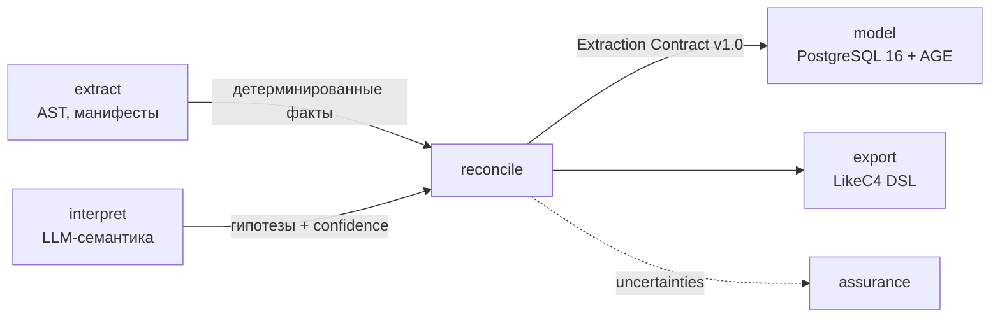

# Extraction Contract v1.0

Канонический контракт передачи фактов архитектуры из контура извлечения
(`extract`, `interpret`) в модуль `model` (граф) и модуль `export`
(LikeC4 / docs-as-code). Закрывает [OQ-3](../open-questions.md#oq-3-контракт-извлечения).

## Состав

| Файл | Назначение |
| :--- | :--- |
| [`extraction-v1.json`](extraction-v1.json) | JSON Schema (Draft 2020-12). Источник истины. |
| [`extraction_v1.py`](extraction_v1.py) | Pydantic v2 DTO. Ручные модели, синхронизированы со схемой. |
| [`kotlin-dto-spec.md`](kotlin-dto-spec.md) | Маппинг полей на Kotlin DTO для `archon-core-service` (ARCH-34). |
| [`fixtures/sample-ecommerce.json`](fixtures/sample-ecommerce.json) | Эталонная фикстура из `sample-architecture.md` (6 сервисов, 3 дефекта). |
| [`validate_contract.py`](validate_contract.py) | Валидация: метасхема, фикстура, round-trip, негативные кейсы. |
| [`../mocks-and-fixtures.md`](../mocks-and-fixtures.md) | Единый реестр моков и фикстур проекта (Contract, FastMCP, AGE seed). |

## Модель контракта



Секция `uncertainties` уходит в `assurance` как сигнал для человеческого контура.

## Структура (7 секций)

| Секция | Обязательная | Что содержит |
| :--- | :---: | :--- |
| `$schema_version` | да | `"1.0"`, SemVer: мажор при breaking, минор additive-only |
| `repository` | да | Срез: url, commit_sha, default_branch, scanned_at |
| `product` | да | Продукт верхнего уровня, slug, команда, evidence_files |
| `containers[]` | нет | C2: сервисы, БД, очереди (kind: service/database/cache/queue/storage/job/other) |
| `external_systems[]` | нет | Системы вне продукта (scope: internal/external) |
| `relationships[]` | нет | Связи с EntityRef-адресацией, evidence, confidence |
| `flows[]` | нет | Динамические сценарии: упорядоченные шаги from→to |
| `uncertainties[]` | нет | Сомнения в dot-path адресации, уходит в assurance |

### Ключевые инварианты

1. **`evidence_files` minItems 1** — у любой сущности, связи, flow и шага есть
   пруф в коде. Пустой пруф = галлюцинация = контракт невалиден. Это ядро
   защиты Zero Drift.
2. **`confidence` 0.0–1.0** — на связях и в uncertainties. < 0.8 требует ревью.
3. **EntityRef**: `product:<slug>`, `container:<slug>`, `external:<slug>`.
   `component:` — v1.1, в v1.0 отсутствует. `external:user` — зарезервирован
   для инициатора в flows (пока не описан явно, добавится с component-уровнем).
4. **DotPath** для `uncertainties[].field`: `product.team_name`,
   `flows[0].steps[2].to` — без `$.` префикса и скобочной адресации ключей.
5. **Slug** — строго kebab-case, `^[a-z0-9][a-z0-9-]{0,63}$`.

### Версионирование (SemVer)

- **Мажор (2.0)**: удаление полей, смена типов, новое обязательное поле.
- **Минор (1.1)**: новые опциональные поля (additive-only), новые enum-значения.
  Потребители обязаны игнорировать неизвестные enum-значения невозможно —
  поэтому новые значения kind — только с допуском в DAL, не молча.
- Схема в репо — единственный источник; DTO (Pydantic/Kotlin) синхронизируются
  в том же PR.

## Скоуп v1.0: что вошло и что нет

**Вошло (ядро):** repository, product, containers, external_systems,
relationships, flows, uncertainties — покрывает PoC AGE (Паша) и LLM-спайки
(Миша), включая подъем связей для v1.1 через `inferred_from`.

**Не вошло (осознанно, v1.1+):**

| Поле | Почему отложено |
| :--- | :--- |
| `components[]` (C3) | Ни один спайк Фазы 0 его не потребляет; ни один спайк его не наполняет. Возвращается с component-уровнем EntityRef. |
| `k8s_hints` | Enterprise-фича для `resolve` (склейка по identity из K8s). PoC-графы строятся без K8s-склейки. |
| `external:user` в flows | Требует описания в схеме пользователя-инициатора как типизированной сущности; пока участник flows задаётся строкой `external:web-client` — клиентская система, не «пользователь». |

## Валидация

```bash
# Полный набор (нужен venv с jsonschema + pydantic)
python docs/architecture/contracts/validate_contract.py

# Только схема
python docs/architecture/contracts/validate_contract.py --schema-only
```

Полный прогон: метасхема → фикстура → round-trip → 8 негативных кейсов
(галлюцинации обязаны отклоняться).

## Потребители

| Модуль | Кто реализует | Как использует контракт |
| :--- | :--- | :--- |
| `interpret` (structured output) | Миша, ARCH-35/36 | Pydantic DTO как schema constrained decoding; невалидный вывод = ретрай |
| `model` (Ingestion DAL) | Паша, ARCH-34 | Kotlin DTO, запись в граф тенанта через Cypher, минуя `k8s_hints` |
| `export` | ARCH-37 | Генерация LikeC4 DSL из связей и flows |
| `policies` | Фаза 1 | Циклы/shared DB ищутся в графе, не в контракте |
