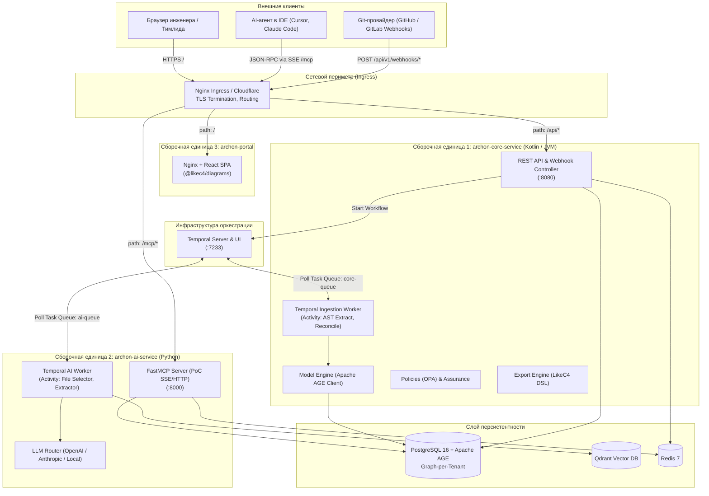
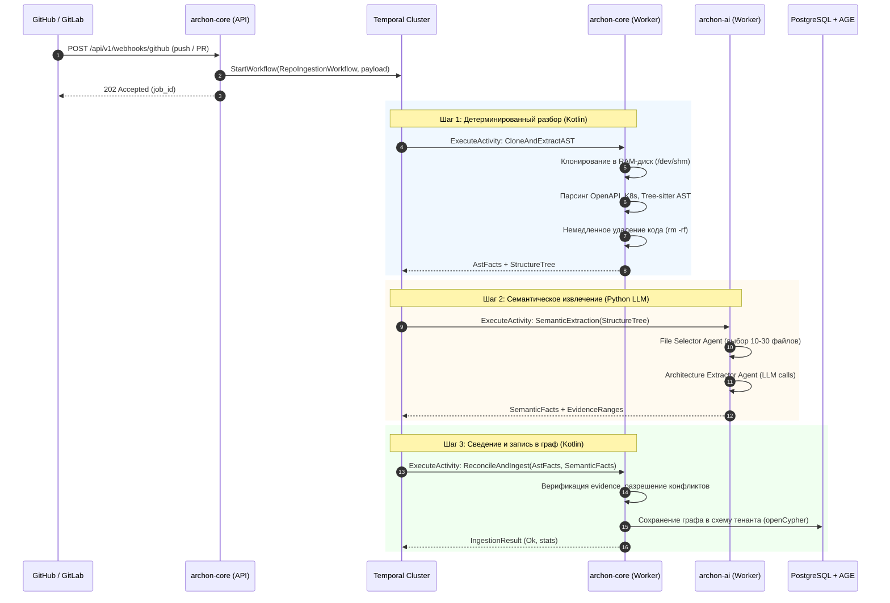

# Физическая топология и развертывание Archon SaaS

> **Раздел:** `docs/architecture/` (Спецификация топологии)  
> **Статус:** Принято в [ADR-0007](../adr/0007-saas-process-topology-and-packaging.md), закрывает [OQ-8](open-questions.md#oq-8-физическая-топология)  
> **Связанные решения:** [ADR-0003 (Graph-per-Tenant)](../adr/0003-source-of-truth-and-tenant-isolation.md), [ADR-0004 (17 модулей)](../adr/0004-module-decomposition-revision-1.md), [ADR-0006 (Managed SaaS)](../adr/0006-saas-delivery-model-and-ai-native-source-of-truth.md), [Code-to-Architecture](code-to-architecture.md)

Документ определяет физическую упаковку 17 логических модулей Archon в сборочные единицы, организацию межпроцессного взаимодействия, изоляцию вычислений и топологию хранения данных в облачной инфраструктуре Managed SaaS.

---

## 1. Архитектурные принципы упаковки

1. **Модуль != сервис (ADR-0004):** 17 модулей являются логическими границами доменов, а не отдельными микросервисами. Для MVP вся система упаковывается ровно в **3 сборочные единицы**.
2. **Языковое разделение команд (tech-stack.md):** 
   - `archon-core-service` на **Kotlin / JVM** (Паша) объединяет всё инженерное ядро, API, работу с БД и детерминированный парсинг.
   - `archon-ai-service` на **Python** (Миша) изолирует взаимодействие с LLM, RAG и промпт-инжиниринг.
   - `archon-portal` на **TypeScript / React** (Фронтенд / пул) отвечает за витрину и LikeC4.
3. **Оркестрация через Temporal Polyglot Workflows:** Долгие распределенные пайплайны связывают Kotlin и Python воркеры через задачи Temporal без прямого синхронного HTTP-сопряжения.
4. **Privacy-by-default:** Исходный код клиентов обрабатывается исключительно в эфемерных RAM-дисках воркера и гарантированно удаляется после синтаксического разбора. В БД сохраняются только архитектурные метаданные и цитаты `evidence_files`.
5. **Минимализм сетевого периметра:** В MVP используется стандартный Ingress-контроллер без раздувания отдельного кластера API Gateway.

---

## 2. Сборочные единицы (Deployable Units)

| Сборочная единица | Стек | Модули фабрики | Назначение |
| :--- | :--- | :--- | :--- |
| **`archon-core-service`** | Kotlin / JVM (Spring Boot 3 / Micronaut) | `model`, `resolve`, `policies`, `drift` (синтакс), `assurance`, `export`, `registry`, `sources`, `extract`, `reconcile`, `platform` | Основной бэкенд, REST API, Webhooks, Ingestion Workflow, взаимодействие с Apache AGE и OPA. |
| **`archon-ai-service`** | Python 3.11+ (FastAPI, LangChain / DSPy, FastMCP) | `interpret`, `drift` (семантика), RAG-компоненты | Воркер семантического извлечения архитектуры через LLM, валидатор доказательств, векторный поиск. В MVP также хостит исследовательский FastMCP. |
| **`archon-portal`** | TypeScript, React, Vite / Nginx | `portal` | Статическое SPA-приложение: LikeC4 интерактивный просмотрщик, каталог сервисов, инбокс находок. |

---

## 3. Слой хранения и инфраструктуры (Managed State & Infrastructure)

| Компонент | Технология | Назначение |
| :--- | :--- | :--- |
| **Граф знаний и реляционные данные** | **PostgreSQL 16 + Apache AGE** | Multi-tenancy по модели **Graph-per-Tenant** ([ADR-0003](../adr/0003-source-of-truth-and-tenant-isolation.md)): каждый тенант изолирован в собственном графе `ag_catalog`. Таблицы аккаунтов, метаданных и аудита используют `tenant_id`. |
| **Векторное хранилище** | **Qdrant** | Векторные эмбеддинги чанков документации и сигнатур кода с фильтрацией по `tenant_id`. |
| **Кэш и быстрый стейт** | **Redis** | Кэширование горячих срезов графа, rate-limiting запросов, сессии SSE. |
| **Оркестратор пайплайнов** | **Temporal Cluster** | Управление сагами анализа, очереди задач (Task Queues), автоматические ретраи и мониторинг. |

---

## 4. Схема физических процессов и взаимодействия



---

## 5. Конвейер анализа репозитория (Temporal Polyglot Workflow)

Обработка репозитория при получении вебхука или по расписанию реализуется как сквозной workflow:



### Преимущества полиглотного Temporal-конвейера:
1. **Автономные ретраи:** При сбоях LLM (rate-limits 429, таймауты) Temporal автоматически перезапускает только Activity 2 с экспоненциальным бэкоффом. Клонирование и AST-разбор повторно не выполняются.
2. **Отсутствие открытых внутренних портов:** Воркеры не слушают входящие HTTP-порты для межсервисной связи, а безопасно вычитывают задачи из брокера Temporal (pull-модель).
3. **Строгая изоляция стеков:** Паша и Миша разрабатывают свои шаги конвейера в нативных средах с независимым тестированием через моки входных DTO Extraction Contract.

---

## 6. Безопасность и песочница кода (Privacy-by-default)

1. **Монтирование временного хранилища:**
   - В K8s под воркера монтирует том типа `emptyDir: { medium: "Memory" }` (RAM-диск).
   - Исходный код клонируется с глубиной `--depth=1`.
2. **Гарантированная очистка:**
   - Чтение структуры и выгрузка отобранных манифестов происходят в оперативной памяти.
   - Сразу по завершении шага `CloneAndExtractAST` выполняется принудительное удаление директории репозитория.
   - В долговременное хранилище (PostgreSQL + AGE) передаются только имена интерфейсов, сигнатуры методов, графовые ребра и диапазоны строк `evidence_files` (3–5 строк кода в качестве цитаты-доказательства).
3. **Изоляция тенантов:**
   - Запросы к графу строго маршрутизируются в схему графа соответствующего тенанта (`SET search_path = ag_catalog, tenant_<id>`).

---

## 7. Сетевые интерфейсы и маршрутизация Ingress

| Путь | Метод | Протокол | Целевой сервис | Назначение |
| :--- | :---: | :--- | :--- | :--- |
| `/` | GET | HTTP/1.1, HTTP/2 | `archon-portal` | Статический бандл веб-портала (SPA). |
| `/api/v1/webhooks/*` | POST | HTTPS | `archon-core-service` | Прием событий от GitHub/GitLab Apps. |
| `/api/v1/*` | ANY | HTTPS | `archon-core-service` | REST API для портала, CI/CD гейтов и управления. |
| `/mcp/*` | POST, GET | SSE / JSON-RPC | `archon-ai-service` (FastMCP) | Канал доставки контекста в AI-агенты IDE (Cursor, Copilot). |

---

## 8. Маппинг 17 модулей в топологию процессов

```
┌─────────────────────────────────────────────────────────────────────────────┐
│                          archon-portal (SPA)                                │
│  [portal]                                                                   │
└─────────────────────────────────────────────────────────────────────────────┘

┌─────────────────────────────────────────────────────────────────────────────┐
│                   archon-core-service (Kotlin / JVM)                        │
│  [platform] [registry] [sources] [extract (AST)] [reconcile]                │
│  [model]    [resolve]  [policies] [drift (syntax)] [assurance] [export]      │
│  [runtime (Temporal Client & Core Worker)]                                  │
└─────────────────────────────────────────────────────────────────────────────┘

┌─────────────────────────────────────────────────────────────────────────────┐
│                     archon-ai-service (Python)                              │
│  [interpret] [drift (semantics)] [mcp (FastMCP PoC)]                        │
│  [runtime (Temporal AI Worker)]                                             │
└─────────────────────────────────────────────────────────────────────────────┘

┌─────────────────────────────────────────────────────────────────────────────┐
│                     Инфраструктура и хранилища                              │
│  PostgreSQL 16 + Apache AGE | Qdrant | Redis | Temporal Cluster             │
└─────────────────────────────────────────────────────────────────────────────┘
```

Каждый логический модуль сохраняет свой файл в `docs/architecture/modules/`, но физически исполняется внутри соответствующего процесса.
