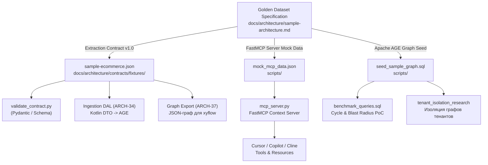

# Реестр моков, фикстур и тестовых данных

> **Раздел:** `docs/architecture/`  
> **Статус:** Актуально (Фаза 0, Golden Dataset)  
> **Связанные документы:** [sample-architecture.md](sample-architecture.md), [contracts/README.md](contracts/README.md), [../../scripts/README.md](../../scripts/README.md), [../INDEX.md](../INDEX.md)

Единый каталог всех тестовых данных, моков и фикстур платформы Archon. Документ служит единой точкой входа для разработчиков и AI-агентов, связывая воедино разрозненные файлы фикстур, их схемы, потребителей и способы запуска.

---

## Концепция: происхождение от Golden Dataset

Все моки и фикстуры в проекте имеют общее происхождение — каноническую спецификацию **Golden Dataset** ([sample-architecture.md](sample-architecture.md)), описывающую ландшафт электронной коммерции из 6 микросервисов (`order-service`, `billing-service`, `inventory-service`, `delivery-service`, `notification-service`, `auth-service`) и 3 намеренных архитектурных дефекта (цикл, устаревший контракт, несанкционированный доступ к чужой БД).

В зависимости от назначения эта модель спроецирована в 3 физических представления:



---

## Сводная матрица тестовых данных

| Контур / Назначение | Файл фикстуры | Спецификация / Схема | Ключевые потребители | Команда валидации или запуска |
| :--- | :--- | :--- | :--- | :--- |
| **Extraction Contract v1.0** (Факты извлечения) | [`docs/architecture/contracts/fixtures/sample-ecommerce.json`](contracts/fixtures/sample-ecommerce.json) | [`extraction-v1.json`](contracts/extraction-v1.json) (Draft 2020-12), [`extraction_v1.py`](contracts/extraction_v1.py) | `validate_contract.py`, Ingestion DAL (Kotlin, ARCH-34), транслятор LikeC4 (`export`, ARCH-37) | `python docs/architecture/contracts/validate_contract.py` |
| **FastMCP Context Server** (Мок для IDE AI-агентов) | [`scripts/mock_mcp_data.json`](../../scripts/mock_mcp_data.json) | Встроенная JSON Schema (`draft-07`), разделы `contracts`, `rules`, `adrs` | [`scripts/mcp_server.py`](../../scripts/mcp_server.py), Cursor IDE, Copilot, Cline | `python3 scripts/mcp_server.py` |
| **Графовая БД (Apache AGE)** (Сид тестового графа) | [`scripts/seed_sample_graph.sql`](../../scripts/seed_sample_graph.sql) | DDL графа `archon_graph`, openCypher узлы `:Service`, `:Contract`, `:Database`, `:Topic` | PostgreSQL 16 + AGE, [`benchmark_queries.sql`](../../scripts/benchmark_cypher_queries/benchmark_queries.sql) (ARCH-19), задачи #17-#20 | `psql -U postgres -d postgres -f scripts/seed_sample_graph.sql` |
| **Канонический эталон** (Текстовая спецификация) | [`docs/architecture/sample-architecture.md`](sample-architecture.md) | Markdown-спецификация Golden Dataset | Документация, разработчики, архитекторы, промпты LLM | Просмотр документации |
| **Архив прототипа archmap** (Reference Examples) | [`docs/architecture/prototypes/archmap_dump/`](prototypes/README.md) | Промпты селектора и экстрактора | Исторический PoC LikeC4 ([`json_to_likec4.py`](prototypes/archmap_dump/json_to_likec4.py)) | Не запускается (архив по ADR-0002) |
| **Веб-портал Mock API** (Витрина `archon-portal`) | Репозиторий `teamv39/archon-portal` | MSW / Fastify Mock API | Фронтенд-разработка портала (Mock-First, задача A2) | В репозитории `archon-portal` |

---

## 1. Контур Extraction Contract v1.0

### Файл фикстуры
- **Путь:** [`docs/architecture/contracts/fixtures/sample-ecommerce.json`](contracts/fixtures/sample-ecommerce.json)
- **Схема:** [`docs/architecture/contracts/extraction-v1.json`](contracts/extraction-v1.json)
- **Python DTO:** [`docs/architecture/contracts/extraction_v1.py`](contracts/extraction_v1.py)
- **Kotlin DTO спецификация:** [`docs/architecture/contracts/kotlin-dto-spec.md`](contracts/kotlin-dto-spec.md)
- **Документация контракта:** [`docs/architecture/contracts/README.md`](contracts/README.md)

### Что содержит фикстура
- `repository`: срез репозитория (`url`, `commit_sha: "a1b2c3d"`, `scanned_at`).
- `product`: метаданные продукта `order-service` с пруфами в кодовой базе (`evidence_files`).
- `containers[]`: сервисы `order-api` и база данных `order-db`.
- `external_systems[]`: `billing-service`, `inventory-service`, `delivery-service`, `auth-service`, `auth-db`, `notification-service`, топик Kafka `order-paid-topic`, клиент `web-client`.
- `relationships[]`: 9 направленных связей с типизацией EntityRef (`container:...`, `external:...`), протоколами (HTTPS/REST, JDBC, Kafka), оценкой достоверности `confidence` (0.85-1.0) и обязательными пруфами `evidence_files` (защита Zero Drift).
- `flows[]`: сквозной бизнес-сценарий `checkout-flow` («Оформление заказа») из 4 шагов.
- `uncertainties[]`: 2 зафиксированных архитектурных сомнения для контура `assurance` (низкий confidence прямой связи с `auth-db`, неявный топик).

### Как валидировать
```bash
# Валидация схемы, фикстуры, round-trip сериализации и 8 негативных тестов
python docs/architecture/contracts/validate_contract.py

# Быстрая проверка соответствия фикстуры схеме
python docs/architecture/contracts/validate_contract.py --schema-only
```

---

## 2. Контур FastMCP Context Server

### Файл фикстуры
- **Путь:** [`scripts/mock_mcp_data.json`](../../scripts/mock_mcp_data.json)
- **Сервер-потребитель:** [`scripts/mcp_server.py`](../../scripts/mcp_server.py)
- **Связанные задачи:** ARCH-22..24, #31

### Что содержит фикстура
- `services[]`: паспорта 6 микросервисов (tier, язык, фреймворк, репозиторий, команда-владелец, исходящие вызовы, флаг цикла `is_defect_cycle: true`).
- `contracts{}`: схемы запросов и ответов для API (`billing-service:/api/v1/invoices`, `order-service:/api/v1/orders`) с архитектурными ограничениями (`architectural_constraints`).
- `validate_dependency_scenarios[]`: 4 сценария проверки зависимостей для вызова `validate_dependency`:
  1. `order-service` -> `delivery-service` — разрешено (OK);
  2. `billing-service` -> `order-service` — заблокировано (дефект 1: прямой цикл A <-> B, нарушение `ARCH-RULE-001`);
  3. `order-service` -> `auth-db` — заблокировано (дефект 3: прямой доступ к чужой БД, нарушение `ARCH-RULE-002`);
  4. `order-service` -> `unknown-service` — заблокировано (сервис отсутствует в реестре).
- `architectural_rules[]`: каталогизированные правила архитектуры (`ARCH-RULE-001: No Direct Cycle`, `ARCH-RULE-002: Service Database Encapsulation`, `ARCH-RULE-003: Contract-First Integration`).
- `adrs[]`: выдержки архитектурных решений (`ADR-001: Async Billing`, `ADR-002: Dedicated DB per Service`).
- `impact_analysis_mocks{}`: готовые результаты анализа последствий (blast radius) изменения эндпоинтов.

### Как запустить
```bash
# Запуск FastMCP сервера (требуется fastmcp)
python3 scripts/mcp_server.py
```

---

## 3. Контур графовой базы (Apache AGE)

### Файл фикстуры / сида
- **Путь:** [`scripts/seed_sample_graph.sql`](../../scripts/seed_sample_graph.sql)
- **Среда выполнения:** [`scripts/docker-compose.age.yml`](../../scripts/docker-compose.age.yml) и [`scripts/init-scripts/init-age.sql`](../../scripts/init-scripts/init-age.sql)
- **Тестовые запросы:** [`scripts/benchmark_cypher_queries/benchmark_queries.sql`](../../scripts/benchmark_cypher_queries/benchmark_queries.sql)
- **Отчет о производительности:** [`scripts/benchmark_cypher_queries/RESULT.md`](../../scripts/benchmark_cypher_queries/RESULT.md)
- **Исследование изоляции тенантов:** [`scripts/postgres_spikes/tenant_isolation_research/`](../../scripts/postgres_spikes/tenant_isolation_research/)

### Что содержит сид
1. Инициализация расширения `age` и пересоздание графа `archon_graph`.
2. Создание узлов `:Service` для 6 сервисов (`order-service`, `billing-service`, `inventory-service`, `delivery-service`, `notification-service`, `auth-service`).
3. Создание узлов `:Contract` (`c-create-invoice`, `c-get-order`, `c-check-stock` и др.).
4. Создание инфраструктурных узлов: `:Database {id: 'auth-db'}`, `:Topic {id: 'topic-order-paid'}`.
5. Создание ребер:
   - `:CALLS` (включая циклический вызов `billing-service` -> `order-service`);
   - `:OWNS` (владение контрактами и БД);
   - `:PRODUCES` и `:CONSUMES` (публикация и вычитка из топика Kafka);
   - несанкционированные ребра `:CALLS` от `order-service` и `billing-service` к `:Database {id: 'auth-db'}` (дефект Shared Database).

### Как развернуть и накатить
```bash
# 1. Запуск контейнера PostgreSQL 16 + AGE
docker compose -f scripts/docker-compose.age.yml up -d

# 2. Накат сида в базу
docker exec -i archon-age-db psql -U postgres -d postgres -f scripts/seed_sample_graph.sql

# 3. Прогон Cypher-бенчмарка (поиск циклов и blast radius)
docker exec -i archon-age-db psql -U postgres -d postgres -f scripts/benchmark_cypher_queries/benchmark_queries.sql
```

---

## 4. Концептуальный первоисточник (Golden Dataset)

- **Путь:** [`docs/architecture/sample-architecture.md`](sample-architecture.md)

Документ описывает бизнес-сценарий E-Commerce, паспорта всех 6 сервисов, детальную диаграмму Mermaid, таблицы узлов и связей, а также эталонные сценарии для 3 дефектов:
- **Дефект 1 (Критический):** циклическая зависимость `order-service` <-> `billing-service`.
- **Дефект 2 (Высокий):** устаревший контракт между сервисами.
- **Дефект 3 (Высокий):** нарушение изоляции БД — прямое чтение `auth-db` сервисами `order-service` и `billing-service` в обход API `auth-service`.

При любых изменениях в составе сервисов, контрактов или дефектов правки начинаются с этого документа.

---

## 5. Архивные материалы и ранние прототипы

- **Каталог:** [`docs/architecture/prototypes/archmap_dump/`](prototypes/README.md)
  - [`json_to_likec4.py`](prototypes/archmap_dump/json_to_likec4.py) — детерминированный компилятор JSON в LikeC4 DSL;
  - [`selector_prompt.md`](prototypes/archmap_dump/selector_prompt.md) и [`extractor_prompt.md`](prototypes/archmap_dump/extractor_prompt.md) — системные промпты агентов выбора и извлечения.

Материалы имеют статус **Reference Examples** согласно [ADR-0002](../adr/0002-archmap-fate.md) и служат примерами логики трансляции в LikeC4.

---

## 6. Витрина и Mock API (Portal)

Для клиентской части Archon (`archon-portal`, SPA на React/Vite + BFF на Fastify) моки вынесены в отдельный репозиторий:
- **Репозиторий:** [`teamv39/archon-portal`](https://github.com/teamv39/archon-portal)
- **Принцип:** Mock-First разработка (раздел 8 в [`docs/guides/portal-onboarding.md`](../guides/portal-onboarding.md) и задача A2 в [`docs/guides/portal-learning-plan.md`](../guides/portal-learning-plan.md)).
- **Назначение:** имитация API ядра (эндпоинты каталога сервисов, графа зависимостей и сессий) через MSW (Mock Service Worker) или Fastify Mock API для автономной разработки фронтенда без поднятия полного контура ядра.

---

## Чек-лист синхронизации моков

При изменении архитектурного ландшафта (добавление сервиса, изменение связей, смена структуры контракта) необходимо синхронно обновить артефакты:

1. [ ] Обновить спецификацию в [sample-architecture.md](sample-architecture.md).
2. [ ] Обновить фикстуру Extraction Contract в [contracts/fixtures/sample-ecommerce.json](contracts/fixtures/sample-ecommerce.json) и проверить: `python docs/architecture/contracts/validate_contract.py`.
3. [ ] Обновить мок MCP-сервера в [../../scripts/mock_mcp_data.json](../../scripts/mock_mcp_data.json).
4. [ ] Обновить графовый сид в [../../scripts/seed_sample_graph.sql](../../scripts/seed_sample_graph.sql).
5. [ ] Если изменились типы полей — синхронизировать [extraction-v1.json](contracts/extraction-v1.json), [extraction_v1.py](contracts/extraction_v1.py) и [kotlin-dto-spec.md](contracts/kotlin-dto-spec.md).
