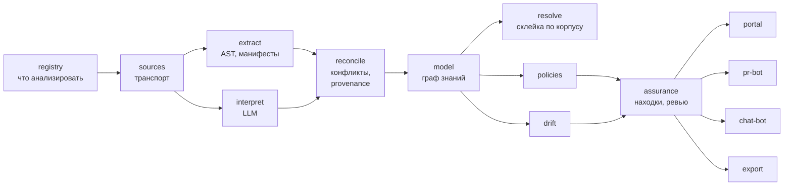

# Модули Archon

Главный документ системы. Здесь описано, что Archon делает и из каких частей состоит.

- Детали каждого модуля — в отдельном файле рядом.
- Открытые вопросы (что ещё не решено) — в [`../open-questions.md`](../open-questions.md).
- Принятые решения — в [`../../adr/`](../../adr/).

**Текущая версия декомпозиции:** ревизия 1, принята в [`ADR-0004`](../../adr/0004-module-decomposition-revision-1.md).

**Хочешь понять продукт, а не технику?** Читай [`../product-overview.md`](../product-overview.md) — там объяснение, что видит пользователь.

## Что видит пользователь (4 точки входа)

16 модулей — это внутреннее устройство, как мотор в машине. Пользователь не лезет в мотор, он видит только 4 интерфейса:

- **Портал (веб-сайт)** — диаграммы, список сервисов, список проблем.
- **Бот в Git** — комментирует PR: "обнови документ, он не совпадает с кодом".
- **Чат-бот** — отвечает на вопросы со ссылкой на код.
- **Экспорт** — выгружает отчёт на дату для аудита.

Всё остальное — внутренняя "фабрика", которая работает под капотом.

## Как фабрика устроена: 5 блоков

На 16 модулей можно смотреть двумя способами:
1. **Блоками** — группируем по близости к пользователю (удобно для презентации).
2. **Слоями конвейера** — группируем по шагам обработки данных (удобно для разработки).

Оба способа описывают одно и то же.

### Взгляд блоками (продуктовый)

| Блок | Модули | Зачем нужен |
| :--- | :--- | :--- |
| **Витрина** | [`portal`](portal.md), [`pr-bot`](pr-bot.md), [`chat-bot`](chat-bot.md), [`export`](export.md) | Показывает результат пользователю |
| **Решение** | [`assurance`](assurance.md) | Следит за жизненным циклом проблемы: обнаружена → исправлена / риск принят / ложная тревога |
| **Мозг** | [`model`](model.md), [`resolve`](resolve.md), [`policies`](policies.md), [`drift`](drift.md) | Строит граф из кода и документов, находит проблемы |
| **Фабрика** | [`registry`](registry.md), [`sources`](sources.md), [`extract`](extract.md), [`interpret`](interpret.md), [`reconcile`](reconcile.md) | Читает код и документы, разбирается в конфликтах |
| **Фундамент** | [`runtime`](runtime.md), [`platform`](platform.md) | Очереди задач, права доступа, аудит, SSO |

**Для MVP:** делаем портал + бот в Git, главная фича — "документы не совпадают с кодом, вот доказательство".

## Как всё работает (простыми словами, 5 шагов)

Представь конвейер, по которому идут данные:

### Шаг 1. Определяет, что анализировать
**Модули:** `registry`, `sources`

`registry` — это конфигурация: какие репозитории читать, кто владелец, какие правила применять.
`sources` — коннекторы: как подключиться к Git, Jira, Confluence.

### Шаг 2. Извлекает факты из кода и документов
**Модули:** `extract`, `interpret`, `reconcile`

Читаем код двумя способами:
- **`extract`** — парсит синтаксис кода (точно, быстро, дёшево).
- **`interpret`** — понимает смысл через LLM (медленно, дорого, может ошибаться).

**`reconcile`** разбирается, если они противоречат друг другу, и сохраняет, откуда взят каждый факт.

### Шаг 3. Строит единый граф
**Модули:** `model`, `resolve`

**`model`** — хранилище графа, где все факты о системе в одном месте. История не теряется, ручные правки не затираются.

**`resolve`** — склеивает одинаковые сущности между разными репозиториями. Например, если два сервиса используют одну и ту же базу данных, `resolve` понимает, что это один объект, а не два.

### Шаг 4. Находит проблемы
**Модули:** `policies`, `drift`, `assurance`

**`policies`** — ищет архитектурные проблемы (циклические зависимости, нарушение правил).

**`drift`** — сравнивает документы с кодом и находит расхождения.

**`assurance`** — управляет жизненным циклом каждой проблемы. Человек решает: исправить, принять риск или отклонить как ложную тревогу.

### Шаг 5. Показывает результат
**Модули:** `portal`, `pr-bot`, `chat-bot`, `export`

Результат попадает туда, где удобно пользователю: веб-портал, комментарий в PR, ответ в чате, файл для аудита.

---

**Горизонтальные слои (обслуживают весь конвейер):**
- **`runtime`** — планирует задачи, считает стоимость прогонов, управляет бюджетами LLM.
- **`platform`** — SSO, права, аудит, мультитенантность (без этого не продать в enterprise).

---

**Ключевая идея:** Автоматика извлекает факты и находит проблемы. Человек принимает решения — исправить, принять риск, отклонить. Решения человека записываются в граф наравне с фактами из кода.

### Взгляд слоями (технический)

Те же 16 модулей, но сгруппированные по шагам обработки данных:

| Слой | Модули | Что делает |
| :--- | :--- | :--- |
| **Корпус** | [`registry`](registry.md), [`sources`](sources.md) | Что анализировать и как подключиться |
| **Извлечение** | [`extract`](extract.md), [`interpret`](interpret.md), [`reconcile`](reconcile.md) | Читает код и документы, разбирается в конфликтах |
| **Модель** | [`model`](model.md), [`resolve`](resolve.md) | Хранит граф, склеивает одинаковые сущности |
| **Аналитика** | [`policies`](policies.md), [`drift`](drift.md) | Находит проблемы |
| **Доверие** | [`assurance`](assurance.md) | Следит за решениями человека |
| **Доставка** | [`portal`](portal.md), [`pr-bot`](pr-bot.md), [`chat-bot`](chat-bot.md), [`export`](export.md) | Показывает результат |
| **Инфраструктура** | [`runtime`](runtime.md), [`platform`](platform.md) | Планирует задачи, права, аудит |

## Статусы и расшифровка модулей

| Модуль | Что делает (одной фразой) | Статус | Комментарий |
| :--- | :--- | :--- | :--- |
| [`registry`](registry.md) | Конфигурация: какие репо читаем, привязки к продуктам и командам | new | конфигурация корпуса не спроектирована |
| [`sources`](sources.md) | Коннекторы: как подключиться к Git, Jira, Confluence | spec | транспорт определён в ADR-0004; коннекторы в archmap по-своему |
| [`extract`](extract.md) | Парсит код (синтаксис): точно, быстро, дёшево | new | AST-контур не начинался |
| [`interpret`](interpret.md) | Понимает смысл документов через LLM: дорого, может ошибаться | prototype | LLM-контур archmap — набросок, не продукт (см. [`../prototypes/archmap.md`](../prototypes/archmap.md)) |
| [`reconcile`](reconcile.md) | Решает конфликты: если `extract` и `interpret` сказали разное | new | концепт введён ревизией; до него конфликты решались "на глаз" |
| [`model`](model.md) | Хранит граф связей — единая версия правды о системе | blocked | заложник OQ-2 (source of truth), не кодить до решения |
| [`resolve`](resolve.md) | Склеивает одинаковые сущности между репозиториями | new | самый сложный алгоритм продукта (OQ-7) |
| [`policies`](policies.md) | Ищет архитектурные аномалии: циклы, shared DB, обход правил | new | набор правил не определён |
| [`drift`](drift.md) | Сравнивает документы с кодом и находит расхождения | new | claims-модель не определена |
| [`assurance`](assurance.md) | Жизненный цикл находок: обнаружена → исправлена / риск принят / ложня | new | концепт введён ревизией; ядро продуктовой идеи |
| [`portal`](portal.md) | Веб-интерфейс: карта, каталог, инбокс находок | new | вьювер-предшественник есть в archmap; catalog стал секцией здесь |
| [`pr-bot`](pr-bot.md) | Бот в Git: комментирует/блокирует при расхождении с доками | new | требует инкрементального `extract` |
| [`chat-bot`](chat-bot.md) | Бот в мессенджере: ответы из графа с пруфами | new | TiMe-бот archmap — прототип-предшественник |
| [`export`](export.md) | Выгрузка отчётов на дату (аудит, регуляторы) | new | введён ревизией (F7: регуляторная отчётность) |
| [`runtime`](runtime.md) | Планирует задачи, очереди, ретраи, бюджеты на прогоны | new | в archmap роль играл n8n; бюджета стоимости никогда не было |
| [`platform`](platform.md) | Enterprise-обвязка: SSO, права, аудит, мультитенантность | new | enterprise-обвязка, обязательна до первого внешнего клиента |

## Что уже существует: archmap

Отдельная категория — не модуль, а прототип-предшественник:
[`../prototypes/archmap.md`](../prototypes/archmap.md). Рабочий прототип
пайплайна (не продукт, никуда не развернут). Источник заготовок для
`interpret`, `sources`, `portal` и главный кандидат на переработку (OQ-1).
Отклонённый подход к каноническим ID (`shared/externals.c4`) — как раз дыра,
под которую в ревизии выделен `resolve`.

## Правила

- **Один модуль = один файл** по [`TEMPLATE.md`](TEMPLATE.md). Больше ~150
  строк — выносим детали рядом.
- **Модуль без строки в этом реестре не существует.**
- **Статусы:** `new`, `prototype`, `spec`, `in-build`, `stable`, `blocked`
  (есть блокер-вопрос).
- **Люди за модулями не закрепляются** (ADR-0004, решение 4): состав команды
  меняется, архитектура — нет. В файле модуля указана нужная компетенция, если
  это вообще что-то упрощает.
- **Проектные решения — только в ADR.** Файл модуля описывает состояние, не
  споры.
- **Логический модуль ≠ сервис.** Сколько процессов реально крутится — OQ-8;
  MVP обязан собираться из 2-3 сборочных единиц.

## Чего в реестре нет (осознанно, пока)

- **CLI.** В черновой слоистой диаграмме CLI числился каналом доставки. В
  ревизии его нет, и это не забывчивость, а вопрос: CLI как пятый канал vs
  CLI как способ поставки всего продукта (модель "CLI-first" из пре-ресерча
  и OQ-10). Ответ зависит от OQ-10; до него канал не вводим.
- **Каталог как отдельный модуль** — стал секцией `portal` (дефолт OQ-17);
  вернётся, если вырастет в публичный API сервис-реестра.

## С чего начать чтение

1. [`model.md`](model.md) — ядро, и главный нерешённый вопрос продукта (OQ-2).
2. [`reconcile.md`](reconcile.md) + [`assurance.md`](assurance.md) — то, что
   отличает Archon от генератора картинок.
3. [`resolve.md`](resolve.md) — самый сложный алгоритм.
