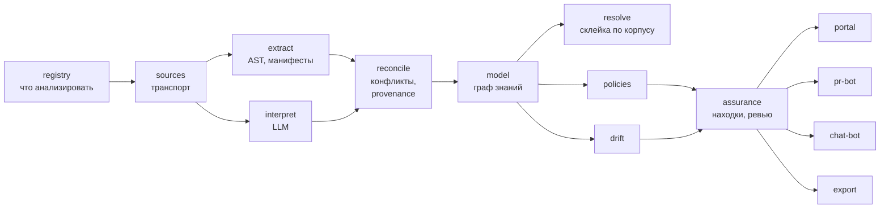

# Модули Archon

Заглавный документ системы. Здесь — что Archon делает и из каких частей
состоит. Детали каждого модуля — в его файле рядом; споры и открытые вопросы
— в [`../open-questions.md`](../open-questions.md); принятые решения — в
[`../../adr/`](../../adr/).

Декомпозиция: ревизия 1, принята в
[`ADR-0004`](../../adr/0004-module-decomposition-revision-1.md).

Продуктовый взгляд — что видит пользователь, а не как устроены внутренности — в
[`../product-overview.md`](../product-overview.md).

## Что видит пользователь (4 точки входа)

Шестнадцать модулей — это фабрика. Пользователь её не видит и трогает только
то, что она выдаёт:

- **портал** — карта, каталог, инбокс находок;
- **PR-бот** — коммент/гейт в MR;
- **чат-бот** — ответ с provenance (ссылкой на узел графа и строку в коде);
- **экспорт** — срез на дату для аудита вместо скриншотов месячной давности.

Вся остальная система — невидимые блоки за этими четырьмя.

## Как фабрика устроена: 5 блоков

На те же 16 модулей можно посмотреть двумя срезами: *слоями конвейера*
(Архитектура) и *блоками близости к пользователю* (Продукт). Оба верны;
блоками — удобнее рассказывать.

| Блок | Модули | Зачем живёт |
| :--- | :--- | :--- |
| Витрина | [`portal`](portal.md), [`pr-bot`](pr-bot.md), [`chat-bot`](chat-bot.md), [`export`](export.md) | показать результат там, где человек уже работает |
| Решение | [`assurance`](assurance.md) | находка рождается один раз (`обнаружена -> исправлена / риск принят / ложная тревога`) |
| Мозг | [`model`](model.md), [`resolve`](resolve.md), [`policies`](policies.md), [`drift`](drift.md) | единый граф + что не так |
| Фабрика | [`registry`](registry.md), [`sources`](sources.md), [`extract`](extract.md), [`interpret`](interpret.md), [`reconcile`](reconcile.md) | копать факты и решать, кто прав |
| Фундамент | [`runtime`](runtime.md), [`platform`](platform.md) | очереди, бюджеты, SSO/права/аудит |

Для MVP витрина = `portal` + `pr-bot`, герой-фича — `drift` ("доки врут —
вот пруф из кода").

## Как всё движется (на пальцах, 5 шагов)

Поток данных, на котором работают пять шагов ниже:

1. **Определяет, что анализировать.** Реестр репозиториев, привязки к
   продуктам и командам, словари — конфигурация конкретного клиента
   (`registry`). Доступ к внешнему миру — через коннекторы (`sources`).
2. **Извлекает факты.** Из кода двумя способами: детерминированно
   (`extract` — точно и дешево) и через LLM (`interpret` — понимает смысл,
   но дорого и может ошибаться). Противоречия двух контуров сводит
   `reconcile`, и именно там у факта рождается "кто это сказал".
3. **Хранит как единый граф.** `model` — одна версия правды о системе, с
   историей и ручными правками, которые не затираются перезапуском.
   `resolve` склеивает сущности между репозиториями и собирает landscape.
4. **Сверяет и находит проблемы.** `policies` ищет архитектурные аномалии,
   `drift` — противоречия документов и кода. Обе пишут находки в
   `assurance`, где человек их проверяет, принимает риск или отклоняет.
5. **Показывает результат там, где удобно.** Портал, бот в MR, бот в
   мессенджере, выгрузка отчётов.

Всё, что считает стоимость и расписание прогонов, — `runtime`; всё, что
относится к "это продаётся в enterprise" (SSO, права, аудит, тенанты), —
`platform`.

Ключевая идея: **человек не обязателен в каждом факте, но обязателен в
каждом решении.** Автоматика извлекает и сравнивает; вердикты, принятые
риски и ручные правки остаются за людьми и записаны в графе наравне с
фактами.

Читается слева направо. `assurance` принимает находки от `policies` и
`drift` и выставляет решения людям в `portal`; доверие к элементам графа
(`auto/reviewed/accepted`) — тоже её ответственность.

Слойная декомпозиция (срез по шагам конвейера, второй взгляд на те же 16
модулей):

| Слой | Модули | Ответ |
| :--- | :--- | :--- |
| Корпус | [`registry`](registry.md), [`sources`](sources.md) | что мы вообще знаем и как туда дотянуться |
| Извлечение | [`extract`](extract.md), [`interpret`](interpret.md), [`reconcile`](reconcile.md) | факты о системе и кто в них прав |
| Модель | [`model`](model.md), [`resolve`](resolve.md) | единый граф и склейка между репозиториями |
| Аналитика | [`policies`](policies.md), [`drift`](drift.md) | что не так |
| Доверие | [`assurance`](assurance.md) | что с этим решили люди |
| Доставка | [`portal`](portal.md), [`pr-bot`](pr-bot.md), [`chat-bot`](chat-bot.md), [`export`](export.md) | показать ответ в нужном месте |
| Инфраструктура | [`runtime`](runtime.md), [`platform`](platform.md) | чтобы работало, окупалось и продавалось |

## Статусы

| Модуль | Статус | Комментарий |
| :--- | :--- | :--- |
| `registry` | new | конфигурация корпуса не спроектирована |
| `sources` | spec | транспорт определён в ADR-0004; коннекторы существуют в archmap по-своему |
| `extract` | new | AST-контур не начинался |
| `interpret` | prototype | LLM-контур archmap — набросок, не продукт (см. [`../prototypes/archmap.md`](../prototypes/archmap.md)) |
| `reconcile` | new | концепт введён ревизией; до него конфликты LLM/AST решались "на глаз" |
| `model` | blocked | заложник OQ-2 (source of truth), не кодить до решения |
| `resolve` | new | самый сложный алгоритм продукта (OQ-7) |
| `policies` | new | набор правил не определён |
| `drift` | new | claims-модель не определена |
| `assurance` | new | концепт введён ревизией; ядро продуктовой идеи |
| `portal` | new | вьювер-предшественник есть в archmap; catalog стал секцией здесь |
| `pr-bot` | new | требует инкрементального `extract` |
| `chat-bot` | new | TiMe-бот archmap — прототип-предшественник |
| `export` | new | введён ревизией (F7: регуляторная отчётность) |
| `runtime` | new | в archmap роль играл n8n; бюджета стоимости никогда не было |
| `platform` | new | enterprise-обвязка, обязательна до первого внешнего клиента |

## Что уже существует: archmap

Отдельная категория — не модуль, а прототип-предшественник:
[`../prototypes/archmap.md`](../prototypes/archmap.md). Рабочий прототип
пайплайна (не продукт, никуда не развернут). Источник заготовок для
`interpret`, `sources`, `portal` и главный кандидат на переработку (OQ-1).
Отклонённый подход к каноническим ID (`shared/externals.c4`) — как раз дыра,
под которую в ревизии выделен `resolve`.

## Правила

- **Один модуль = один файл** по [`TEMPLATE.md`](TEMPLATE.md). Больше ~150
  строк — выносим детали рядом.
- **Модуль без строки в этом реестре не существует.**
- **Статусы:** `new`, `prototype`, `spec`, `in-build`, `stable`, `blocked`
  (есть блокер-вопрос).
- **Люди за модулями не закрепляются** (ADR-0004, решение 4): состав команды
  меняется, архитектура — нет. В файле модуля указана нужная компетенция, если
  это вообще что-то упрощает.
- **Проектные решения — только в ADR.** Файл модуля описывает состояние, не
  споры.
- **Логический модуль ≠ сервис.** Сколько процессов реально крутится — OQ-8;
  MVP обязан собираться из 2-3 сборочных единиц.

## Чего в реестре нет (осознанно, пока)

- **CLI.** В черновой слоистой диаграмме CLI числился каналом доставки. В
  ревизии его нет, и это не забывчивость, а вопрос: CLI как пятый канал vs
  CLI как способ поставки всего продукта (модель "CLI-first" из пре-ресерча
  и OQ-10). Ответ зависит от OQ-10; до него канал не вводим.
- **Каталог как отдельный модуль** — стал секцией `portal` (дефолт OQ-17);
  вернётся, если вырастет в публичный API сервис-реестра.

## С чего начать чтение

1. [`model.md`](model.md) — ядро, и главный нерешённый вопрос продукта (OQ-2).
2. [`reconcile.md`](reconcile.md) + [`assurance.md`](assurance.md) — то, что
   отличает Archon от генератора картинок.
3. [`resolve.md`](resolve.md) — самый сложный алгоритм.
