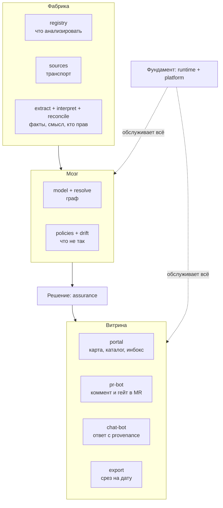

# Продуктовый взгляд на Archon

> Черновик. Этот документ отвечает на вопрос "что видит пользователь". 
> Как всё устроено внутри — читай в [`modules/README.md`](modules/README.md).

## Что такое Archon простыми словами

Представь, что у компании есть код сервисов и документация к ним. Со временем код меняется, а документы забывают обновлять. В итоге документы врут: написано, что сервис A вызывает сервис B, а на самом деле уже давно наоборот.

**Archon — это платформа, которая сама проверяет, совпадают ли документы с реальным кодом.** Она читает код, смотрит документы и говорит: "Вот здесь у вас в доках написано одно, а в коде происходит другое".

## Пользователь видит 4 точки входа, а не 16 модулей

Внутри Archon 16 модулей — это как детали в моторе машины. Но водитель не трогает мотор напрямую. Он видит только руль, педали и приборную панель.

В Archon таких "приборов" четыре:

### 1. Портал (веб-сайт)

Открываешь в браузере, видишь:

- **Карту архитектуры** — диаграммы сервисов и связей между ними. Рисуются автоматически из кода, а не руками в Lucidchart.
- **Каталог сервисов** — список всех сервисов: кто владелец, от кого зависит, какие API.
- **Список проблем** — где документы не совпадают с кодом, какие правила нарушены. Каждая проблема — с доказательством из кода.
- **Оценку зрелости** — как со временем меняется качество документации и кода.

### 2. Бот в Git (комментирует PR)

Разработчик создал Pull Request (предлагает изменения в коде). Archon сам проверяет PR и пишет комментарий:

> "Этот PR меняет связь между сервисами `payments` и `billing`, но документ `docs/payments.md` всё ещё описывает старую схему. Обнови документ перед мержем."

Можно настроить: бот будет просто предупреждать или жёстко блокировать мерж до исправления.

### 3. Чат-бот (в мессенджере)

Пишешь боту в Slack/Teams: "Кто отвечает за платежи?" — бот отвечает и указывает, откуда взял информацию (конкретный файл, строка кода). Не просто "поиск по тексту", а ответ на основе графа связей, который Archon сам построил.

Если бот не уверен в ответе, он честно скажет "уверенность низкая".

### 4. Экспорт (отчёты)

Кнопка "выгрузить отчёт на сегодня". Получаешь PDF или JSON — снимок всей архитектуры на конкретную дату. Нужно для аудиторов, руководства, регуляторов. Вместо того чтобы делать скриншоты вручную.

## Что происходит внутри: 5 блоков

Внутри 16 модулей сгруппированы в 5 блоков по принципу "насколько близко к пользователю":

| Блок | Что делает | Пользователь видит? |
| :--- | :--- | :--- |
| **Витрина** | Показывает результат в удобном виде: портал, бот в Git, чат-бот, экспорт | Да, только это |
| **Решение** | Следит за жизненным циклом каждой проблемы: обнаружена → исправлена / риск принят / ложная тревога | Видит статусы проблем |
| **Мозг** | Строит граф связей из кода и документов, ищет что не так | Нет, видит только следствия |
| **Фабрика** | Читает код, документы, разбирается в конфликтах между источниками | Нет |
| **Фундамент** | Очереди задач, права доступа, аудит, SSO (без этого не продать в enterprise) | Нет |

Есть два способа посмотреть на эти 16 модулей:
- **Блоками** (как выше) — удобно для разговора о продукте.
- **Слоями конвейера** — удобно для разговора об архитектуре (см. [`modules/README.md`](modules/README.md)).

Оба способа описывают одно и то же, просто с разных сторон.

## Диаграмма продукта (снизу вверх)

Читается снизу вверх: фабрика копает факты, мозг складывает их в граф и
проверяет, решение фиксирует вердикт человека, витрина показывает его там,
где удобно. Фундамент под всеми.

## Как это выглядит в реальной жизни

**Утро, архитектор:**
Открывает портал, видит 3 проблемы, которые система нашла ночью. Две исправляет сразу, одну помечает "мы знаем об этом, риск принят" — больше система её не показывает.

**День, разработчик:**
Создаёт PR с изменением кода. Бот пишет комментарий: "Ты поменял код, а документ `docs/payments.md` всё ещё описывает старое". Разработчик тут же правит документ в том же PR.

**Вечер, тимлид:**
Пишет боту в Slack: "Кто трогал сервис `billing` за последний месяц?" — получает ответ со ссылками на коммиты и людей.

**Через квартал, для аудита:**
Нажимает "экспорт", получает PDF с полным снимком архитектуры на эту дату. Никаких ручных скриншотов.

## Что делаем сначала (MVP)

**MVP** — Minimum Viable Product, минимальная версия для первых пользователей.

Делаем:
- Портал и бот в Git (чат-бот и экспорт — потом).
- Главную фичу: показываем, где документы не совпадают с кодом, с доказательствами.
- Фабрику и мозг — только то, что нужно для главной фичи, на одном репозитории.

## Роли и точки входа

| Роль | Основная точка входа | Что получает |
| :--- | :--- | :--- |
| Архитектор | портал + экспорт | карта, инбокс, срез на дату |
| Разработчик | pr-bot + чат | комментарий в MR, быстрые ответы |
| Тимлид/менеджмент | портал | зрелость, динамика дрейфа |
| Безопасность/аудит | экспорт + портал | пруфы, история решений |
| Новичок | портал + чат | онбординг по актуальному графу |

## Чем Archon НЕ является

Важно понимать границы:

- **Не фреймворк типа Backstage.** Пользователю не надо писать код, чтобы начать работать с Archon.
- **Не замена Confluence.** Archon работает только с архитектурной документацией (описания сервисов, схемы связей). Общие статьи, заметки, HR-политики — это не для нас.
- **Не просто "поиск по документам".** Чат-бот работает не как Google по файлам, а отвечает на основе графа связей, который система сама построила.
- **Не редактор диаграмм.** Диаграммы не рисуются руками, а генерируются из кода автоматически.
