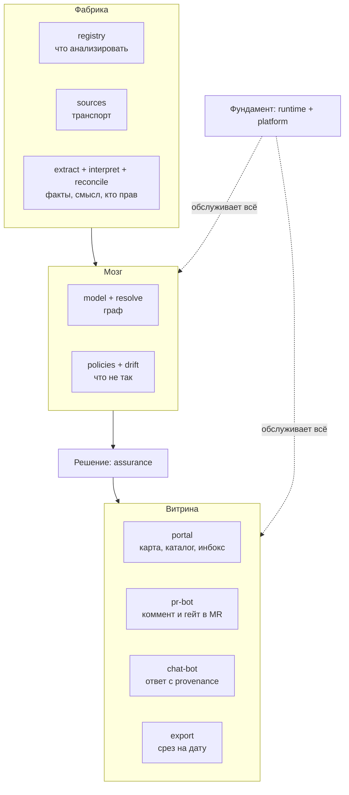

# Продуктовый взгляд на Archon

> Черновик. Это ответ на вопрос "что видит пользователь", а не "как
> устроено внутри". Технический разрез — в [`modules/README.md`](modules/README.md);
> этот документ не заменяет его, а дополняет.

## Archon для пользователя — это 4 точки входа, а не 16 модулей

16 модулей — это фабрика. Пользователь имеет дело только с тем, что она
выдаёт наружу. Если рассказывать продукт в одном предложении: **Archon сам
читает код и документы, строит из них граф и сам находит, где доки врут,
— а человек это решение видит там, где уже работает.**

### Точка 1. Портал (веб)

То, что открывается в браузере. Заменяет связку
"конфлюенс + люсидчарт + табличка сервисов в нотайон":

- **карта архитектуры** — C4/landscape, но не нарисованная вручную, а
  собранная из графа (актуальность — дата последнего прогона);
- **каталог сервисов** — кто владеет, чем зависит, какие контракты;
- **инбокс находок** — где доки врут, какие политики нарушены, с
  пруфами из кода;
- **зрелость** — скоркарды по политикам, динамика дрейфа.

### Точка 2. PR-бот (в Git)

Разработчик открывает MR/PR — Archon комментирует сам:

> Этот PR меняет зависимость `payments -> billing`, а `docs/payments.md`
> всё ещё утверждает обратное. Политика `no-shared-db` нарушена.

По настройке — подсказка или жёсткий гейт (не смержить без решения
находки). Единственная точка входа, которую разработчик трогает каждый
день, поэтому ей нужен особый контроль качества сообщений (см. `pr-bot`).

### Точка 3. Чат-бот (мессенджер)

Вопрос "@архон, кто отвечает за платежи и где их данные?" — ответ со
ссылкой на узел графа и на конкретную строку кода, откуда взят. Не
"поиск по документам", а **ответ из графа с provenance**. Если ответ
взят с низкой уверенностью — бот обязан это сказать.

### Точка 4. Экспорт (отчётность)

Срез архитектуры на дату для аудита, регуляторов, борда. Кнопка
"выгрузить PDF/JSON" — вместо скриншотов месячной давности.

## Что за точками входа: 5 блоков

| Блок | Модули | Зачем живёт | Пользователь видит? |
| :--- | :--- | :--- | :--- |
| Витрина | `portal`, `pr-bot`, `chat-bot`, `export` | показать результат там, где человек уже работает | да, только её |
| Решение | `assurance` | находка живёт одна жизнь: `обнаружена -> исправлена / риск принят / ложная тревога` | видит решения и статусы |
| Мозг | `model`, `resolve`, `policies`, `drift` | единый граф + что в нём не так | нет, видит следствия |
| Фабрика | `registry`, `sources`, `extract`, `interpret`, `reconcile` | копать факты из кода и доков, разрешать конфликты источников | нет |
| Фундамент | `runtime`, `platform` | очереди, бюджеты прогонов, SSO, права, аудит | нет, но без него не продаётся |

Техническая слоистая декомпозиция (Корпус/Извлечение/Модель/Аналитика/
Доверие/Доставка/Инфраструктура) — тот же набор из 16 модулей, но срезанный
по шагам конвейера, а не по близости к пользователю. Оба среза верны;
блоками удобнее говорить о продукте, слоями — об архитектуре.

## Диаграмма продукта (снизу вверх)

Читается снизу вверх: фабрика копает факты, мозг складывает их в граф и
проверяет, решение фиксирует вердикт человека, витрина показывает его там,
где удобно. Фундамент под всеми.

## Типичный день (чтобы не было абстракции)

- Архитектор утром открывает портал: в инбоксе 3 находки от ночного
  прогона — две фиксит, одну помечает "риск принят" (пишется в граф).
- Разработчик в обед открывает MR: бот пишет, что правка дрейфует
  `docs/payments.md`; разработчик правит документ в том же MR.
- Тимлид вечером спрашивает в чате, кто трогает сервис `billing`, —
  получает ответ с источником факта.
- Через квартал: кнопка "экспорт" — срез для аудита на дату, не
  ручной скриншот.

## Что входит в MVP

- Витрина: `portal` + `pr-bot` (остальные каналы добавляются потом,
  `assurance` их развязывает).
- Герой-фича — `drift`: "доки врут — вот пруф из кода". Её и продаём.
- Фабрика и мозг — минимально достаточные для героя на одном корпусе репо.

## Роли и точки входа

| Роль | Основная точка входа | Что получает |
| :--- | :--- | :--- |
| Архитектор | портал + экспорт | карта, инбокс, срез на дату |
| Разработчик | pr-bot + чат | комментарий в MR, быстрые ответы |
| Тимлид/менеджмент | портал | зрелость, динамика дрейфа |
| Безопасность/аудит | экспорт + портал | пруфы, история решений |
| Новичок | портал + чат | онбординг по актуальному графу |

## Чем Archon не является (границы)

- Не фреймворк для портала (не Бэкстейдж) — пользователь не пишет код,
  чтобы пользоваться.
- Не замена конфлюенса/вики как хранилища любых текстов — только
  архитектурная и сервисная документация в связке с кодом.
- Не "ещё один чат по документам" — чат ценен только как интерфейс к
  графу с provenance.
- Не генератор картинок — диаграмма есть проекция графа, а не предмет
  рисования руками.
