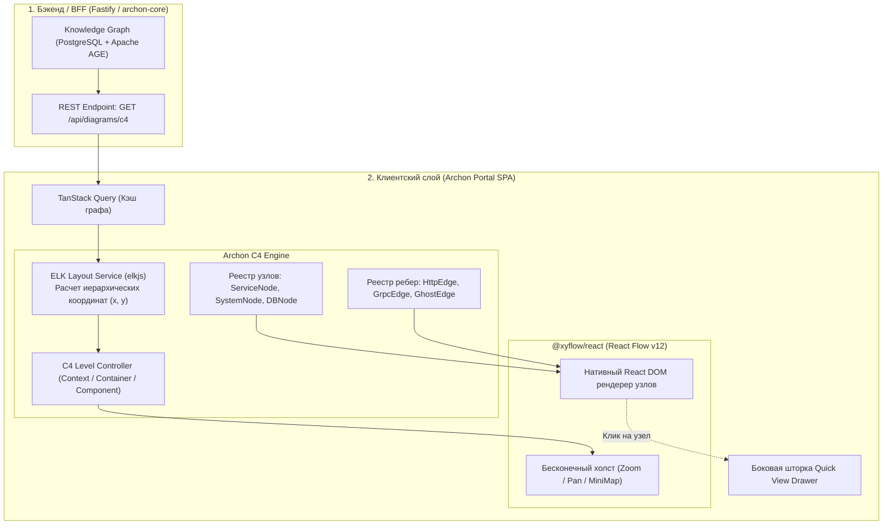

# RFC: Интерактивный архитектурный холст на базе React Flow (Architecture Canvas on React Flow)

> **Статус:** Proposed (На обсуждении)  
> **Инициаторы:** Команда разработки веб-витрины (Portal UI & BFF)  
> **Дата:** 2026-11-01  
> **Целевые задачи:** [ARCH-42: Интерактивная архитектурная карта](https://github.com/teamv39/archon/issues/8), [ARCH-40: Паспорт сервиса](https://github.com/teamv39/archon/issues/6), [ARCH-46: BFF агрегация данных](https://github.com/teamv39/archon/issues/12)  
> **Связанные документы:** [ТЗ 04: Архитектурная карта](../design/04-architecture-map.md), [ТЗ 02: Паспорт сервиса](../design/02-service-passport.md), [Tech Stack Proposal](tech-stack.md), [ADR-0002](../adr/0002-archmap-fate.md), [ADR-0007](../adr/0007-saas-process-topology-and-packaging.md).

---

## 1. Резюме предложения

Предлагается заменить запланированную библиотеку визуализации диаграмм `@likec4/diagrams` на связку **`@xyflow/react` (React Flow v12) + `elkjs` (Eclipse Layout Kernel)** в качестве графического движка архитектурной витрины Archon (экран `/architecture` и интерактивный C4-виджет в паспорте сервиса `/services/:id`).

В рамках данного перехода:
1. **Отказываемся от идеи форка React Flow.** Сам пакет `@xyflow/react` подключается как чистая upstream-зависимость. Необходимый для платформы функционал (семантика C4, авто-раскладка, визуализация дрейфа) реализуется в виде модульного слоя расширения (`C4CanvasEngine`) поверх стандартных интерфейсов React Flow (`nodeTypes`, `edgeTypes`, hooks).
2. **Устраняем трансляцию в DSL.** Отменяется необходимость компиляции графа в промежуточный синтаксис LikeC4 (`.c4`) на стороне BFF/бэкенда. BFF отдает клиенту структурированный JSON-граф `{ nodes, edges }`, извлеченный напрямую из Knowledge Graph (PostgreSQL + Apache AGE).
3. **Получаем 100% контроль над визуализацией узлов.** Узлы и ребра реализуются как нативные React-компоненты на Tailwind CSS и shadcn/ui в строгом соответствии с дизайн-системой Archon в Figma, включая бейджи расхождений Zero Drift, индикаторы Tier, отображение незадокументированных вызовов (Ghost Dependencies) и бесшовный вызов боковой шторки Quick View Drawer.

---

## 2. Контекст и проблемы текущего решения (LikeC4)

На ранних этапах проекта и в исследовательском прототипе `archmap` использование LikeC4 рассматривалось как быстрый способ получить интерактивные диаграммы в нотации C4 Model без разработки собственного холста с нуля.

Однако в ходе проектирования витрины (спринты 1–2) и детализации требований [ТЗ 04](../design/04-architecture-map.md) выявился ряд критических ограничений LikeC4:

### 2.1. Закрытый рендерер и невозможность кастомизации под продуктовые задачи
Archon — это не статическая wiki и не классический инструмент визуализации архитектуры. Ключевая ценность платформы — **Zero Drift (устранение расхождений между кодом и документацией)**.
* На карте архитектуры узел микросервиса должен отображать оперативное состояние: пульсирующий индикатор активного дрейфа (например, `! 2`), бейдж критичности (`Tier-1`), стек технологий, аватар ответственной команды и триггер открытия контекстной шторки (Drawer).
* В `@likec4/diagrams` внутренний рендеринг узлов закрыт. Внедрение произвольного React-дерева в узел графа либо крайне ограничено, либо требует хрупких обходных путей (DOM-инъекции, кастомный canvas overlay). Реализовать утвержденные в Figma макеты экранов в рамках LikeC4 практически невозможно.

### 2.2. Несоответствие динамике ребер: Ghost Dependencies
По ТЗ 04, если в коде обнаружен фактический вызов между сервисами, который отсутствует в зафиксированной архитектуре (Ghost Dependency), связь должна отображаться контрастным пунктиром с предупреждением и тултипом доказательств (Evidence). В LikeC4 модель связей жестко завязана на валидный DSL, где добавление динамических стилей и интерактивных оверлеев на ребра сопряжено со значительными ограничениями.

### 2.3. Лишний трансляционный слой на бэкенде
Для работы `@likec4/diagrams` требовалось:
1. Запросить граф из базы данных.
2. Сериализовать граф в DSL-код LikeC4 (`.c4`).
3. Запустить компилятор LikeC4 (в Node.js/CLI или WASM), чтобы рассчитать геометрию и получить итоговый бандл.
4. Передать бандл на фронтенд.

Этот конвейер вносит лишнюю задержку, усложняет BFF-сервис (`archon-core-service` / BFF) и порождает дублирование моделей данных.

### 2.4. Риски версионирования и размера бандла
В отчетах команды портала зафиксированы риски несовместимости зависимостей LikeC4 с актуальными версиями React 18/19 и экосистемой Vite/Tailwind, а также высокий вес компилятора в клиентской сборке.

---

## 3. Архитектура предлагаемого решения: React Flow v12 + ELK

Вместо монолитного инструмента визуализации предлагается модульная архитектура из трех независимых компонентов:
1. **Базовый холст:** `@xyflow/react` (React Flow v12) — отвечает за бесконечный холст, жесты, панорамирование, масштабирование, миникарту и виртуализацию видимых элементов.
2. **Движок авто-раскладки:** `elkjs` (Eclipse Layout Kernel) — производит автоматический расчет координат `(x, y)` узлов и ортогональную трассировку ребер без взаимных наложений.
3. **Продуктовый слой Archon (`C4CanvasEngine`):** набор кастомных узлов, типов связей и машина состояний навигации по уровням C4.



---

## 4. Почему форк React Flow не нужен (Why NOT Fork)

Идея форка базового репозитория `@xyflow/react` была рассмотрена и отклонена по следующим причинам:

1. **Maintenance Trap (Ловушка сопровождения):** Форк публичной библиотеки требует постоянного ручного мержа изменений апстрима: оптимизаций производительности рендера больших графов, правок обработки колеса мыши и тачпадов, адаптации под мажорные релизы React. Это неоправданная трата ресурсов команды.
2. **Unopinionated Архитектура React Flow:** Библиотека не навязывает стили или структуру данных. Все необходимые точки расширения уже присутствуют в штатном API:
   - Свой UI карточки узла декларируется через компонент, регистрируемый в словаре `nodeTypes`.
   - Своя линия связи декларируется через компонент с кастомным SVG path в словаре `edgeTypes`.
   - Обработка кликов, наведений и выделения работает через стандартные хуки и колбэки (`onNodeClick`, `onPaneClick`, `useReactFlow`).
3. **Решение:** Пакет `@xyflow/react` подключается как обычная зависимость из `npm`. Вся кастомная функциональность оформляется в локальный модуль витрины: `src/features/architecture-map/canvas/`.

---

## 5. Детали реализации продуктового слоя

### 5.1. Автоматическая раскладка через `elkjs`
React Flow не вычисляет координаты сам, требуя явных значений `position: { x, y }`. Для нотации C4 критически важна читаемая раскладка с группировкой (контейнеры внутри систем) и направленными стрелками вызовов.

Для этого подключается библиотека `elkjs` (Eclipse Layout Kernel):
* Алгоритм: `elk.layered` (Layered / Sugiyama-style layout) — отраслевой стандарт для диаграмм архитектуры и потоков данных.
* Настройки: автоматический расчет отступов между иерархическими контейнерами (`org.eclipse.elk.spacing.nodeNode`), ортогональная маршрутизация ребер (`org.eclipse.elk.edgeRouting: ORTHOGONAL`), маршрутизация портов с четырех сторон узла.
* Выполнение: расчет координат происходит на клиенте за 10–30 мс для графов до 200 узлов. Для сверхбольших топологий расчет может кэшироваться в TanStack Query или предварительно рассчитываться на BFF.

### 5.2. Кастомные типы узлов (`nodeTypes`)
Разрабатывается библиотека компонентов, оформленная строго по UI-Kit в Figma:
1. **`ServiceNode` (основной рабочий узел):**
   - Заголовок: системное имя микросервиса.
   - Метаданные: бейдж критичности (`Tier-1`), иконка основного рантайма (Kotlin, Go, Python), стек персистентности (Postgres, Redis).
   - **Индикатор Zero Drift:**
     - `In Sync`: нейтральный зеленый/серый статус.
     - `Drift Detected`: заметный бейдж со счетчиком расхождений (например, `! 2`), анимацией пульсации и кнопкой быстрого перехода к списку находок.
   - Интерактивность: ховер подсвечивает входящие и исходящие связи; клик открывает боковую шторку Quick View Drawer.
2. **`DatabaseNode` / `QueueNode`:** компактные специализированные карточки хранилищ и брокеров сообщений.
3. **`GroupNode` / `SystemNode`:** полупрозрачный контейнер C4, объединяющий сервисы одного домена или одной подсистемы с возможностью визуального схлопывания.

### 5.3. Кастомные типы связей (`edgeTypes`)
1. **`StandardDependencyEdge`:**
   - Стилизованная плавная или ортогональная линия.
   - Лейбл протокола по центру связи: `HTTP`, `gRPC`, `Kafka`.
   - Интерактивный тултип при наведении со списком обнаруженных эндпоинтов / топиков.
2. **`GhostDependencyEdge` (Связь-призрак):**
   - Вызов обнаружен в AST кода или трейсах, но не описан в документации.
   - Рендерится красным анимированным пунктиром с предупреждающим маркером по центру. Клик открывает модальное окно верификации доказательств (Evidence Review).

### 5.4. Навигация по уровням C4 (Drill-Down)
Реализуется через переключение срезов графа:
* **Уровень 1 (System Context):** внешние акторы, внешние системы и крупные доменные блоки Archon.
* **Уровень 2 (Containers / Сервисы — основной экран):** микросервисы, базы данных, очереди сообщений.
* **Уровень 3 (Components):** модули и ключевые контроллеры выбранного сервиса (открывается при двойном клике на сервис или из паспорта).
При переключении уровня клиент запрашивает соответствующий срез, прогоняет через `elkjs` и плавно перемещает камеру через `reactFlowInstance.fitView({ duration: 600 })`.

---

## 6. Контракт данных BFF (Упрощенный JSON API)

Вместо генерации DSL LikeC4 контракт BFF (`/api/diagrams/c4`) сводится к чистому JSON:

```json
{
  "viewId": "containers-overview",
  "level": "container",
  "nodes": [
    {
      "id": "billing-service",
      "type": "service",
      "data": {
        "title": "billing-service",
        "tier": "Tier-1",
        "domain": "Payments",
        "techStack": ["Kotlin", "PostgreSQL"],
        "driftCount": 2,
        "status": "drift_detected"
      }
    },
    {
      "id": "orders-db",
      "type": "database",
      "data": {
        "title": "orders-db",
        "tier": "Tier-1",
        "engine": "PostgreSQL 16",
        "driftCount": 0,
        "status": "in_sync"
      }
    }
  ],
  "edges": [
    {
      "id": "billing-to-db",
      "source": "billing-service",
      "target": "orders-db",
      "type": "dependency",
      "data": {
        "protocol": "PostgreSQL Wire",
        "isGhost": false,
        "evidenceFiles": ["src/main/resources/application.yml"]
      }
    },
    {
      "id": "billing-to-auth-ghost",
      "source": "billing-service",
      "target": "auth-service",
      "type": "ghost",
      "data": {
        "protocol": "gRPC",
        "isGhost": true,
        "description": "Незадокументированный вызов AuthService/ValidateToken",
        "evidenceFiles": ["src/main/kotlin/client/AuthClient.kt:42"]
      }
    }
  ]
}
```

Бэкенд выполняет только выборку из графа и свертку (агрегацию) связей для запрошенного уровня C4. Расчет координат узлов делегируется клиенту.

---

## 7. Сравнение подходов

| Параметр | Исходный вариант: LikeC4 | Вариант 1: Форк React Flow | Вариант 2: `@xyflow/react` + `elkjs` (Предлагается) |
| :--- | :--- | :--- | :--- |
| **Кастомизация узлов (Figma)** | Жесткие ограничения | Полная свобода | Полная свобода (нативный React/Tailwind) |
| **Отображение Zero Drift статусов** | Почти невозможно без костылей | Полная поддержка | Полная поддержка (бейджи, анимации, тултипы) |
| **Стоимость поддержки платформы** | Низкая (библиотека "всё-в-одном") | **Критически высокая** (поддержка чужого форка) | **Низкая** (стандартный npm-пакет + свой UI-слой) |
| **Сложность BFF-пайплайна** | Высокая (трансляция в `.c4`, запуск CLI) | Низкая (чистый JSON) | Низкая (чистый JSON) |
| **Авто-раскладка (Layout)** | Из коробки (встроенная) | Требуется настройка | Решается интеграцией с `elkjs` (~100 строк кода) |
| **Совместимость с React 18/19** | Риски несовместимости версий | Зависит от команды Archon | Официальная поддержка upstream |

---

## 8. План внедрения и оценка трудозатрат

1. **Технический спайк (PoC) — 1–2 дня:**
   - Подключение `@xyflow/react` и `elkjs` в ветке витрины.
   - Проверка алгоритма `elk.layered` на синтетическом графе из 30 микросервисов со связями.
   - Проверка плавности перемещения камеры (`fitView`) и производительности раскладки.
2. **Разработка UI-узлов по Figma (`ARCH-42`) — 2–3 дня:**
   - Компонент `ServiceNode` с бейджами дрейфа и поддержкой состояний `In Sync` / `Drift Detected`.
   - Компоненты `DatabaseNode`, `QueueNode`.
   - Ребра `StandardEdge` и `GhostEdge` (пунктир незадокументированного вызова).
   - Интеграция с боковой шторкой Quick View Drawer.
3. **Адаптация BFF (`ARCH-46`) — 1 день:**
   - Реализация DTO `/api/diagrams/c4` (отказ от сборки LikeC4 бандлов, выдача чистого JSON).
4. **Виджет паспорта сервиса (`ARCH-40`) — 1 день:**
   - Встраивание разработанного компонента холста в режим «1-hop окружение сервиса» с фиксированным размером.

**Итого:** Переход не увеличивает плановые сроки спринта по задаче `ARCH-42`, так как время на настройку `elkjs` с лихвой компенсируется отказом от отладки транслятора LikeC4 DSL на бэкенде и обхода стилей в `@likec4/diagrams`.

---

## 9. Открытые вопросы для обсуждения

1. **Где хранить ручные корректировки координат (если потребуются):**
   - Нужна ли пользователю возможность вручную подвинуть узел и сохранить его позицию, или раскладка всегда строго детерминированная через `elkjs`?
   - *Рекомендация:* На этапе MVP раскладка строго автоматическая (детерминированная от топологии графа). Ручное перетаскивание доступно только локально во время сессии без персистентности на сервере.
2. **Кэширование раскладки больших графов:**
   - Стоит ли кэшировать вычисленные `elkjs` координаты в браузере (через `IndexedDB` / TanStack Query) для ускорения повторного открытия карты?
   - *Рекомендация:* Да, кэшировать по ключу `hash(graphRevision + level)`. При неизменности топологии раскладка отображается мгновенно.
