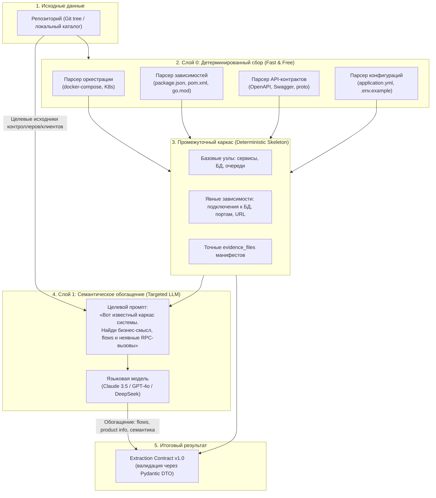

# RFC: Гибридный контур анализа репозиториев (Hybrid Analysis Pipeline)

> **Статус:** Draft / In Discussion  
> **Авторы:** Денис (@ischademadda), Михаил (@vocisy)  
> **Связанные документы:** [ADR-0002](../adr/0002-archmap-fate.md), [ADR-0004](../adr/0004-module-decomposition-revision-1.md), [Extraction Contract v1.0](contracts/extraction-v1.json), [Веха Code-to-Architecture](code-to-architecture.md).

---

## 1. Контекст и мотивация

В раннем прототипе `archmap` анализ репозитория выполнялся «в лоб» через языковую модель:
1. Полный список путей файлов скармливался в LLM (селектор) через промпт на 25 КБ.
2. Отобранные 15–20 файлов отправлялись в другой гигантский промпт (экстрактор на 50 КБ) в надежде, что модель «догадается» об архитектуре всего проекта.

### Почему этот подход был временным костылем:
* **Неоправданная дороговизна и латентность:** передача сотен путей и десятков файлов в тяжелые модели стоит дорого и занимает десятки секунд на каждый прогон.
* **Слепые зоны селектора:** селектор файлов, анализируя только имена путей, часто пропускал критичные связующие файлы (конфигурации, клиенты, скрытые в неочевидных папках).
* **Галлюцинации и пропуски очевидного:** LLM пыталась угадать базы данных и брокеры сообщений по импортам кода, игнорируя лежащие рядом `docker-compose.yml` или конфигурационные манифесты.
* **Отсутствие опоры на детерминированные факты:** модель решала задачу, которую парсер за 5 миллисекунд решает со 100% точностью и нулевой стоимостью.

Цель данного RFC — спроектировать **современный гибридный пайплайн**, объединяющий быстрый детерминированный синтаксический анализ (`extract`) и точечный семантический LLM-анализ (`interpret`).

---

## 2. Ключевая концепция: Детерминированный каркас + Семантическое обогащение

До 80% архитектурных фактов о контейнерах, инфраструктуре и внешних интеграциях уже явно зафиксированы в репозитории:
* Файлы оркестрации: `docker-compose.yml`, Helm-чарты, K8s манифесты.
* Манифесты пакетов: `package.json`, `pom.xml`, `build.gradle`, `go.mod`, `requirements.txt`.
* Спецификации контрактов: `openapi.yaml`, `swagger.json`, `*.proto`.
* Конфигурации окружения: `application.yml`, `config.json`, `.env.example`.

Эти факты должны извлекаться **детерминированно (без LLM)**, формируя гарантированный «скелет» архитектуры. Языковая модель подключается только на втором этапе для решения задач, где статический анализ бессилен.

---

## 3. Трехуровневая архитектура пайплайна

### Слой 0: Детерминированный сборщик (модуль `extract`)
1. **Поиск сервисов и топологии запуска:**
   - Читает `docker-compose.yml`: имена сервисов, образы, проброшенные порты, секции `depends_on`, ссылки на базы данных (postgres, mysql, redis, mongo) и брокеры (kafka, rabbitmq).
2. **Анализ стека и библиотек:**
   - Читает манифесты зависимостей: определяет используемые фреймворки (Spring Boot, NestJS, FastAPI, Chi, Express), HTTP/gRPC-клиенты и драйверы БД.
3. **Экспорт эндпоинтов и контрактов:**
   - Читает OpenAPI / Swagger спецификации, формируя список публичных интерфейсов сервиса.
4. **Результат Слоя 0:**
   - Список сущностей `Container` (`kind`: service, database, queue, cache) с точными `evidence_files` (строки в `docker-compose` и манифестах).
   - Список гарантированных связей `relationships` (например, сервис -> postgres).

### Слой 1: Точечный семантический интерпретатор (модуль `interpret`)
LLM вызывается **не на весь репозиторий вслепую**, а получает на вход:
1. Уже известный каркас из Слоя 0 (список сервисов, баз данных и явных связей).
2. Текст `README.md` (для извлечения `product.name`, `business_description`, команды).
3. Содержимое только тех файлов, где описана бизнес-логика и клиентские вызовы (роуты, обработчики запросов, вызовы внешних систем).

**Задачи LLM на этом шаге:**
* Сформулировать понятное человеку бизнес-назначение сервиса (`Product` / `Container.description`).
* Восстановить цепочки сквозных бизнес-сценариев (`flows`: шаг за шагом, от кого кому и какое действие).
* Найти неявные межсервисные вызовы (HTTP-вызовы к другим сервисам по URL/конфигам).
* Сформулировать сомнения в массив `uncertainties`.

---

## 4. Сравнение подходов

| Параметр | Легаси-подход (archmap dump) | Целевой гибридный подход |
| :--- | :--- | :--- |
| **Стоимость анализа** | Высокая (все файлы и пути идут в LLM) | Минимальная (80% фактов извлекается бесплатно) |
| **Время работы** | 30–60+ секунд | 2–5 секунд (детерминированная часть) + один короткий вызов LLM |
| **Точность контейнеров/БД** | Вероятностная (может не заметить БД в коде) | 100% детерминированная (из docker-compose/манифестов) |
| **Evidence files** | Часто размытые или галлюцинированные | Строгие ссылки на реальные манифесты и строки конфигов |
| **Сложность поддержки** | 80 КБ хрупких промптов с инструкциями | Модульный парсер + компактный промпт обогащения |

---

## 5. Вопросы для исследования и проработки (Зона ответственности Миши)

В рамках совместной работы над RFC и следующего PoC Мише предстоит исследовать:

1. **Инструменты парсинга Слоя 0 (Python):**
   - Какие легковесные библиотеки использовать для разбора:
     - `docker-compose.yml` (PyYAML / специализированные парсеры compose-спецификаций);
     - OpenAPI / Swagger (`prance`, `openapi-spec-validator` или чистый yaml/json парсинг);
     - Манифестов (`package.json`, `pom.xml` через xml.etree, `go.mod`).
2. **Стратегия обнаружения файлов (Discovery):**
   - Как надежно находить манифесты в монорепозиториях и полирепозиториях без перебора лишних директорий (`.git`, `node_modules`, `build`, `target`).
3. **Формат объединения (Reconciliation):**
   - Как объединять детерминированные сущности Слоя 0 с ответом LLM из Слоя 1, чтобы LLM не перетирала проверенные факты, а только дополняла их (`flows`, описания).

---

## 6. План внедрения

1. **Этап 1 (ARCH-35, текущая задача):** Финализация настоящего RFC, согласование интерфейса каркаса Слоя 0.
2. **Этап 2 (ARCH-53, следующая задача):** Практический PoC детерминированного экстрактора `scripts/spikes/manifest_extractor.py` на эталонном репозитории.
3. **Этап 3 (ARCH-36):** Бенчмарк гибридного пайплайна: замер точности, времени и токеномики по сравнению с чистым LLM.
