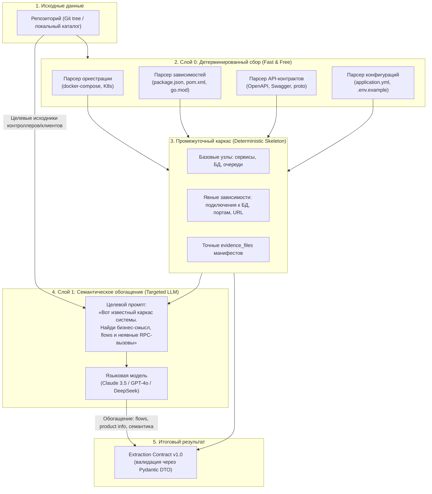

# RFC: Гибридный контур анализа репозиториев (Hybrid Analysis Pipeline)

> **Статус:** Accepted  
> **Авторы:** Денис (@ischademadda), Михаил (@vocisy)  
> **Дата принятия:** 2026-10-10  
> **Связанные документы:** [ADR-0002](../adr/0002-archmap-fate.md), [ADR-0004](../adr/0004-module-decomposition-revision-1.md), [Extraction Contract v1.0](contracts/extraction-v1.json), [Веха Code-to-Architecture](code-to-architecture.md).

---

## 1. Контекст и мотивация

В раннем прототипе `archmap` анализ репозитория выполнялся «в лоб» через языковую модель:
1. Полный список путей файлов скармливался в LLM (селектор) через промпт на 25 КБ.
2. Отобранные 15–20 файлов отправлялись в другой гигантский промпт (экстрактор на 50 КБ) в надежде, что модель «догадается» об архитектуре всего проекта.

### Почему этот подход был временным костылем:
* **Неоправданная дороговизна и латентность:** передача сотен путей и десятков файлов в тяжелые модели стоит дорого и занимает десятки секунд на каждый прогон.
* **Слепые зоны селектора:** селектор файлов, анализируя только имена путей, часто пропускал критичные связующие файлы (конфигурации, клиенты, скрытые в неочевидных папках).
* **Галлюцинации и пропуски очевидного:** LLM пыталась угадать базы данных и брокеры сообщений по импортам кода, игнорируя лежащие рядом `docker-compose.yml` или конфигурационные манифесты.
* **Отсутствие опоры на детерминированные факты:** модель решала задачу, которую парсер за 5 миллисекунд решает со 100% точностью и нулевой стоимостью.

Цель данного RFC — спроектировать **современный гибридный пайплайн**, объединяющий быстрый детерминированный синтаксический анализ (`extract`) и точечный семантический LLM-анализ (`interpret`).

---

## 2. Ключевая концепция: Детерминированный каркас + Семантическое обогащение

До 80% архитектурных фактов о контейнерах, инфраструктуре и внешних интеграциях уже явно зафиксированы в репозитории:
* Файлы оркестрации: `docker-compose.yml`, Helm-чарты, K8s манифесты.
* Манифесты пакетов: `package.json`, `pom.xml`, `build.gradle`, `go.mod`, `requirements.txt`.
* Спецификации контрактов: `openapi.yaml`, `swagger.json`, `*.proto`.
* Конфигурации окружения: `application.yml`, `config.json`, `.env.example`.

Эти факты должны извлекаться **детерминированно (без LLM)**, формируя гарантированный «скелет» архитектуры. Языковая модель подключается только на втором этапе для решения задач, где статический анализ бессилен.

---

## 3. Трехуровневая архитектура пайплайна



### Слой 0: Детерминированный сборщик (модуль `extract`)
1. **Поиск сервисов и топологии запуска:**
   - Читает `docker-compose.yml`: имена сервисов, образы, проброшенные порты, секции `depends_on`, ссылки на базы данных (postgres, mysql, redis, mongo) и брокеры (kafka, rabbitmq).
2. **Анализ стека и библиотек:**
   - Читает манифесты зависимостей: определяет используемые фреймворки (Spring Boot, NestJS, FastAPI, Chi, Express), HTTP/gRPC-клиенты и драйверы БД.
3. **Экспорт эндпоинтов и контрактов:**
   - Читает OpenAPI / Swagger спецификации, формируя список публичных интерфейсов сервиса.
4. **Результат Слоя 0:**
   - Список сущностей `Container` (`kind`: service, database, queue, cache) с точными `evidence_files` (строки в `docker-compose` и манифестах).
   - Список гарантированных связей `relationships` (например, сервис -> postgres).

### Слой 1: Точечный семантический интерпретатор (модуль `interpret`)
LLM вызывается **не на весь репозиторий вслепую**, а получает на вход:
1. Уже известный каркас из Слоя 0 (список сервисов, баз данных и явных связей).
2. Текст `README.md` (для извлечения `product.name`, `business_description`, команды).
3. Содержимое только тех файлов, где описана бизнес-логика и клиентские вызовы (роуты, обработчики запросов, вызовы внешних систем).

**Задачи LLM на этом шаге:**
* Сформулировать понятное человеку бизнес-назначение сервиса (`Product` / `Container.description`).
* Восстановить цепочки сквозных бизнес-сценариев (`flows`: шаг за шагом, от кого кому и какое действие).
* Найти неявные межсервисные вызовы (HTTP-вызовы к другим сервисам по URL/конфигам).
* Сформулировать сомнения в массив `uncertainties`.

---

## 4. Сравнение подходов

| Параметр | Легаси-подход (archmap dump) | Целевой гибридный подход |
| :--- | :--- | :--- |
| **Стоимость анализа** | Высокая (все файлы и пути идут в LLM) | Минимальная (80% фактов извлекается бесплатно) |
| **Время работы** | 30–60+ секунд | 2–5 секунд (детерминированная часть) + один короткий вызов LLM |
| **Точность контейнеров/БД** | Вероятностная (может не заметить БД в коде) | 100% детерминированная (из docker-compose/манифестов) |
| **Evidence files** | Часто размытые или галлюцинированные | Строгие ссылки на реальные манифесты и строки конфигов |
| **Сложность поддержки** | 80 КБ хрупких промптов с инструкциями | Модульный парсер + компактный промпт обогащения |

---

## 5. Архитектура Слоя 0: детерминированный экстрактор

### 5.1. Принятые решения по инструментам

#### Docker Compose
**Решение:** самописная Pydantic-модель + PyYAML.

**Обоснование:**
- Готовых библиотек практически нет (`python-compose` заброшена, `compose-go` — для Go).
- Compose имеет официальную [JSON Schema](https://github.com/compose-spec/compose-spec/blob/master/schema/compose-spec.json), но покрывать всю спецификацию не нужно.
- Для MVP достаточно subset полей: `services`, `depends_on`, `ports`, `environment`, `image`, `volumes`.

**Реализация:**
```python
from pydantic import BaseModel
import yaml

class ComposeService(BaseModel):
    image: str | None = None
    depends_on: list[str] | dict = []
    ports: list[str] = []
    environment: dict[str, str] | list[str] = {}
    # ... только необходимые поля

class ComposeFile(BaseModel):
    services: dict[str, ComposeService]
    
with open('docker-compose.yml') as f:
    data = yaml.safe_load(f)
    compose = ComposeFile(**data)
```

**Маппинг в Extraction Contract:**
- `services` → `Container` (kind: service/database/queue/cache по эвристике image-имени)
- `depends_on` → `Relationship` (kind: data/sync)
- `evidence_files`: `["docker-compose.yml:15-23"]` (строки сервиса)

#### OpenAPI / Swagger
**Решение:** PyYAML/json + ручной парсинг paths без полной валидации.

**Обоснование:**
- `prance` (15+ зависимостей, resolving `$ref` через сеть) — оверкилл для сбора базовых фактов.
- Нам нужны только `paths`, `servers`, `info` — это 5 строк кода.
- Если позже понадобится валидация — добавим `openapi-spec-validator` (легковесный, 3 зависимости).

**Реализация:**
```python
import yaml
from pathlib import Path

def extract_openapi_endpoints(spec_path: Path) -> list[dict]:
    with open(spec_path) as f:
        spec = yaml.safe_load(f)
    
    endpoints = []
    for path, methods in spec.get('paths', {}).items():
        for method, details in methods.items():
            if method in ['get', 'post', 'put', 'delete', 'patch']:
                endpoints.append({
                    'path': path,
                    'method': method.upper(),
                    'operation_id': details.get('operationId'),
                    'summary': details.get('summary'),
                })
    return endpoints
```

**Маппинг в Extraction Contract:**
- Endpoints не идут в `Container`, но сохраняются как метаданные для `interpret` (помогают понять назначение сервиса).

#### Манифесты зависимостей
**Решение:** нативные парсеры по языку, без tree-sitter.

| Формат | Инструмент | Обоснование |
|--------|-----------|-------------|
| `package.json` | `json.load()` | Нативный JSON |
| `pom.xml` | `xml.etree.ElementTree` | Стандартная библиотека Python |
| `build.gradle` | regex + текстовый парсинг | Groovy DSL, полный парсинг — сложно; для MVP извлекаем dependencies блоки |
| `go.mod` | текстовый парсинг построчно | Простой формат `require (...)`  |
| `requirements.txt` | `open().readlines()` | Построчный список |
| `Cargo.toml` | `tomli` (Python 3.11+: `tomllib`) | TOML-парсер |

**Маппинг в Extraction Contract:**
- Фреймворки (Spring, NestJS, FastAPI) → `Container.technology`
- БД-драйверы (psycopg2, mysql-connector) → `Relationship` (подтверждение связи сервис→БД)
- HTTP-клиенты (axios, requests, okhttp) → маркер для `interpret` (сервис вызывает внешние API)

#### Tree-sitter
**Решение:** НЕ используем в Слое 0, откладываем на будущее.

**Обоснование:**
- Tree-sitter нужен для анализа **кода** (импорты, вызовы функций, строки подключения).
- Для Слоя 0 (манифесты и конфиги) достаточно простых парсеров.
- Tree-sitter подключится в Слое 1 (`interpret`) или при реализации инкрементального анализа (OQ-6).

### 5.2. Стратегия обнаружения файлов (Discovery)

**Проблема:** в монорепозиториях манифесты разбросаны по поддиректориям, а перебор всех файлов захватывает `.git`, `node_modules`, `target` (десятки тысяч файлов).

**Решение:** двухпроходное сканирование с ignore-списком.

#### Проход 1: быстрое обнаружение по имени (glob + blacklist)
```python
from pathlib import Path

IGNORED_DIRS = {'.git', 'node_modules', 'build', 'target', 'dist', '.venv', 'venv', '__pycache__'}

def discover_manifests(repo_root: Path) -> dict[str, list[Path]]:
    manifests = {
        'compose': [],
        'openapi': [],
        'package': [],
        'build': [],
    }
    
    for path in repo_root.rglob('*'):
        # Пропуск игнорируемых директорий
        if any(part in IGNORED_DIRS for part in path.parts):
            continue
        
        if path.is_file():
            if path.name in ['docker-compose.yml', 'docker-compose.yaml', 'compose.yml']:
                manifests['compose'].append(path)
            elif path.name in ['openapi.yaml', 'openapi.json', 'swagger.yaml', 'swagger.json']:
                manifests['openapi'].append(path)
            elif path.name == 'package.json':
                manifests['package'].append(path)
            elif path.name in ['pom.xml', 'build.gradle', 'go.mod', 'Cargo.toml']:
                manifests['build'].append(path)
    
    return manifests
```

#### Проход 2: валидация и фильтрация
Не все `package.json` — корневые манифесты проектов (многие лежат в `node_modules` подзависимостей). Фильтруем:
```python
def filter_root_package_json(candidates: list[Path]) -> list[Path]:
    """Оставляем только package.json, у которых есть scripts или dependencies."""
    roots = []
    for path in candidates:
        with open(path) as f:
            data = json.load(f)
        if 'scripts' in data or 'dependencies' in data or 'devDependencies' in data:
            roots.append(path)
    return roots
```

**Для монорепо:** если обнаружено несколько `package.json` с `workspaces` или `pnpm-workspace.yaml` — это монорепо. Каждый workspace — отдельный `Container`.

### 5.3. Формат объединения Слоя 0 и Слоя 1 (Reconciliation)

**Проблема:** как не дать LLM перетереть детерминированные факты из compose-файлов и манифестов.

**Решение:** приоритет источника по типу факта.

| Тип факта | Приоритет | Обоснование |
|-----------|-----------|-------------|
| `Container.slug`, `kind`, `technology` | **Слой 0** | Детерминированный факт из манифестов |
| `Container.description` | **Слой 1** | Семантика, которую парсер не извлечёт |
| `Relationship` (явная: сервис→БД в compose) | **Слой 0** | Точная связь из конфигурации |
| `Relationship` (неявная: HTTP-вызов другого сервиса) | **Слой 1** | Требует анализа кода |
| `Flow` (бизнес-сценарии) | **Слой 1** | Семантическая задача |
| `Product.name`, `team_name` | **Слой 1** (из README) | Бизнес-контекст |

**Алгоритм в модуле `reconcile`:**
```python
def merge_containers(l0: Container, l1: Container) -> Container:
    """Слой 0 — источник структурных фактов, Слой 1 дополняет семантикой."""
    return Container(
        slug=l0.slug,  # Всегда из Слоя 0
        name=l0.name,
        kind=l0.kind,
        technology=l0.technology or l1.technology,  # Fallback на LLM, если парсер не нашёл
        description=l1.description,  # Всегда из Слоя 1
        evidence_files=l0.evidence_files + l1.evidence_files,  # Объединение
    )
```

**Конфликты (разные значения `slug` или `kind`):**
- Логируются в `uncertainties` контракта.
- Отправляются в очередь `assurance` для ручной проверки.
- По умолчанию побеждает Слой 0 (детерминированный источник надёжнее).

### 5.4. Триггеры запуска пайплайна

**MVP (полный анализ):**
1. **Onboarding репозитория** — первое добавление в `registry`.
2. **Явный запрос на ресканирование** — кнопка в портале / API-вызов.
3. **По расписанию** (опционально) — еженедельный full scan для обнаружения дрейфа.

**Будущее (инкрементальный анализ, OQ-6):**
- Анализ по git diff при коммите/PR (только изменённые манифесты).
- Webhook от Git-провайдера → `sources` → `extract` только для дельты.
- Это отдельная веха, не блокирует MVP.

**Допущение для MVP:** полный пересборочный цикл (Слой 0 + Слой 1) занимает 2-5 секунд на репозиторий среднего размера. Это приемлемо для onboarding и редких ресканов.

---

## 6. Открытые вопросы и ограничения

### 6.1. Отложенные на будущее
1. **Инкрементальный анализ (OQ-6):** анализ по git diff, а не полное пересканирование. Требует отдельной проработки триггеров и кеширования промежуточных результатов.
2. **Tree-sitter для кода:** AST-анализ исходников (.py, .go, .ts) для извлечения импортов, вызовов API, строк подключения. Не входит в MVP Слоя 0, подключается в `interpret` или при реализации OQ-6.
3. **Kubernetes-манифесты и Helm-чарты:** пока фокус на docker-compose. K8s YAML — следующий шаг после валидации подхода.
4. **Монорепо workspace-сканирование:** эвристика для Nx, Turborepo, Lerna. Сейчас каждый `package.json` с dependencies — отдельный кандидат.

### 6.2. Риски
- **Ложные позитивы при обнаружении манифестов:** не все `package.json` — корневые проекты. Митигация: фильтрация по наличию `scripts`/`dependencies`.
- **Неполнота детерминированного слоя:** compose-файл может не содержать всех сервисов (часть поднимается вручную). Митигация: Слой 1 (LLM) дополняет недостающее.
- **Конфликты приоритетов источников:** если Слой 0 и Слой 1 дают разные `kind` для одного контейнера. Митигация: жёсткое правило "Слой 0 побеждает" + запись в `uncertainties`.

---

## 7. План внедрения

1. **Этап 1 (ARCH-35, текущая задача):** Финализация настоящего RFC, согласование архитектуры Слоя 0 и интерфейса каркаса.
2. **Этап 2 (ARCH-53, следующая задача):** Практический PoC детерминированного экстрактора `scripts/spikes/manifest_extractor.py` на эталонном репозитории (тестируем на 2-3 реальных проектах разных стеков).
3. **Этап 3 (ARCH-36):** Бенчмарк гибридного пайплайна: замер точности, времени и токеномики по сравнению с чистым LLM-подходом прототипа.
4. **Этап 4:** Интеграция в модуль `extract` основной кодовой базы Archon (после подтверждения жизнеспособности подхода).

---

## 8. Зависимости Python для MVP Слоя 0

Минималистичный стек без тяжёлых зависимостей:

```txt
pyyaml>=6.0         # Парсинг YAML (compose, openapi)
pydantic>=2.0       # Валидация и типобезопасность
tomli>=2.0          # TOML для Cargo.toml (Python <3.11)
```

**Намеренно НЕ включены:**
- `prance` — слишком тяжёлый для простого парсинга OpenAPI
- `docker-compose` (python) — заброшена
- `tree-sitter` — отложен до AST-анализа кода
- `lxml` — используем `xml.etree` из stdlib

Общий размер зависимостей: ~5 МБ. Время установки: <10 секунд.
