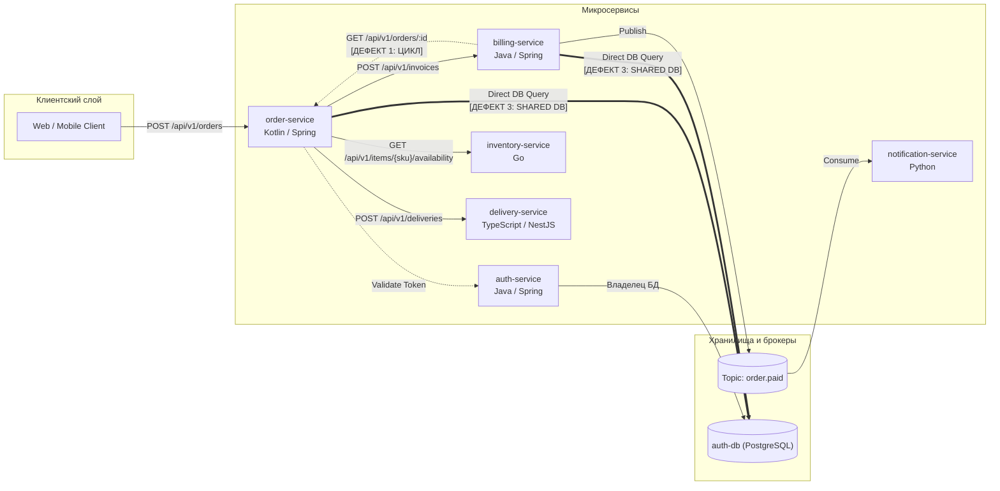

# Эталонная тестовая архитектура (Golden Dataset)

Документ описывает стандартный тестовый ландшафт сервисов и связей, используемый
для PoC графовой базы (Apache AGE, Паша) и PoC Model Context Protocol сервера (Cursor/Copilot, Миша).

> **Каталог реализаций:** Полный перечень физических файлов, схем и команд запуска собран в едином [Реестре моков и фикстур](mocks-and-fixtures.md):
> - Extraction Contract v1.0 JSON: [`contracts/fixtures/sample-ecommerce.json`](contracts/fixtures/sample-ecommerce.json)
> - FastMCP Server Mock JSON: [`../../scripts/mock_mcp_data.json`](../../scripts/mock_mcp_data.json)
> - Apache AGE Graph Seed SQL: [`../../scripts/seed_sample_graph.sql`](../../scripts/seed_sample_graph.sql)

---

## 1. Сценарий: E-Commerce Checkout & Billing

В качестве эталона взят классический домен электронной коммерции из 6 сервисов:



---

## 2. Паспорт сервисов (Узлы `:Service`)

| `id` | `name` | `language` | `framework` | `repo_url` | `owner_team` |
| :--- | :--- | :--- | :--- | :--- | :--- |
| `order-service` | Order Management | Kotlin | Spring Boot 3 | `github.com/acme/order-service` | Checkout |
| `billing-service` | Billing & Payments | Java | Spring Boot 3 | `github.com/acme/billing-service` | Payments |
| `inventory-service` | Warehouse & Stock | Go | Chi | `github.com/acme/inventory-service` | Logistics |
| `delivery-service` | Delivery & Shipping | TypeScript | NestJS | `github.com/acme/delivery-service` | Logistics |
| `notification-service` | Email & Push | Python | FastAPI | `github.com/acme/notification-service` | Marketing |
| `auth-service` | IAM & Tokens | Java | Spring Boot 3 | `github.com/acme/auth-service` | Security |

---

## 3. Контракты сервисов (Узлы `:Contract`)

### 3.1. REST-эндпоинты
1. **`contract-billing-create-invoice`**:
   * Сервис-владелец: `billing-service`
   * Метод/Путь: `POST /api/v1/invoices`
   * Потребитель: `order-service`
   * Схема DTO (CreateInvoiceRequest):
     ```json
     {
       "order_id": "string (uuid)",
       "amount": "number (decimal)",
       "currency": "string (ISO 4217, e.g. USD, RUB)",
       "customer_id": "string (uuid)"
     }
     ```
   * Схема ответа (InvoiceResponse):
     ```json
     {
       "invoice_id": "string (uuid)",
       "status": "string (PENDING, PAID, REJECTED)",
       "payment_url": "string (uri)"
     }
     ```

2. **`contract-order-get`**:
   * Сервис-владелец: `order-service`
   * Метод/Путь: `GET /api/v1/orders/{id}`
   * Потребитель: `billing-service` (создает циклический вызов!)

3. **`contract-inventory-check`**:
   * Сервис-владелец: `inventory-service`
   * Метод/Путь: `GET /api/v1/items/{sku}/availability`
   * Потребитель: `order-service`

4. **`contract-delivery-create`**:
   * Сервис-владелец: `delivery-service`
   * Метод/Путь: `POST /api/v1/deliveries`
   * Потребитель: `order-service`
   * Схема DTO (CreateDeliveryRequest):
     ```json
     {
       "order_id": "string (uuid)",
       "recipient_address": "string",
       "delivery_slot": "string (ISO-8601)",
       "courier_comment": "string (optional)"
     }
     ```
   * Схема ответа (DeliveryResponse):
     ```json
     {
       "delivery_id": "string (uuid)",
       "status": "string (SCHEDULED, IN_TRANSIT, DELIVERED)",
       "tracking_code": "string"
     }
     ```

### 3.2. Событийные контракты (Kafka)
4. **`contract-kafka-order-paid`**:
   * Топик: `order.paid`
   * Продюсер: `billing-service`
   * Консьюмер: `notification-service`
   * Схема события:
     ```json
     {
       "event_id": "string (uuid)",
       "order_id": "string (uuid)",
       "paid_at": "string (ISO-8601)",
       "amount": "number"
     }
     ```

---

## 4. Заложенные архитектурные дефекты (для проверки правил)

В эталонный датасет намеренно заложены 3 дефекта, которые должен находить модуль `policies` и `drift`:

1. **Circular Dependency (Циклическая зависимость):**  
   `order-service` синхронно вызывает `billing-service` (`POST /api/v1/invoices`), а `billing-service` синхронно вызывает `order-service` (`GET /api/v1/orders/{id}`).  
   *Ожидание от проверки:* AGE Cypher-запрос на поиск циклов находит петлю длины 2.

2. **Undocumented Endpoint (Архитектурный дрейф):**  
   В коде `order-service` есть рабочий эндпоинт `DELETE /api/v1/orders/{id}/force`, но в OpenAPI спецификации и Wiki документации он отсутствует.  
   *Ожидание:* модуль `drift` регистрирует finding `undocumented_public_api`.

3. **Shared Database / Direct DB Coupling:**  
   `order-service` и `billing-service` напрямую обращаются к базе данных `auth-db`.

---

## 5. Загрузка в Apache AGE (SQL Seed)

Полный исполняемый скрипт инициализации схемы `archon_graph`, узлов сервисов, контрактов и дефектов вынесен в отдельный файл [`../../scripts/seed_sample_graph.sql`](../../scripts/seed_sample_graph.sql).

Запуск сидирования через `psql`:
```bash
psql -h localhost -p 5432 -U archon -d archon_db -f scripts/seed_sample_graph.sql
```

Для просмотра всех связанных наборов данных (JSON Extraction Contract, FastMCP mock) обратитесь к [Реестру моков и фикстур](mocks-and-fixtures.md).

---

## 6. Форматы ответов MCP Server для Cursor (Для PoC Миши)

### 6.1. Инструмент `get_service_contract`

Когда Cursor через MCP запрашивает контракт:
`get_service_contract(service_id="billing-service", endpoint="/api/v1/invoices")`

MCP-сервер возвращает структурированный ответ:

```json
{
  "service": "billing-service",
  "endpoint": "/api/v1/invoices",
  "method": "POST",
  "protocol": "REST",
  "description": "Создание инвойса на оплату заказа",
  "request_body": {
    "type": "object",
    "required": ["order_id", "amount", "currency", "customer_id"],
    "properties": {
      "order_id": { "type": "string", "format": "uuid" },
      "amount": { "type": "number", "minimum": 0.01 },
      "currency": { "type": "string", "enum": ["USD", "EUR", "RUB"] },
      "customer_id": { "type": "string", "format": "uuid" }
    }
  },
  "response_body": {
    "type": "object",
    "properties": {
      "invoice_id": { "type": "string", "format": "uuid" },
      "status": { "type": "string", "enum": ["PENDING", "PAID", "REJECTED"] },
      "payment_url": { "type": "string", "format": "uri" }
    }
  },
  "architectural_constraints": [
    "Сервис billing-service НЕ должен синхронно вызывать order-service (предотвращение цикла)",
    "Таймаут вызова: 1500ms, обязателен ретрай по статусам 502/503/504"
  ]
}
```

---

### 6.2. Инструмент `validate_dependency` (Проверка допустимости связей)

AI-агент вызывает `validate_dependency(source, target)` перед добавлением новой зависимости в коде, чтобы предотвратить появление архитектурных дефектов и циклов.

#### Тестовый сценарий 1: Допустимая зависимость (Success)
*Запрос:* `validate_dependency(source="order-service", target="delivery-service")`  
*Ответ:*
```json
{
  "allowed": true,
  "source": "order-service",
  "target": "delivery-service",
  "dependency_type": "SYNCHRONOUS_REST",
  "impact": {
    "new_edges": 1,
    "cycles_detected": 0,
    "risk_level": "LOW"
  },
  "message": "Зависимость допустима. Циклических связей и нарушений архитектурных слоев не обнаружено."
}
```

#### Тестовый сценарий 2: Прямой цикл A ↔ B (Дефект 1, Critical)
*Запрос:* `validate_dependency(source="billing-service", target="order-service")`  
*Ответ:*
```json
{
  "allowed": false,
  "source": "billing-service",
  "target": "order-service",
  "violation_type": "CIRCULAR_DEPENDENCY",
  "cycle_length": 2,
  "cycle_path": [
    "billing-service",
    "order-service",
    "billing-service"
  ],
  "risk_level": "CRITICAL",
  "message": "Запрещено архитектурной политикой No-Cycles: вызов создает прямую циклическую зависимость billing-service -> order-service -> billing-service. Рекомендуется использовать асинхронные события (Kafka topic: order.paid)."
}
```

#### Тестовый сценарий 3: Транзитивный цикл длины 3 (A → B → C → A)
*Контекст:* `order-service` вызывает `delivery-service`, а `billing-service` вызывает `order-service`. Если `delivery-service` попытается вызвать `billing-service`:  
*Запрос:* `validate_dependency(source="delivery-service", target="billing-service")`  
*Ответ:*
```json
{
  "allowed": false,
  "source": "delivery-service",
  "target": "billing-service",
  "violation_type": "CIRCULAR_DEPENDENCY",
  "cycle_length": 3,
  "cycle_path": [
    "delivery-service",
    "billing-service",
    "order-service",
    "delivery-service"
  ],
  "risk_level": "CRITICAL",
  "message": "Запрещено архитектурной политикой No-Cycles: вызов создает транзитивный цикл длины 3: delivery-service -> billing-service -> order-service -> delivery-service."
}
```

#### Тестовый сценарий 4: Нарушение архитектурных слоев (Layering Violation)
*Контекст:* `auth-service` относится к инфраструктурному слою (Security / Tier 0), а `delivery-service` — к бизнес-логике (Tier 2).  
*Запрос:* `validate_dependency(source="auth-service", target="delivery-service")`  
*Ответ:*
```json
{
  "allowed": false,
  "source": "auth-service",
  "target": "delivery-service",
  "violation_type": "LAYERING_VIOLATION",
  "rule": "TIER_DOWNWARDS_ONLY",
  "risk_level": "HIGH",
  "message": "Запрещено правилом архитектурных слоев: Security/IAM сервис (auth-service, Tier 0) не может иметь исходящих зависимостей на сервис бизнес-домена (delivery-service, Tier 2)."
}
```
