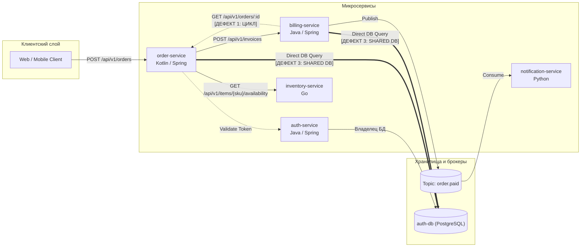

# Эталонная тестовая архитектура (Golden Dataset)

Документ описывает стандартный тестовый ландшафт сервисов и связей, используемый
для PoC графовой базы (Apache AGE, Паша) и PoC Model Context Protocol сервера (Cursor/Copilot, Миша).

---

## 1. Сценарий: E-Commerce Checkout & Billing

В качестве эталона взят классический домен электронной коммерции из 5 сервисов:



---

## 2. Паспорт сервисов (Узлы `:Service`)

| `id` | `name` | `language` | `framework` | `repo_url` | `owner_team` |
| :--- | :--- | :--- | :--- | :--- | :--- |
| `order-service` | Order Management | Kotlin | Spring Boot 3 | `github.com/acme/order-service` | Checkout |
| `billing-service` | Billing & Payments | Java | Spring Boot 3 | `github.com/acme/billing-service` | Payments |
| `inventory-service` | Warehouse & Stock | Go | Chi | `github.com/acme/inventory-service` | Logistics |
| `notification-service` | Email & Push | Python | FastAPI | `github.com/acme/notification-service` | Marketing |
| `auth-service` | IAM & Tokens | Java | Spring Boot 3 | `github.com/acme/auth-service` | Security |

---

## 3. Контракты сервисов (Узлы `:Contract`)

### 3.1. REST-эндпоинты
1. **`contract-billing-create-invoice`**:
   * Сервис-владелец: `billing-service`
   * Метод/Путь: `POST /api/v1/invoices`
   * Потребитель: `order-service`
   * Схема DTO (CreateInvoiceRequest):
     ```json
     {
       "order_id": "string (uuid)",
       "amount": "number (decimal)",
       "currency": "string (ISO 4217, e.g. USD, RUB)",
       "customer_id": "string (uuid)"
     }
     ```
   * Схема ответа (InvoiceResponse):
     ```json
     {
       "invoice_id": "string (uuid)",
       "status": "string (PENDING, PAID, REJECTED)",
       "payment_url": "string (uri)"
     }
     ```

2. **`contract-order-get`**:
   * Сервис-владелец: `order-service`
   * Метод/Путь: `GET /api/v1/orders/{id}`
   * Потребитель: `billing-service` (создает циклический вызов!)

3. **`contract-inventory-check`**:
   * Сервис-владелец: `inventory-service`
   * Метод/Путь: `GET /api/v1/items/{sku}/availability`
   * Потребитель: `order-service`

### 3.2. Событийные контракты (Kafka)
4. **`contract-kafka-order-paid`**:
   * Топик: `order.paid`
   * Продюсер: `billing-service`
   * Консьюмер: `notification-service`
   * Схема события:
     ```json
     {
       "event_id": "string (uuid)",
       "order_id": "string (uuid)",
       "paid_at": "string (ISO-8601)",
       "amount": "number"
     }
     ```

---

## 4. Заложенные архитектурные дефекты (для проверки правил)

В эталонный датасет намеренно заложены 3 дефекта, которые должен находить модуль `policies` и `drift`:

1. **Circular Dependency (Циклическая зависимость):**  
   `order-service` синхронно вызывает `billing-service` (`POST /api/v1/invoices`), а `billing-service` синхронно вызывает `order-service` (`GET /api/v1/orders/{id}`).  
   *Ожидание от проверки:* AGE Cypher-запрос на поиск циклов находит петлю длины 2.

2. **Undocumented Endpoint (Архитектурный дрейф):**  
   В коде `order-service` есть рабочий эндпоинт `DELETE /api/v1/orders/{id}/force`, но в OpenAPI спецификации и Wiki документации он отсутствует.  
   *Ожидание:* модуль `drift` регистрирует finding `undocumented_public_api`.

3. **Shared Database / Direct DB Coupling:**  
   `order-service` и `billing-service` напрямую обращаются к базе данных `auth-db`.

---

## 5. Готовый Cypher DDL для Apache AGE (Копируй и запускай)

Скрипт для создания графа `archon_graph` в PostgreSQL 16 + Apache AGE:

```sql
-- 1. Инициализация расширения и графа
LOAD 'age';
SET search_path = ag_catalog, '$user', public;

SELECT drop_graph('archon_graph', true);
SELECT create_graph('archon_graph');

-- 2. Создание узлов (Services)
SELECT * FROM cypher('archon_graph', $$
    CREATE (o:Service {id: 'order-service', name: 'Order Service', lang: 'Kotlin', framework: 'Spring Boot'}),
           (b:Service {id: 'billing-service', name: 'Billing Service', lang: 'Java', framework: 'Spring Boot'}),
           (i:Service {id: 'inventory-service', name: 'Inventory Service', lang: 'Go', framework: 'Chi'}),
           (n:Service {id: 'notification-service', name: 'Notification Service', lang: 'Python', framework: 'FastAPI'}),
           (a:Service {id: 'auth-service', name: 'Auth Service', lang: 'Java', framework: 'Spring Boot'})
$$) as (n agtype);

-- 3. Создание контрактов (Contracts)
SELECT * FROM cypher('archon_graph', $$
    CREATE (c_inv:Contract {id: 'c-create-invoice', proto: 'REST', method: 'POST', path: '/api/v1/invoices'}),
           (c_ord:Contract {id: 'c-get-order', proto: 'REST', method: 'GET', path: '/api/v1/orders/{id}'}),
           (c_stock:Contract {id: 'c-check-stock', proto: 'REST', method: 'GET', path: '/api/v1/items/{sku}/availability'}),
           (c_paid:Contract {id: 'c-order-paid', proto: 'KAFKA', topic: 'order.paid'})
$$) as (n agtype);

-- 4. Привязка экспозиции контрактов (EXPOSES)
SELECT * FROM cypher('archon_graph', $$
    MATCH (b:Service {id: 'billing-service'}), (c:Contract {id: 'c-create-invoice'}) CREATE (b)-[:EXPOSES]->(c)
$$) as (n agtype);

SELECT * FROM cypher('archon_graph', $$
    MATCH (o:Service {id: 'order-service'}), (c:Contract {id: 'c-get-order'}) CREATE (o)-[:EXPOSES]->(c)
$$) as (n agtype);

SELECT * FROM cypher('archon_graph', $$
    MATCH (i:Service {id: 'inventory-service'}), (c:Contract {id: 'c-check-stock'}) CREATE (i)-[:EXPOSES]->(c)
$$) as (n agtype);

SELECT * FROM cypher('archon_graph', $$
    MATCH (b:Service {id: 'billing-service'}), (c:Contract {id: 'c-order-paid'}) CREATE (b)-[:EXPOSES]->(c)
$$) as (n agtype);

-- 5. Привязка потребления контрактов (CONSUMES) и зависимостей (DEPENDS_ON)
SELECT * FROM cypher('archon_graph', $$
    MATCH (o:Service {id: 'order-service'}), (c:Contract {id: 'c-create-invoice'}), (b:Service {id: 'billing-service'})
    CREATE (o)-[:CONSUMES]->(c),
           (o)-[:DEPENDS_ON {sync: true}]->(b)
$$) as (n agtype);

SELECT * FROM cypher('archon_graph', $$
    MATCH (o:Service {id: 'order-service'}), (c:Contract {id: 'c-check-stock'}), (i:Service {id: 'inventory-service'})
    CREATE (o)-[:CONSUMES]->(c),
           (o)-[:DEPENDS_ON {sync: true}]->(i)
$$) as (n agtype);

SELECT * FROM cypher('archon_graph', $$
    MATCH (n:Service {id: 'notification-service'}), (c:Contract {id: 'c-order-paid'}), (b:Service {id: 'billing-service'})
    CREATE (n)-[:CONSUMES]->(c),
           (n)-[:DEPENDS_ON {sync: false}]->(b)
$$) as (n agtype);

-- Создание циклической зависимости (billing -> order, дефект 1)
SELECT * FROM cypher('archon_graph', $$
    MATCH (b:Service {id: 'billing-service'}), (c:Contract {id: 'c-get-order'}), (o:Service {id: 'order-service'})
    CREATE (b)-[:CONSUMES]->(c),
           (b)-[:DEPENDS_ON {sync: true}]->(o)
$$) as (n agtype);

-- 6. Создание базы данных и связей прямого доступа (Shared Database, дефект 3)
SELECT * FROM cypher('archon_graph', $$
    CREATE (db:Database {id: 'auth-db', name: 'Auth Database', engine: 'PostgreSQL'})
$$) as (n agtype);

SELECT * FROM cypher('archon_graph', $$
    MATCH (a:Service {id: 'auth-service'}), (db:Database {id: 'auth-db'})
    CREATE (a)-[:OWNS_DB]->(db)
$$) as (n agtype);

SELECT * FROM cypher('archon_graph', $$
    MATCH (o:Service {id: 'order-service'}), (db:Database {id: 'auth-db'})
    CREATE (o)-[:DIRECT_DB_ACCESS]->(db)
$$) as (n agtype);

SELECT * FROM cypher('archon_graph', $$
    MATCH (b:Service {id: 'billing-service'}), (db:Database {id: 'auth-db'})
    CREATE (b)-[:DIRECT_DB_ACCESS]->(db)
$$) as (n agtype);
```

---

## 6. Формат ответа MCP Server для Cursor (Для PoC Миши)

Когда Cursor через MCP вызывает инструмент:
`get_service_contract(service_id="billing-service", endpoint="/api/v1/invoices")`

MCP-сервер возвращает структурированный ответ:

```json
{
  "service": "billing-service",
  "endpoint": "/api/v1/invoices",
  "method": "POST",
  "protocol": "REST",
  "description": "Создание инвойса на оплату заказа",
  "request_body": {
    "type": "object",
    "required": ["order_id", "amount", "currency", "customer_id"],
    "properties": {
      "order_id": { "type": "string", "format": "uuid" },
      "amount": { "type": "number", "minimum": 0.01 },
      "currency": { "type": "string", "enum": ["USD", "EUR", "RUB"] },
      "customer_id": { "type": "string", "format": "uuid" }
    }
  },
  "response_body": {
    "type": "object",
    "properties": {
      "invoice_id": { "type": "string", "format": "uuid" },
      "status": { "type": "string", "enum": ["PENDING", "PAID", "REJECTED"] },
      "payment_url": { "type": "string", "format": "uri" }
    }
  },
  "architectural_constraints": [
    "Сервис billing-service НЕ должен синхронно вызывать order-service (предотвращение цикла)",
    "Таймаут вызова: 1500ms, обязателен ретрай по статусам 502/503/504"
  ]
}
```
