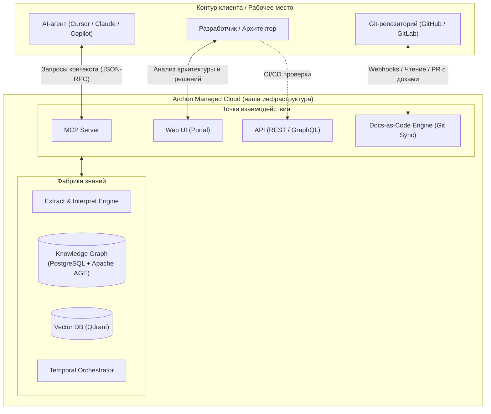

# Эволюция модели поставки: от CLI/IaaS к SaaS и Context-as-a-Service

Статус: рабочий драфт, 2026-09-03.  
Контекст: развитие идей из [`ai-context-layer-research.md`](ai-context-layer-research.md) и [`business-value-analysis.md`](business-value-analysis.md).  
Ключевая мысль: отказ от сложной on-premise/self-hosted эксплуатации на стороне клиента в пользу управляемого SaaS, где Archon выступает как hosted AI-native Source of Truth для инженерных команд и AI-агентов.

---

## 1. Предпосылки: почему On-Premise / CLI-first (IaaS-подход) тормозит продукт

В [ADR-0005](../adr/0005-product-scope-and-delivery-model.md) зафиксирована модель: all-in-one self-hosted CLI-first. Предполагалось, что развертывание в контуре заказчика устранит страх утечки кода, а CLI позволит быстро запускать анализ.

Однако детальный анализ сценариев и рыночной ситуации показал критические ограничения этого подхода:

1. **Проблема Time-to-Value (дырка D1 в [`business-value-analysis.md`](business-value-analysis.md)):**
   Чтобы поднять self-hosted Archon, клиенту нужно выделить инфраструктуру, поднять PostgreSQL 16 с Apache AGE, настроить Qdrant, Temporal, NATS, сконфигурировать инференс LLM (локальный vLLM/Ollama или прокси) и поддерживать все компоненты. Барьер первого запуска измеряется днями или неделями согласований с DevOps/SecOps.
2. **Сдвиг разработки в сторону ADLC (Agentic Development Lifecycle):**
   Инженеры все чаще пишут код в связке с AI-агентами (Cursor, Copilot, Claude Code). Агентам требуется моментальный доступ к контексту через сетевые протоколы (MCP). Поднимать локальный комплекс ради того, чтобы агент получил пару контрактов, нерационально.
3. **Эксплуатационные затраты клиента:**
   Модель, требующая от клиента разворачивать и поддерживать инфраструктуру (IaaS/on-prem), перекладывает проблемы масштабирования, обновлений и мониторинга на клиента. Это резко снижает конверсию из интереса в регулярное использование.

**Вывод:** клиенту не нужна еще одна тяжелая система на поддержке. Клиенту нужен готовый результат — актуальная архитектура, проверенный контекст и чистая интеграция с AI-инструментами.

---

## 2. Концепция: Archon в нашей инфраструктуре

Archon переходит к модели **Managed Platform / SaaS (Context-as-a-Service)**:

### Ключевые принципы

1. **Нулевая эксплуатационная нагрузка на клиента:**
   Вся вычислительная фабрика (AST-парсеры, LLM-интерпретаторы, Temporal, графовая база данных, очереди NATS) живет и масштабируется на нашей стороне.
2. **Подключение за 2 минуты:**
   Клиент авторизует GitHub App или GitLab Integration, указывает репозитории — и конвейер запускается автоматически.
3. **Приватность кода по умолчанию:**
   Archon анализирует код и сохраняет в Knowledge Graph только метаданные: топологию, интерфейсы, типы, зависимости и архитектурные контракты. Исходный код не хранится в облаке после завершения сессии анализа, что снимает основные возражения безопасности.

---

## 3. Archon как Source of Truth для AI-агентов

Главная продуктовая ценность SaaS-решения — быть **AI-native Source of Truth** для всей кодовой базы организации:

1. **Постоянная поддержка и авто-актуализация документации:**
   * Archon отслеживает изменения в кодовой базе через вебхуки коммитов и PR.
   * При обнаружении архитектурных изменений система автоматически инициирует обновление технической документации в репозитории (`AGENTS.md`, `.archon/`, карточки сервисов).
   * Документация перестает быть заброшенной вики: она формируется и валидируется на основе реальных фактов кода.
2. **Сжатые, структурированные связи без галлюцинаций:**
   * LLM в IDE часто ошибаются, пытаясь распарсить огромные чужие модули целиком или угадать неявные интеграции.
   * Archon предоставляет агенту компактную, нормализованную выжимку: какие модули вызывают друг друга, по каким контрактам, какие инварианты нельзя нарушать, кто владелец сервиса.
   * Контекстное окно модели расходуется эффективно (экономия токенов до 80%), а точность генерации кода резко возрастает.

---

## 4. Archon как сервис: ключевые интерфейсы

Пользователь и его инструменты получают 4 специализированных канала:

### 4.1. MCP Server (Model Context Protocol)

Основной канал для AI-агентов в IDE (Cursor, Claude Desktop, Copilot Workspace):

* **Назначение:** предоставление проверенного контекста по первому требованию модели.
* **Что отдает MCP:**
  * Контекст текущего сервиса/модуля: границы ответственности, стек, внутренние слои.
  * Топологию зависимостей: вверх (кто вызывает этот сервис) и вниз (кого вызывает он).
  * Контракты интеграций: схемы DTO, эндпоинты, топики сообщений.
  * Архитектурные правила и политики: запреты на прямое обращение в БД, обязательные интерцепторы, правила версионирования.
  * Находки и риски (Assurance): известные аномалии и принятые компромиссы.

### 4.2. Web-интерфейс (Portal)

Визуальный центр управления архитектурой для людей:

* **Интерактивные C4-диаграммы:** наглядные схемы (Context, Container, Component, Flows) на базе LikeC4/React Flow, перерисовывающиеся по коду.
* **Spec-Drift Monitor:** интерфейс расхождений — где код разошелся с заявленными спецификациями и кто за это отвечает.
* **Knowledge Graph Explorer:** графовый браузер связей между всеми продуктами компании.
* **Assurance Inbox:** очередь решений для системного архитектора (подтверждение изменений, принятие технического долга, подавление ложных срабатываний).

### 4.3. API (REST / GraphQL)

Программный интерфейс для автоматизации и интеграции:

* **CI/CD Quality Gates:** запуск проверок архитектурных инвариантов и дрейфа при сборке пайплайнов (замена локального CLI-вызова на удаленный API-чек).
* **Событийная интеграция (Webhooks):** отправка нотификаций о дрейфе и нарушении политик в корпоративные шины и мессенджеры.
* **Кастомные интеграции с внутренними порталами:** возможность для enterprise-клиентов забирать данные графа в свои системы.
* *Статус:* требуется точная фиксация контрактов (вынесено в открытые вопросы).

### 4.4. Docs-as-Code Engine (Git Sync)

* Двусторонний мост между облачным графом и кодовой базой.
* Archon через GitHub App создает коммиты или Pull Request'ы, поддерживая в актуальном состоянии:
  * `AGENTS.md` в корне репозиториев;
  * `.archon/catalog.yaml` и схемы контрактов;
  * Архитектурные описания модулей в markdown.

---

## 5. Сравнение моделей: Self-Hosted/IaaS vs Managed SaaS

| Критерий | Прежняя модель (CLI / Self-Hosted) | Новая модель (Managed SaaS) |
| :--- | :--- | :--- |
| **Развертывание** | Docker/K8s на инфраструктуре клиента | 0 действий по инфре; вход через GitHub/GitLab OAuth |
| **Time-to-Value** | Дни/недели (подготовка окружения, баз, LLM) | 2–5 минут до первого графа и подключения к MCP |
| **Подключение агентов** | Локальная настройка, проброс портов к self-host | Публичный/приватный MCP URL с токеном авторизации |
| **Инференс LLM** | На стороне клиента (поиск GPU или ключей) | Включен в сервис, оптимизирован по кэшированию и латентности |
| **Обновления системы** | Ручное обновление образов клиентом | Непрерывный rollout на нашей инфраструктуре |
| **Целевой покупатель** | DevOps / Инфраструктурная команда | VP of Engineering, Lead Architect, Product Engineering |
| **Барьер внедрения** | Высокий | Минимальный |

---

## 6. Влияние на архитектуру и стек Archon

Переход к SaaS требует адаптации проектных решений:

1. **Multi-Tenancy в ядре ([`platform`](../architecture/modules/platform.md)):**
   * Жесткая изоляция данных разных организаций в PostgreSQL + Apache AGE (схемы per-tenant или row-level security).
   * Изоляция векторных коллекций в Qdrant.
2. **Управление затратами и очередями ([`runtime`](../architecture/modules/runtime.md)):**
   * Контроль лимитов токенов LLM на организацию.
   * Приоритизация фоновых задач и изоляция очередей в Temporal.
3. **Безопасность хранения:**
   * Хранение токенов доступа к репозиториям в HashiCorp Vault / Cloud KMS.
   * Политика удаления временных копий исходного кода сразу после извлечения AST и фактов.
4. **Статус документов:**
   * [ADR-0005](../adr/0005-product-scope-and-delivery-model.md) требует актуализации или замены на **ADR-0006**, фиксирующий SaaS-модель и генерацию docs-as-code как первичные цели.
   * [OQ-18](../architecture/open-questions.md) (SaaS как канал поставки) меняет статус с *secondary/post-MVP* на *primary driver*.

---

## 7. Открытые вопросы (Next Steps)

1. **OQ-API: Формат и скоуп внешнего API**
   * Нужен ли GraphQL для кастомных запросов к графу или достаточно REST API с типовыми эндпоинтами для CI/CD?
   * Требуется ли gRPC для стриминга обновлений графа?
2. **OQ-Sec-Enterprise: Модель для закрытых контуров (Hybrid/VPC)**
   * Достаточно ли классического SaaS с SOC2/ISO-сертификацией для 80% рынка?
   * Для клиентов со строгим air-gapped контуром: опция развертывания легковесного сканирующего агента (Local Agent), который парсит AST локально и передает в SaaS-граф только обезличенные метаданные.
3. **OQ-MCP-Auth: Авторизация и аудит запросов AI-агентов**
   * Как гранулированно раздавать доступы агентам через MCP (read-only per repo vs global org access)?
   * Как логировать, какие узлы архитектуры читал агент перед генерацией конкретного кода?